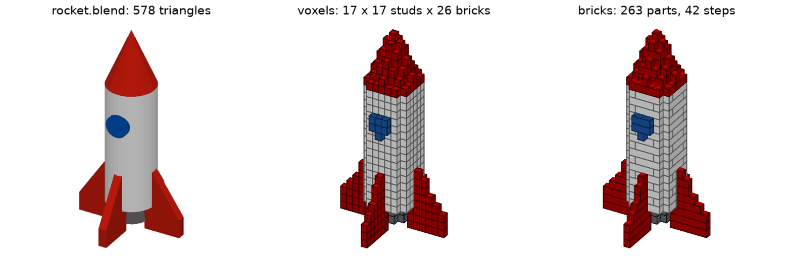

# mesh2brick

**Deutsch** · [English](README.md)

`mesh2brick` übersetzt ein 3D-Modell (STL, OBJ, 3MF, PLY, glTF, STEP oder eine
Blender-Datei `.blend`) in ein **physisch baubares LEGO®-kompatibles Modell** und erzeugt
daraus

1. eine **LDraw-Datei** (`.ldr`/`.mpd`) mit `0 STEP`-Bauschritten,
2. eine **Teileliste** als CSV, BrickLink-XML und Rebrickable-CSV,
3. eine **PDF-Bauanleitung** auf Deutsch oder Englisch: Deckblatt mit Bild und Maßen,
   Teileliste mit Bildern, Schritte mit Teilebildern und verständlichen Hinweisen.

Das Projekt baut auf dem GPL-Ökosystem rund um
[legolization](https://github.com/hbmartin/legolization) (Steine platzieren,
Stabilität, Bauschritte), [pyldraw3](https://github.com/hbmartin/pyldraw3)
(LDraw-Bibliothek) und [rebrickable](https://github.com/hbmartin/rebrickable)
(Offline-Katalog) auf. mesh2brick ergänzt den Mesh-/CAD-Import, die Farbübernahme,
einen größeren Teilekatalog, schönere Anleitungen, eine einheitliche Konfiguration
und CLI sowie eine optionale KI-Schicht.

> **Stand: 1.0.** Alle acht Phasen des Plans sind fertig. `mesh2brick convert` macht aus
> STL, OBJ, PLY, 3MF, glTF, STEP und Blender-Dateien ein LDraw-Modell, drei Teilelisten und
> eine PDF-Bauanleitung, in den Farben des Modells, für Modelle bis 2.000 Teile in unter
> 5 Minuten auf einem Laptop; auf Wunsch ergänzt Claude Abschnittstitel und Schritttexte.
> `mesh2brick inspect` zeigt vorher, was aus einem Modell wird. Siehe die
> [Beispielgalerie](docs/gallery/README.md) und [docs/STATUS.md](docs/STATUS.md).

| Von Blender zu LEGO: `rocket.blend` wie eingelesen, als Voxel, als Steine |
|---|
|  |

## Installation (Entwicklung)

Voraussetzungen: Python ≥ 3.12 und [uv](https://docs.astral.sh/uv/).

```sh
uv sync
uv run ldraw download --yes   # einmalig: LDraw-Teilebibliothek (~150 MB)
uv run ldraw generate --yes   # einmalig: Teile-/Farbmodule erzeugen
uv run mesh2brick --help
uv sync --extra step          # optional: STEP-Import (OpenCASCADE über cascadio, ~70 MB)
uv sync --extra step --extra llm  # optional: KI-Schicht (Anthropic-SDK, ca. 2 MB)
```

Für `.blend`-Dateien muss [Blender](https://www.blender.org) installiert sein (getestet mit
4.0); ein Python-Paket kommt nicht hinzu. mesh2brick findet Blender an den üblichen Orten
oder über `MESH2BRICK_BLENDER=/pfad/zu/blender`.

## Benutzung

```sh
# Erster Blick: Größe, Farben, Voxel und grobe Teilezahl in Sekunden, dazu ein Bild
# (out/rocket.inspect.png: das Modell wie eingelesen neben seinen Voxeln)
uv run mesh2brick inspect tests/fixtures/rocket.blend -o out/

# Alles in einem Schritt: LDraw, Teilelisten (CSV, BrickLink-XML, Rebrickable-CSV), PDF
uv run mesh2brick convert tests/fixtures/rocket.blend -o out/

# Größe: die Höhe in cm oder mm oder die längste Kante in Noppen (Standard: 32 Noppen,
# etwa 26 cm). Größen erst mit inspect ausprobieren; es zeigt die LEGO-Größe in Sekunden.
uv run mesh2brick inspect tests/fixtures/rocket.blend -o out/ --size 30cm
uv run mesh2brick convert tests/fixtures/rocket.blend -o out/ --size 30cm
uv run mesh2brick convert tests/fixtures/bunny_lowpoly.stl -o out/ --size 16studs

# Zeitgrenze: Eine Umwandlung dauert höchstens 5 Minuten. Braucht ein großes Modell länger,
# bekommst du das beste stabile Modell, das bis dahin gefunden wurde, und das Deckblatt
# sagt das. inspect und convert empfehlen ab etwa 2.000 Teilen mehr Zeit
# („recommended: --time 20min“):
uv run mesh2brick convert modell.stl -o out/ --size 40cm --time 20min

# Oder Schritt für Schritt:
# 1. Mesh auf das Noppenraster voxelisieren (längste Achse standardmäßig 32 Noppen)
uv run mesh2brick voxelize tests/fixtures/bunny_lowpoly.stl -o out/ --size 16studs

# 2. Steine auf das Gitter setzen: LDraw-Datei, Steinmodell (JSON), PNG-Vorschau
uv run mesh2brick place out/bunny_lowpoly.grid.npz -o out/

# Voxeldateien gehen auch (MagicaVoxel .vox, numpy .npy)
uv run mesh2brick place tests/fixtures/heart.vox -o out/

# Farben kommen aus dem Modell, wenn es welche hat (Filamente und Materialien in 3MF,
# STEP-Farben, OBJ/glTF-Materialien und -Texturen, PLY-Vertexfarben). Sie werden auf
# ~40 aktuelle LEGO-Farben abgebildet. Stattdessen alles in einer Farbe:
uv run mesh2brick convert tests/fixtures/toadstool.obj -o out/ --set color.mode=single

# Teile ansehen (offline): Größen, BrickLink-/Rebrickable-Nummern, Farben
uv run mesh2brick catalog list --category slope
uv run mesh2brick catalog show 3001

# Nur bestimmte Teile verwenden (Whitelist) oder Teile verbieten (Blacklist)
uv run mesh2brick convert modell.stl -o out/ --set "parts.include=[3001, 3003, 3004]"
uv run mesh2brick convert modell.stl -o out/ --set "parts.exclude=[3008, 3007]"

# Glatte Oberseiten: Fliesen dort, wo das 3D-Modell flach ist (Oberseite eines Kastens,
# Sockel), Noppen überall sonst. Platten werden zu gleich großen Fliesen, Steine zu
# 2 Platten + Fliese; die Stabilität wird neu geprüft. Auch auf Treppen runder Formen:
# --set parts.tiles=all; unterste Lage ohne Fliesen: --set parts.tiles_on_base=false
uv run mesh2brick convert modell.stl -o out/ --set "parts.categories=[brick, plate, slope, tile]"

# Jede Einstellung aus mesh2brick.yaml lässt sich auf der Kommandozeile überschreiben
uv run mesh2brick place modell.vox --set placement.strategy=greedy --set placement.seed=3

# Anleitung auf Englisch, 4 Schritte pro Seite, flache .ldr statt .mpd
uv run mesh2brick convert modell.stl -o out/ --set output.language=en \
    --set output.steps_per_page=4 --set "output.formats=[ldr, bom_csv, pdf]"

# Vorschau eines fertigen Modells, optional bis zu einem Bauschritt
uv run mesh2brick render out/heart.bricks.json --step 3
```

Alle Einstellungen sind in [examples/mesh2brick.yaml](examples/mesh2brick.yaml)
beschrieben.

## Blender- und glTF-Dateien

- **`.blend`:** mesh2brick startet dein Blender im Hintergrund (Werkseinstellungen, in der
  Datei gespeicherte Skripte laufen nicht, die Datei wird nur gelesen) und lässt es die
  **sichtbaren** Objekte der aktiven Szene exportieren, mit angewendeten Modifiern; Kurven
  und Text werden zu Meshes, versteckte Objekte, Kameras und Lichter bleiben weg
  ([ADR 0014](docs/adr/0014-blender-import-via-headless-blender-and-gltf.md)). Die Einheiten
  der Szene zählen: Eine Millimeter-Szene behält mit `input.scale_mode: mm` ihre Größe.
- **`.glb`/`.gltf`:** werden direkt gelesen, nach den glTF-Regeln (Y nach oben, Meter,
  Material- und Vertexfarben in linearem Licht). `input.up_axis: z` bleibt; das Drehen von
  glTFs Y-oben übernimmt mesh2brick selbst.
- Ohne Blender: das Modell in Blender als `.glb` exportieren (Datei → Exportieren →
  glTF 2.0) und diese Datei umwandeln.

## Die Bauanleitung

- **Deckblatt:** Bild des Modells, Zahl der Teile und Schritte, Größe in cm, Gewicht,
  Farben, ob das Modell von allein steht und (mit der KI-Schicht) die Bauabschnitte mit
  ihren Seitenzahlen.
- **Teileliste:** eine Kachel pro Teil und Farbe mit Bild (alle im selben Maßstab),
  Anzahl, Name und LDraw-Nummer; ein Hinweis, wenn LEGO ein Teil in der Farbe nicht
  herstellt.
- **Schritte (1–4 pro Seite):** neue Teile in voller Farbe, frühere blass, darüber alle
  neuen Teile als Bilder. Baugruppen werden auf blauem Feld gebaut und dann aufgesetzt.
  Ein kleines gelbes Feld „zuerst“ zeigt Teile, die man vorher in der Hand
  zusammensteckt (ein Teil unter einem Überhang zusammen mit dem Teil, das es hält).
- **Große Modelle (über 500 Teile)** bekommen Schritte Schicht für Schicht (mit den
  „zuerst“-Feldern), und jeder Zwischenstand wird auf Standfestigkeit geprüft, parallel
  auf mehreren Kernen; ein Schritt, bei dem man das Modell halten muss, sagt das. Stoppt
  die Zeitgrenze die Prüfung, steht auf dem Deckblatt, wie viele Zwischenstände geprüft
  sind (`--time 20min` prüft alle).
  In ihren Schrittbildern sind die schon gebauten Teile ruhige Flächen (Noppen ja, Fugen nein),
  damit die neuen Teile herausstechen und das PDF unter 10 MB bleibt.
- Farbnamen bleiben wie bei BrickLink und Rebrickable (englisch), damit man sie dort
  findet; dahinter steht in Klammern ein deutscher Name („Bright Green (Hellgrün)“).
- **Mit der KI-Schicht:** Bauabschnitte mit Titeln („Sockel“, „Kopf“, „Linkes Ohr“) und
  ein kurzer Satz pro Schritt, der sagt, was gebaut wird („Setze den fertigen Hut oben
  auf den weißen Stiel.“).

## Optional: Schritttexte und Abschnitte von Claude (KI-Schicht)

Mit `llm.enabled: true` fragt mesh2brick nach dem Platzieren Claude (Anthropic-API): Es
soll Bauabschnitte benennen, Schritte zusammenlegen, die man ohnehin in einem Zug baut,
und pro Schritt einen kurzen Satz schreiben. **mesh2brick prüft jeden Vorschlag** am
Modell: Ein zusammengelegter Schritt muss jedes Teil gehalten und sichtbar lassen, ein
Text darf nur Teile und Mengen seines eigenen Schritts nennen. Was die Prüfung nicht
besteht, fällt weg; die Anleitung wird also nie schlechter als ohne KI
([ADR 0013](docs/adr/0013-llm-layer-proposes-mesh2brick-checks.md)).

```sh
uv sync --extra llm                       # einmalig
export ANTHROPIC_API_KEY=...              # oder: ant auth login
uv run mesh2brick convert modell.stl -o out/ --set llm.enabled=true
# -> out/modell.llm.json: was übernommen wurde, Tokens und Kosten des Laufs

uv run mesh2brick feedback                # Läufe auflisten
uv run mesh2brick feedback --rate 4 --note "Texte etwas lang"   # letzter Lauf, 1-5 Sterne, 5 = am besten
uv run mesh2brick feedback --export laeufe.jsonl                # für späteres Fine-Tuning
```

Ein Lauf kostet bei Modellen mit 270–1.000 Teilen etwa 0,06–0,20 $ mit dem
voreingestellten `claude-sonnet-5-5` (Grenze `llm.max_cost_usd: 1.0`, siehe
[docs/benchmarks.md](docs/benchmarks.md)). Eine Bewertung hat 1 bis 5 Sterne,
**5 = am besten** (1 = unbrauchbar, 3 = in Ordnung). Bewertungen bleiben auf deinem
Rechner (`MESH2BRICK_DATA_DIR`); Läufe mit 4 oder 5 Sternen werden zu Beispielen für
spätere Läufe, Notizen werden als Rückmeldung weitergegeben. `llm.tasks` wählt
`group_steps`, `write_step_text` und das optionale `choose_part` (Ersatz für Teile, die
LEGO in einer Farbe nicht herstellt, bei `parts.availability: report`).

## Beispielgalerie

[docs/gallery/README.md](docs/gallery/README.md) zeigt jedes Beispielmodell des Repos wie
eingelesen, als Voxel und als Steine, mit Teilezahl, Schritten und Zeiten.

## Ergebnisse in anderen Programmen öffnen

- **BrickLink Studio:** die `.mpd` (oder `.ldr`) über **Datei → Öffnen** laden. Unter macOS hing
  Studios **Import** in unserem Test bei jeder Datei (auch bei Studios eigenem Export);
  Datei → Öffnen lädt dieselbe Datei sofort. Eine Duo-Testdatei zeigte in Studio keine
  Überlappungen, keine Duplikate und keine Stabilitätsprobleme.
- LDraw-Betrachter (LDView, LeoCAD) öffnen die Dateien direkt. In der `.mpd` ist jede
  Baugruppe ein eigenes Untermodell mit eigenen Schritten.

## Entwicklung

```sh
uv run ruff check . && uv run ruff format --check . && uv run mypy src && uv run pytest
uv run pre-commit install
```

Commits folgen [Conventional Commits](https://www.conventionalcommits.org/) und tragen
ein DCO-Sign-off (`git commit -s`). Architekturentscheidungen stehen in
[docs/adr/](docs/adr/), die Lizenzen der Abhängigkeiten in
[docs/THIRD_PARTY.md](docs/THIRD_PARTY.md).

## Lizenz

GPL-3.0-or-later, siehe [LICENSE](LICENSE). LEGO® ist eine Marke der LEGO Gruppe, die
dieses Projekt weder unterstützt noch autorisiert.
