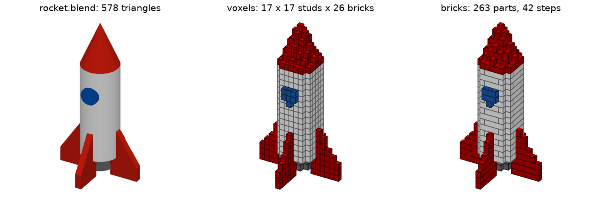

# mesh2brick

[Deutsch](README.de.md) · **English**

`mesh2brick` turns a 3D model (STL, OBJ, 3MF, PLY, glTF, STEP or a Blender `.blend` file)
into a **physically buildable LEGO®-compatible model** and produces

1. an **LDraw file** (`.ldr`/`.mpd`) with `0 STEP` build steps,
2. a **parts list** as CSV, BrickLink XML and Rebrickable CSV,
3. a **PDF building instruction** in German or English: cover with picture and size,
   parts list with pictures, steps with part call-outs and plain-language hints.

It builds on the GPL ecosystem around
[legolization](https://github.com/hbmartin/legolization) (brick placement,
stability physics, build steps), [pyldraw3](https://github.com/hbmartin/pyldraw3)
(LDraw library) and [rebrickable](https://github.com/hbmartin/rebrickable)
(offline catalogue). mesh2brick adds mesh/CAD import, colour transfer, a wider part
catalogue, nicer instructions, one configuration file/CLI, and an optional LLM layer.

> **Status: 1.0.** All eight phases of the plan are done. `mesh2brick convert` turns STL,
> OBJ, PLY, 3MF, glTF, STEP and Blender files into an LDraw model, three parts lists and a
> PDF building instruction, in the model's own colours, for models up to 2,000 parts in
> under 5 minutes on a laptop; optionally Claude adds section titles and step texts.
> `mesh2brick inspect` shows beforehand what a model will give. See the
> [example gallery](docs/gallery/README.md) and [docs/STATUS.md](docs/STATUS.md).

| From Blender to LEGO: `rocket.blend` as read, as voxels, as bricks |
|---|
|  |

## Installation (development)

Requires Python ≥ 3.12 and [uv](https://docs.astral.sh/uv/).

```sh
uv sync
uv run ldraw download --yes   # once: LDraw parts library (~150 MB download)
uv run ldraw generate --yes   # once: generate the part/colour modules
uv run mesh2brick --help
uv sync --extra step          # optional: STEP import (OpenCASCADE via cascadio, ~70 MB)
uv sync --extra step --extra llm  # optional: LLM layer (Anthropic SDK, ~2 MB)
```

`.blend` files need an installed [Blender](https://www.blender.org) (tested with 4.0); no
Python package is added. mesh2brick finds it in the usual places or via
`MESH2BRICK_BLENDER=/path/to/blender`.

## Usage

```sh
# First look: size, colours, voxels and a rough part count in seconds, plus a picture
# (out/rocket.inspect.png: the model as read next to its voxels)
uv run mesh2brick inspect tests/fixtures/rocket.blend -o out/

# Everything in one go: LDraw, parts lists (CSV, BrickLink XML, Rebrickable CSV), PDF
uv run mesh2brick convert tests/fixtures/rocket.blend -o out/

# Size: the height in cm or mm, or the longest edge in studs (default: 32 studs, about
# 26 cm). Try sizes with inspect first; it shows the LEGO size in seconds.
uv run mesh2brick inspect tests/fixtures/rocket.blend -o out/ --size 30cm
uv run mesh2brick convert tests/fixtures/rocket.blend -o out/ --size 30cm
uv run mesh2brick convert tests/fixtures/bunny_lowpoly.stl -o out/ --size 16studs

# Time limit: a conversion takes at most 5 minutes (placement.time_limit_s). If a big
# model needs longer, you get the best stable model found by then, and the PDF cover
# says so. More time usually means fewer parts:
uv run mesh2brick convert model.stl -o out/ --size 40cm --set placement.time_limit_s=1200

# Or stage by stage:
# 1. Voxelize a mesh onto the stud grid (longest axis = 32 studs by default)
uv run mesh2brick voxelize tests/fixtures/bunny_lowpoly.stl -o out/ --size 16studs

# 2. Place bricks on the grid: LDraw file, brick model JSON, PNG preview
uv run mesh2brick place out/bunny_lowpoly.grid.npz -o out/

# Voxel files work too (MagicaVoxel .vox, numpy .npy)
uv run mesh2brick place tests/fixtures/heart.vox -o out/

# Colours come from the model when it has any (slicer filaments and materials in 3MF,
# STEP colours, OBJ/glTF materials and textures, PLY vertex colours) and are matched
# to ~40 current LEGO colours. One colour for everything instead:
uv run mesh2brick convert tests/fixtures/toadstool.obj -o out/ --set color.mode=single

# Browse the parts (offline): sizes, BrickLink/Rebrickable numbers, colours
uv run mesh2brick catalog list --category slope
uv run mesh2brick catalog show 3001

# Use only some parts (whitelist) or forbid some (blacklist)
uv run mesh2brick convert model.stl -o out/ --set "parts.include=[3001, 3003, 3004]"
uv run mesh2brick convert model.stl -o out/ --set "parts.exclude=[3008, 3007]"

# Override any setting from mesh2brick.yaml on the command line
uv run mesh2brick place model.vox --set placement.strategy=greedy --set placement.seed=3

# Instructions in English, 4 steps per page, flat .ldr instead of .mpd
uv run mesh2brick convert model.stl -o out/ --set output.language=en \
    --set output.steps_per_page=4 --set "output.formats=[ldr, bom_csv, pdf]"

# Render a preview of a placed model, optionally up to a build step
uv run mesh2brick render out/heart.bricks.json --step 3
```

All settings are documented in [examples/mesh2brick.yaml](examples/mesh2brick.yaml).

## Blender and glTF files

- **`.blend`:** mesh2brick starts your Blender in the background (factory settings, scripts
  stored in the file are not run, the file is only read) and lets it export the **visible**
  objects of the active scene with modifiers applied; curves and text become meshes, hidden
  objects, cameras and lights are left out ([ADR 0014](docs/adr/0014-blender-import-via-headless-blender-and-gltf.md)).
  The scene's units count: a millimetre scene keeps its size with `input.scale_mode: mm`.
- **`.glb`/`.gltf`:** read directly, with the glTF conventions (Y up, metres, material and
  vertex colours in linear light). Keep `input.up_axis: z`; mesh2brick turns glTF's Y up
  itself.
- Without Blender, export the model from Blender as `.glb` (File → Export → glTF 2.0) and
  convert that file.

## The building instructions

- **Cover:** picture of the model, number of parts and steps, size in cm, weight,
  colours, whether the model stands on its own, and (with the LLM layer) the build
  sections with their pages.
- **Parts list:** one tile per part and colour with a picture (all at one scale),
  quantity, name and LDraw number; a hint if LEGO does not make a part in that colour.
- **Steps (1–4 per page):** new parts in full colour, earlier ones faded, a call-out
  with every new part. Sub-assemblies are built on a blue panel and then attached.
  A small yellow "first" box shows parts to put together in the hand before placing
  them (a part hanging under an overhang together with the part that holds it).
- **Big models (over 500 parts)** get steps layer by layer without a stability check
  for every intermediate state; the cover says so.
- Colour names stay the BrickLink/Rebrickable names, so they can be found there;
  German booklets add a German name in brackets ("Bright Green (Hellgrün)").
- **With the LLM layer:** build sections with titles ("Base", "Head", "Left ear") and a
  short sentence per step that says what it builds ("Put the finished cap on the stem.").

## Optional: step texts and sections by Claude (LLM layer)

With `llm.enabled: true`, mesh2brick asks Claude (Anthropic API) after placing the
parts to name build sections, to merge steps a builder would do as one, and to write a
short sentence per step. **mesh2brick checks every proposal** against the model: a merge
must keep every part held and visible, a text may only mention parts and quantities of
its own step. Whatever fails is left out, so the instructions are never worse than
without the LLM layer ([ADR 0013](docs/adr/0013-llm-layer-proposes-mesh2brick-checks.md)).

```sh
uv sync --extra llm                       # once
export ANTHROPIC_API_KEY=...              # or: ant auth login
uv run mesh2brick convert model.stl -o out/ --set llm.enabled=true
# -> out/model.llm.json: what was accepted, tokens and cost of the run

uv run mesh2brick feedback                # list the runs
uv run mesh2brick feedback --rate 4 --note "texts a bit long"   # rate the latest run
uv run mesh2brick feedback --export runs.jsonl                  # for a later fine-tuning
```

A run costs about $0.06–0.20 for models of 270–1,000 parts with the default
`claude-sonnet-5-5` (limit `llm.max_cost_usd: 1.0`, see
[docs/benchmarks.md](docs/benchmarks.md)). Ratings stay on your computer
(`MESH2BRICK_DATA_DIR`); runs rated 4 or 5 become examples for later runs, and notes
are passed on as feedback. `llm.tasks` selects `group_steps`, `write_step_text` and
the opt-in `choose_part` (replacements for parts LEGO does not make in a colour, with
`parts.availability: report`).

## Example gallery

[docs/gallery/README.md](docs/gallery/README.md) shows every example model of the repository
as read, as voxels and as bricks, with part counts, steps and times.

## Opening the results in other programs

- **BrickLink Studio:** open the `.mpd` (or `.ldr`) with **File → Open**. On macOS, Studio's
  **Import** hung for every file in our test (even for files Studio exported itself);
  File → Open loads the same file at once. A Duo test file showed no overlaps, no
  duplicates and no stability issues in Studio.
- LDraw viewers (LDView, LeoCAD) open the files directly. In the `.mpd` every
  sub-assembly is its own sub-model with its own steps.

## Development

```sh
uv run ruff check . && uv run ruff format --check . && uv run mypy src && uv run pytest
uv run pre-commit install
```

Commits follow [Conventional Commits](https://www.conventionalcommits.org/) and are
signed off (`git commit -s`, [DCO](https://developercertificate.org/)). Architecture
decisions live in [docs/adr/](docs/adr/), third-party licences in
[docs/THIRD_PARTY.md](docs/THIRD_PARTY.md).

## Licence

GPL-3.0-or-later, see [LICENSE](LICENSE). LEGO® is a trademark of the LEGO Group,
which does not sponsor, authorise or endorse this project.
