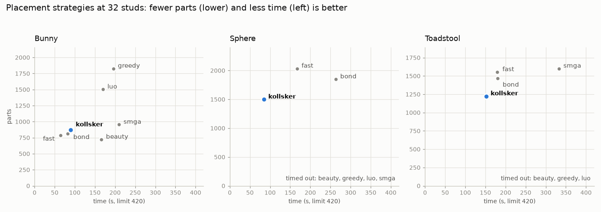

# Projektstatus

Stand: 2026-11-01 · Aktuelle Phase: **5 – Strategien und Farbverfügbarkeit: fertig, gemergt (#16)** · Nächste: **Phase 6 – Anleitungsqualität**
Repo: https://github.com/leckermatz79/mesh2brick (öffentlich) · Plan: [PLAN.md](PLAN.md) · Messwerte: [benchmarks.md](benchmarks.md)

## Fazit in zwei Sätzen

- **Strategien:** Alle 7 Platzierungsstrategien von legolization habe ich an den Testmodellen gemessen. `kollsker` bleibt die beste Wahl, eine eigene Strategie lohnt sich nicht (ADR 0010).
- **Farbverfügbarkeit:** Steine, die LEGO in einer Farbe nicht herstellt, landen nicht mehr im Modell. An Duo habe ich deinen Vergleich gemacht: Einschränken vorher schlägt Aufteilen danach deutlich.

| Galerie: Strategien bei 32 Noppen (weniger Teile = tiefer, schneller = weiter links) |
|---|
|  |

## Erledigt (Phase 5)

- **Benchmark aller Strategien** auf 6 Testmodellen bei 16 Noppen und 3 bei 32 Noppen (Tabellen in [benchmarks.md](benchmarks.md)).
  - Alle fertigen Läufe waren stabil und aus einem Stück.
  - `kollsker` braucht in 6 von 9 Fällen die wenigsten Teile und ist fast immer am schnellsten.
  - Andere Strategien sind bei einzelnen Modellen besser, etwa `smga` beim Torus mit 69 statt 213 Teilen. Dafür brauchen sie 2- bis 5-mal so lange und scheitern bei anderen Modellen am Zeitlimit.
  - **Entscheidung:** keine eigene Strategie. Die Unterschiede sind Abwägungen zwischen vorhandenen Strategien, keine fehlende Fähigkeit.
- **Steine, die es in einer Farbe nicht gibt** (neue Einstellung `parts.availability`):
  - `exclude` (Standard): Solche Teile werden vor der Platzierung für das ganze Modell weggelassen.
  - `split`: Sie werden danach in kürzere Steine derselben Farbe aufgeteilt. Die Fugen liegen dabei versetzt zu den Schichten darüber und darunter, danach wird die Stabilität neu geprüft.
  - `report`: Sie werden nur gemeldet.

## Dein Studio-Check (geschlossen)

Deine Prüfung in BrickLink Studio ersetzt jetzt den Wieder-Einlese-Test als manuelle Abnahme. Die Screenshots bleiben lokal in `out/studio/`.

| Befund | Bewertung |
|---|---|
| Studios „Import“ hängt auf dem Mac bei jeder Datei, „Datei → Öffnen“ geht sofort. | Studio-Eigenheit. Steht jetzt in beiden READMEs. |
| Keine Überlappungen, keine Duplikate. | Bestätigt die eigene Prüfung beim Export. |
| 0 Stabilitätsprobleme, aber 31 Clutch-Power-Hinweise (Flügel, Füße). | Siehe unten. |
| Schrittgrößen schwanken zwischen 1 und 6 Teilen, Schritt 87 hat nur ein 1×1-Plättchen. | Phase 6 |

**Clutch-Power gegen legolization:**
- **Stabilität:** Beide Programme sind sich einig, das Modell ist stabil. legolizations höchste Belastung liegt bei nur 2 % dessen, was eine Noppe hält, und zwar genau an der Flügelspitze und an den Beinen, wo Studio warnt.
- **Was Studio meldet:** Studios Hinweise betreffen die Festigkeit beim Anfassen, also Ziehen und Drücken. legolization prüft nur die Schwerkraft.
- **Schwachstellen:** Es gibt keine Stelle, an der ein größeres Stück an einer einzigen schwachen Verbindung hängt.

**Mindestwandstärke oder Versatzmuster?**
- **Mindestwandstärke: nein.** Die Flügel sind meist 2–3 Noppen dick, nur 25 von 1.013 Steinen liegen in echten 1-Noppen-Wänden.
- **Versatzmuster:** Hier gibt es eine echte Schwäche. 41 % der senkrechten Fugen laufen über eine Steinlage hinweg durch, statt versetzt zu sein. Ich habe vier Hebel ausprobiert, keiner hilft:
  - legolizations Mauerwerks-Strategie `bond` (mehr Teile, eher mehr durchlaufende Fugen),
  - zwei Einstellungen in legolization (keine Wirkung),
  - ein eigener Nachbearbeitungsschritt (nur 1 % besser, wieder entfernt).
- **Fazit:** Der richtige Ort ist die Platzierung selbst in legolization (Upstream-Kandidat #11). Die Messgröße „durchlaufende Fugen“ bleibt im Benchmark, damit spätere Verbesserungen sichtbar werden.

## Dein Vergleich an Duo

| Weg | Teile | Zeit | stabil | Teile, die es so nicht gibt |
|---|---:|---:|---|---:|
| nur melden (bisher) | 1.013 | 106 s | ja | 36 |
| aufteilen danach | 1.049 | 130 s | ja | 0 |
| **einschränken davor** | **1.025** | **70 s** | ja | 0 |

**Warum Einschränken gewinnt:** legolization plant die kürzeren Steine gleich mit, statt dass lange Steine nachträglich zerschnitten werden. Das ergibt weniger zusätzliche Teile, und sogar der letzte Optimierungsschritt wird schneller.

**Einschränkung:** Das Weglassen gilt heute für das ganze Modell. Ein 2×8, den es in Grün nicht gibt, fehlt dann auch in Weiß. Bei Duo kostet das nichts, weil Grün überwiegt. Wirklich pro Farbe einschränken geht erst, wenn legolization erlaubte Teile pro Farbe annimmt. Das ist als Upstream-Kandidat #9 vermerkt und hängt an #8.

## Upstream #8 (von dir freigegeben)

**Überraschung beim Vorbereiten:** legolization kann das in der Entwicklungsversion schon. `run()` nimmt dort einen eigenen Katalog an, nur ist das noch in keiner Veröffentlichung enthalten.

- **Was beigetragen wird:** nur die fehlende klare Fehlermeldung, wenn im Katalog unverzichtbare Teile fehlen, dazu Tests und Doku. Die komplette Testsuite von legolization ist grün (1.468 Tests).
- **Unser lokaler Patch** entfällt, sobald legolization eine neue Version veröffentlicht.
- **Veröffentlicht** (von dir, 2026-11-01): [Issue #90](https://github.com/hbmartin/legolization/issues/90) und [Draft-PR #91](https://github.com/hbmartin/legolization/pull/91). Noch keine Antwort vom Maintainer, ebenso bei #88/#89 (bisher nur automatische Prüfungen).

## Lückenliste: legolizations PDF gegen SPEC §1 (unverändert, wird in Phase 6 geschlossen)

| Anforderung | Stand | Lücke |
|---|---|---|
| Deckblatt mit Bild, Teilezahl, Maßen | Titel, Teilezahl, Gewicht, Stabilitätsurteil | kein Modellbild, keine Maße in cm |
| Teileliste | Liste mit Anzahl, LDraw-Nummer, Farbe, Gewicht | interne Namen (`brick_2x4`), keine Teilebilder |
| Schrittseiten mit Teile-Callouts | Bild pro Schritt, neue Teile hervorgehoben, Callouts als Text | Callouts ohne Teilebilder; Modell im Bild recht klein |
| Gedimmte Vorschritte | ja (unser Renderer) | – |
| 1–4 Schritte pro Seite | fest 2 | Einstellung noch nicht nach außen geführt |
| Deutsch und Englisch | nur Englisch | Übersetzung fehlt (legolization kennt nur Englisch) |
| Unterbaugruppen als eigene Abschnitte | ja bei geprüfter Schrittplanung | bei Schicht-Reihenfolge (große Modelle) keine |
| Verständliche Hinweise | Warnungen wie „prefix unstable (score 1.00)" | Fachjargon |
| Schriften | Helvetica, nicht eingebettet | manche Betrachter zeigen dann keinen Text (z. B. `pdftoppm` hier); Ghostscript/Vorschau zeigen ihn |
| Größe | Hase 4,8 MB, Duo 10 MB | Ziel < 10 MB für den Hasen schon erfüllt |

## Als Nächstes

1. **Phase 6 (Issue #7): Anleitungsqualität.**
   - Eigenes PDF-Layout, falls legolizations Heft nicht reicht: Deckblatt mit Bild und Maßen, Teileliste mit Bildern, Callouts, 1–4 Schritte pro Seite, Deutsch und Englisch.
   - Unterbaugruppen als eigene Abschnitte.
   - **Aus deinem Studio-Check:** gleichmäßigere Schrittgrößen (heute 1 bis 6 Teile, Schritt 87 hat nur ein 1×1-Plättchen).
   - Ziel: PDF unter 10 MB für den Hasen.
2. Upstream: Antworten auf #88/#89 und #90/#91 abwarten.

## Bekannte Einschränkungen

| Was | Einschätzung |
|---|---|
| „Teile weglassen“ gilt fürs ganze Modell, nicht pro Farbe. | Upstream #9 (nach #8) |
| 1×1-Stein und 1×1-Platte lassen sich weder weglassen noch aufteilen. Gibt es sie in einer Modellfarbe nicht, meldet die Teileliste das. | selten; akzeptiert |
| legolization setzt nur Platten bis 2×8. Größere Platten würden Teile sparen. | Upstream-Kandidat #10 |
| Sehr schmale Whitelists kosten Teile und Zeit. | dokumentiert |
| Reine Computer-Grundfarben landen teils auf Nachbarfarben (#FF0000 → „Reddish Orange“). | von dir als Farbmetrik akzeptiert; optional Ausnahmetabelle |
| Bemalte Farben aus dem Slicer und Texturen in 3MF werden noch nicht gelesen. | bei Bedarf |
| Große Modelle (> 500 Teile) bekommen Schritte in Schicht-Reihenfolge ohne Stabilitätsprüfung. | von dir akzeptiert; Phase 6 bzw. Upstream |
| Die letzte Optimierung in legolization („remerge“) lässt sich nicht begrenzen. | Upstream-Kandidat #5 |
| Slopes vorerst aus (legolization-Hänger, Upstream #2 offen). | nach Upstream-Fix wieder an |
| PDF-Text englisch. | Phase 6 |

## Umgebung (gut zu wissen)

- Die Python-Umgebung liegt außerhalb von Nextcloud (`.venv` ist ein Symlink nach `~/.local/share/venvs/mesh2brick`).
- Die LDraw-Teilebibliothek liegt in `~/Library/Caches/pyldraw3`, der Zwischenspeicher für Teilebeschreibungen in `~/Library/Caches/mesh2brick`. `samples/` (Duo) ist von Git ausgeschlossen.
- STEP braucht einmalig `uv sync --extra step`.

## Deine Entscheidungen

| Datum | Frage | Entscheidung |
|---|---|---|
| 2026-11-01 | Erster echter Testfall? | Duo (Eule aus `samples/`), **nur lokal**: nicht im Repo, nicht in der Galerie. |
| 2026-11-01 | Typische Modellgröße? | **32 Noppen** auf der längsten Achse (≈ 26 cm) als Standard, 48 erst später. |
| 2026-11-01 | LeoCAD für PDF-Schrittbilder installieren? | **Ja**, per Homebrew zu Beginn von Phase 2. Leider nicht möglich (s. o.). |
| 2026-11-01 | Fehlerbericht #2 bei legolization einreichen? | **Ja**, plus PR-Entwurf für das Zeitlimit; mit Hinweis, dass das Problem in einem Vibe-Coding-Projekt aufgefallen ist. Erledigt: Issue #88, Draft-PR #89. |
| 2026-11-01 | Wie lange darf eine Umwandlung dauern? | **5 Minuten.** Phase 2: Duo unter 5 Minuten als Zielmarke, Hebel per Benchmark wählen. Erreicht: 110 s. |
| 2026-11-01 | Manuelle Prüfung der `.ldr` in BrickLink Studio? | **Ja, Screenshot kommt später.** Bis dahin gilt der strenge Wieder-Einlese-Test als Prüfung. |
| 2026-11-01 | LeoCAD manuell installieren und nutzen? | **Nein.** Schrittbilder kommen vom eigenen Renderer. |
| 2026-11-01 | Schichtschritte für große Modelle (> 500 Teile)? | **Ja**, in Ordnung. |
| 2026-11-01 | STEP-Zusatzpaket mit 70 MB (über der 50-MB-Regel)? | **In Ordnung.** Ein vollständiger CAD-Kern rechtfertigt die Größe, er wird nur bei Bedarf installiert. Die Rückfrage war richtig: So soll die 50-MB-Regel funktionieren. |
| 2026-11-01 | Farben aus dem Modell automatisch übernehmen? | **Ja.** Einfarbig bleibt per Config erreichbar (`color.mode: single`). |
| 2026-11-01 | Gängige LEGO-Farben statt exakter Farbtöne? | **Ja.** Eine Anleitung, deren Steine man nicht kaufen kann, ist wertlos. Für Spezialfälle gibt es `color.palette: all`. |
| 2026-11-01 | Reines #FF0000 wird „Reddish Orange“ | **Kein Bug, sondern Farbmetrik.** Optional in Phase 4: kleine Ausnahmetabelle für reine Primärfarben. Erwähnen, nicht priorisieren. |
| 2026-11-01 | Upstream-Vorschlag „erlaubte Teile direkt angeben“ (#8) einreichen? | **Ja, einreichen.** Derselbe Fall wie #88/#89, und den lokalen Patch will man nicht dauerhaft pflegen. Im Issue kurz auf #89 verweisen, weil der Maintainer dort noch nicht reagiert hat, damit er den Zusammenhang sieht. Erledigt: Issue #90, Draft-PR #91. |
| 2026-11-01 | Steine, die es in einer Farbe nicht gibt, automatisch ersetzen? | **Ja, als Zwischenlösung** (1×8 → 2× 1×4, danach Stabilitätsprüfung). Sauber wäre, die Farbverfügbarkeit schon bei der Platzierung zu kennen (hängt am selben Upstream-Thema). **Phase 5 vergleicht beides im Benchmark an Duo:** Aufteilen danach gegen Einschränken davor. |
| 2026-11-01 | Manuelle Prüfung in BrickLink Studio | **Erledigt** (Duo, lokal): keine Überlappungen, keine Duplikate, 0 Stabilitätsprobleme, 31 Clutch-Hinweise (Flügel, Füße). Import hängt auf dem Mac, Datei → Öffnen geht (README). Schrittgrößen → Phase 6. |

## Fragen an dich

Keine offenen Fragen.

## Offene Kleinigkeit

Die Release-Seiten auf GitHub fehlen, die Tags existieren. Das Anlegen öffentlicher Seiten wurde vom
Rechtesystem blockiert. Befehl für `v0.0.0`:
`awk '/^## \[0.0.0\]/{f=1;next} /^## \[/{f=0} f' CHANGELOG.md | gh release create v0.0.0 --prerelease --title "v0.0.0 – Phase 0: skeleton" --notes-file -`
