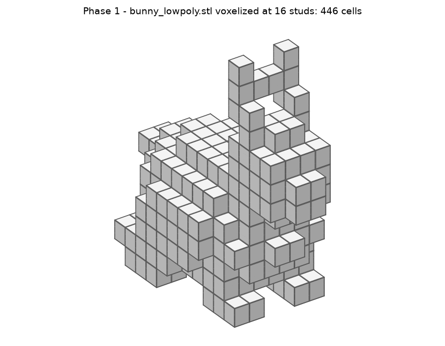
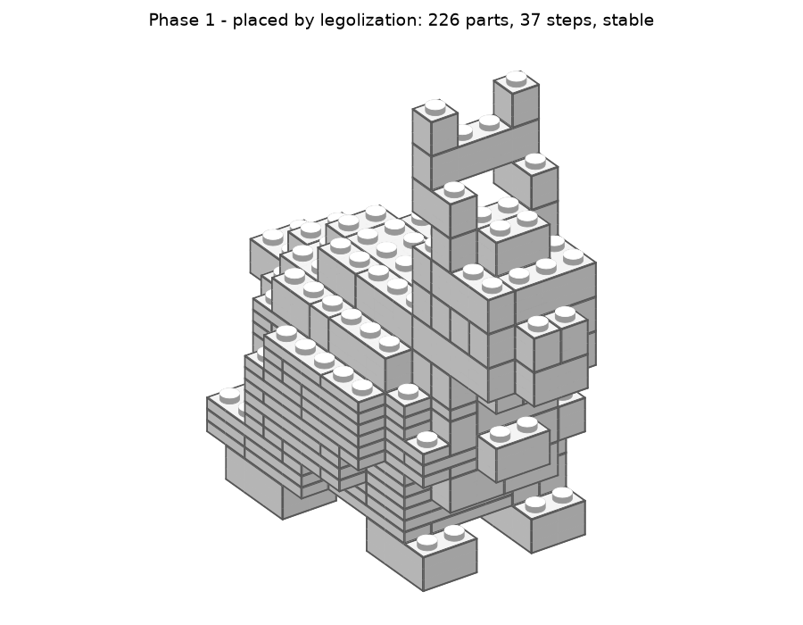

# Projektstatus

Stand: 2026-11-01 · Aktuelle Phase: **1 – Ingest + Voxelisierung: fertig, wartet auf Merge** · Nächste: **Phase 2 – End-to-End (MVP)**
Repo: https://github.com/leckermatz79/mesh2brick (öffentlich) · Plan: [PLAN.md](PLAN.md) · Messwerte: [benchmarks.md](benchmarks.md)

## Fazit in zwei Sätzen

mesh2brick liest jetzt echte 3D-Dateien (STL, OBJ, PLY und 3MF, auch Bambu-Studio-Projekte) und
macht daraus ein Noppenraster, das das Volumen fast exakt trifft (Kugel: 0,1 % Abweichung).
Der Hase hat bei 16 Noppen 226 Teile, steht stabil und ist in 9 Sekunden fertig. Größere Modelle
brauchen in legolization aber noch sehr lange, das ist das große Thema für Phase 2.

| Voxel (Hase, 16 Noppen) | Steine (legolization) |
|---|---|
|  |  |

## Erledigt (Phase 1)

- **Import:** STL, OBJ, PLY über trimesh. Für 3MF gibt es einen eigenen Leser, weil Slicer-Dateien die Geometrie in Unterdateien auslagern und gängige Leser diese übersehen. Einheiten (mm, cm, Zoll …) werden umgerechnet, Bauteile zusammengeführt.
- **Aufbereitung:** Hochachse einstellbar (`input.up_axis`), optional „auf die stabilste Seite legen" (`input.auto_orient`). Löcher, verdrehte Flächen und kaputte Dreiecke werden repariert. Wenn das nicht reicht: Warnung und Ersatzverfahren.
- **Voxelisierung (ADR 0003):** 16 Messstrahlen pro Noppe. Ein Feld gilt als gefüllt, wenn es mindestens zur Hälfte im Modell liegt (`voxel.threshold`). Brick- oder Plate-Höhe ist wählbar, überlappende Teile werden vereinigt, Hohlräume bleiben leer. Für 2 Millionen Dreiecke unter 1 Sekunde.
- **Rundungsregel:** Breite und Tiefe werden auf ganze Noppen gerundet und das Modell mittig darauf gesetzt. Das Raster beginnt am tiefsten Punkt des Modells.
- **Farben:** `single` (eine Farbe) und `height_bands` (Farbstreifen von unten nach oben, `color.bands`).
- **Dateien:** `.grid.npz` (eigenes Format), `.npy` und `.vox` im Format, das legolization liest; Round-Trip mit allen Volltonfarben getestet.
- **CLI:** `mesh2brick voxelize modell.stl` zeigt Größe in Noppen und cm, Volumenabweichung, Teile-Schätzung und schreibt ein Vorschaubild. `mesh2brick place modell.grid.npz` setzt die Steine.
- **Testmodelle:** Würfel, Kugel, L-Winkel, Torus und ein selbst erzeugter Low-Poly-Hase (CC0). Einen frei lizenzierten Scan-Hasen gibt es nicht.
- **Abnahme erfüllt:**
  - Würfel 10 mm → 1 × 1 Noppe, 1 Brick hoch.
  - Kugel bei 32 Noppen: 0,1 % Volumenabweichung (Grenze 15 %).
  - Alle Testmodelle laufen fehlerfrei durch legolization.
- 257 automatische Tests, 96 % Abdeckung.

## Wichtiger Fund: legolization kann sich aufhängen

Mit Schrägsteinen (Slopes) blieb legolization beim Hasen (16 Noppen) **unbegrenzt hängen**. Ursache ist der
LP-Löser HiGHS, der bei manchen Stabilitätsrechnungen in seiner Vorverarbeitung festläuft. legolization
setzt dafür keine Zeitgrenze. Was ich gemacht habe:

1. **Lokaler Patch:** Jeder Lösungsversuch bekommt 5 Sekunden. Danach übernimmt der nächste Versuch, der
   dieselbe Rechnung in 2–3 Sekunden schafft. Der Patch ist dokumentiert, mit einem Regressionstest abgesichert
   und in `docs/UPSTREAM.md` vermerkt.
2. **Slopes sind vorerst abgeschaltet** (`parts.categories: [brick, plate]`). Auch mit Patch braucht der Hase mit
   Slopes 443 s statt 9 s. Wer sie trotzdem will: `--set parts.categories=[brick,plate,slope]`.
3. **Fehlerbericht für legolization liegt fertig vor** (`docs/UPSTREAM.md`, Entwurf #2), mit
   Reproduktionsdatei. Eingereicht wird er nur mit deinem OK.

## Lokaler Praxistest: Duo

Die 3MF-Datei aus Bambu Studio wird korrekt gelesen: 12 Teile, 2,1 Mio. Dreiecke, identisch zur STL.
Bei 32 Noppen ergibt das 32 × 19 Noppen × 24 Bricks (25,6 × 15,2 × 23 cm), voxelisiert in 0,9 s. Die Form
ist gut erkennbar. Das Platzieren der Steine dauert mit legolization bei dieser Größe noch sehr lange
(Messung läuft, Ergebnis im PR). Bilder bleiben wie vereinbart lokal.

## Als Nächstes (Phase 2, Issue #3)

1. `mesh2brick convert modell.stl` in einem Schritt: Voxel → Steine → `.ldr` + drei Teilelisten + PDF.
2. **Laufzeit großer Modelle** angehen. legolization bekommt ein Zeitbudget, wir vergleichen die Strategien
   (`greedy` vs. `luo`) an Duo-Größe, und die Laufzeit wird während der Berechnung angezeigt.
3. LeoCAD installieren (von dir freigegeben) für die Schrittbilder im PDF.

## Bekannte Einschränkungen

| Was | Einschätzung |
|---|---|
| Slopes vorerst aus (siehe oben). | Upstream-Fix (#2), danach wieder Standard |
| Große Modelle (Duo bei 32 Noppen, ~4.500 Felder) brauchen beim Platzieren sehr lange. Fast die ganze Zeit geht in legolizations Stabilitätsrechnung. | Phase 2: Zeitbudget, Strategiewahl; ggf. Upstream |
| Noch ohne Wirkung: `color.mode` vertex/texture/cad (Phase 3), `parts.include/exclude/max_parts` (Phase 4), `llm.*` (Phase 7), `output.language/page_size` und BOM-/PDF-Formate (Phase 2). | eigener Code, geplant |
| `steps.keep_symmetry: false` wirkt nicht, weil legolization symmetrische Hälften immer zusammenhält. | akzeptieren |
| Bricks und Plates lassen sich nicht abwählen. | Phase 4 |
| Die Vorschau zeichnet Slopes als Quader. | spätestens Phase 6 |
| `voxelize` schätzt die zu bauenden Felder („~2.417 von 4.509"). legolization rechnet beim Aushöhlen leicht anders (ADR 0004). | akzeptieren |
| Dünne Teile unter einer halben Noppe (z. B. Schnabel bei kleiner Größe) fallen beim Voxelisieren weg. | so gewollt (`voxel.threshold`); bei Bedarf kleiner stellen |

## Umgebung (gut zu wissen)

- Die Python-Umgebung liegt außerhalb von Nextcloud (`.venv` ist ein Symlink nach `~/.local/share/venvs/mesh2brick`).
- Die LDraw-Teilebibliothek liegt in `~/Library/Caches/pyldraw3`.
- `samples/` (Duo) ist von Git ausgeschlossen.
- Neue Abhängigkeit: `networkx` (klein, BSD-Lizenz), weil trimesh es zum Löcherstopfen braucht.

## Deine Entscheidungen

| Datum | Frage | Entscheidung |
|---|---|---|
| 2026-11-01 | Erster echter Testfall? | Duo (Eule aus `samples/`), **nur lokal**: nicht im Repo, nicht in der Galerie. |
| 2026-11-01 | Typische Modellgröße? | **32 Noppen** auf der längsten Achse (≈ 26 cm) als Standard, 48 erst später. |
| 2026-11-01 | LeoCAD für PDF-Schrittbilder installieren? | **Ja**, per Homebrew zu Beginn von Phase 2. |

## Fragen an dich

Wenn keine Antwort kommt, gilt jeweils die Standardannahme.

1. **Darf ich den Fehlerbericht #2 bei legolization einreichen?** Er betrifft das Aufhängen bei Slopes; der Entwurf steht in `docs/UPSTREAM.md`. *Annahme: nein, erst wenn du ihn gelesen hast. Bis dahin bleiben der lokale Patch und „Slopes aus" aktiv.*
2. **Wie lange darf eine Umwandlung dauern?** *Annahme: bis 5 Minuten wie in der SPEC (§9). Wenn legolization länger braucht, liefere ich das beste bis dahin gefundene stabile Ergebnis und sage das an.*

## Offene Kleinigkeit

Die Release-Seiten auf GitHub fehlen, die Tags existieren. Das Anlegen öffentlicher Seiten wurde vom
Rechtesystem blockiert. Befehl für `v0.0.0`:
`awk '/^## \[0.0.0\]/{f=1;next} /^## \[/{f=0} f' CHANGELOG.md | gh release create v0.0.0 --prerelease --title "v0.0.0 – Phase 0: skeleton" --notes-file -`
