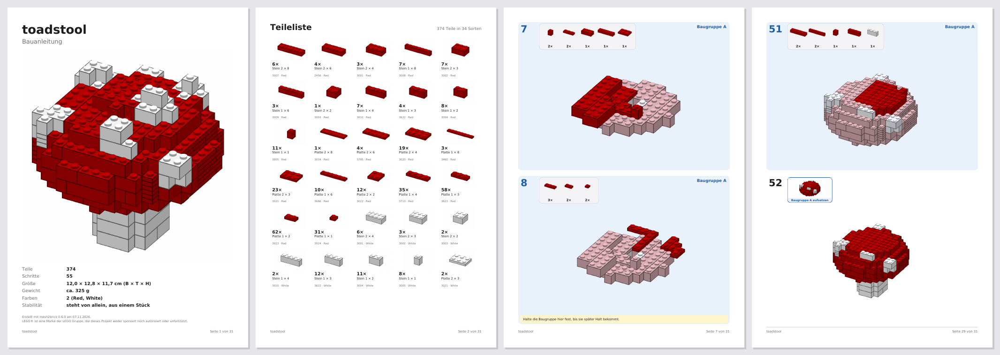
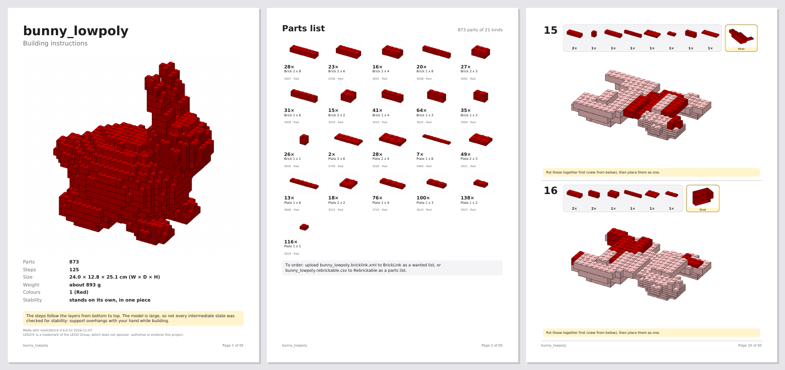

# Projektstatus

Stand: 2026-11-07 · Aktuelle Phase: **6 – Anleitungsqualität: fertig, PR offen** · Nächste: **Phase 7 – KI-Schicht**
Repo: https://github.com/leckermatz79/mesh2brick (öffentlich) · Plan: [PLAN.md](PLAN.md) · Messwerte: [benchmarks.md](benchmarks.md)

## Fazit in zwei Sätzen

- **Eigene Bauanleitung:** Das PDF hat jetzt ein Deckblatt mit Bild und Maßen, eine Teileliste mit Bildern, Teilebilder in jedem Schritt und verständliche Hinweise, auf Deutsch oder Englisch. Der Hase (873 Teile) ergibt 65 Seiten mit 5,5 MB.
- **Bessere Schritte:** Bei großen Modellen hängt kein Teil mehr in der Luft (Duo: vorher 155 Teile), und Mini-Schritte mit 1–2 Teilen gibt es deutlich seltener (Duo: 11 → 4).

| Galerie: Fliegenpilz auf Deutsch (Deckblatt, Teileliste, Baugruppe, Baugruppe aufsetzen) |
|---|
|  |

| Großes Modell auf Englisch: Hase mit 873 Teilen (gelbes Kästchen „first“ = vorher zusammenstecken) |
|---|
|  |

## Erledigt (Phase 6)

- **Eigenes PDF statt legolizations Heft** (ADR 0011). Alle Punkte der Lückenliste sind geschlossen:

| Anforderung | Vorher | Jetzt |
|---|---|---|
| Deckblatt | Titel, Teilezahl, Gewicht | Bild, Teile, Schritte, Größe in cm, Gewicht, Farben, „steht von allein“ |
| Teileliste | interne Namen (`brick_2x4`), keine Bilder | Bild pro Teil und Farbe (alle im selben Maßstab), Anzahl, Name, LDraw-Nummer |
| Schritte | Teile nur als Text, Modell klein | Teilebilder mit Anzahl, Bild wächst mit dem Modell, frühere Teile blass |
| Schritte pro Seite | fest 2 | 1–4 einstellbar (`output.steps_per_page`, Standard 2) |
| Sprache | nur Englisch | Deutsch (Standard) oder Englisch (`output.language`) |
| Hinweise | „prefix unstable (score 1.00)“ | z. B. „Halte das Modell hier mit einer Hand fest“ |
| Schrift | nicht eingebettet | eingebettet, Umlaute gehen überall |
| Unterbaugruppen | nur bei kleinen Modellen, flach in der `.ldr` | eigenes blaues Feld im PDF, eigener Schritt „Baugruppe A aufsetzen“, eigenes Untermodell in der `.mpd` |
| Größe | Hase 4,8 MB | Hase 5,5 MB (Ziel < 10 MB), Duo 7,0 MB |

- **`.mpd` statt `.ldr` als Standard:** So bleiben Unterbaugruppen als eigene Untermodelle mit eigenen Schritten erhalten (SPEC Phase 6). Wer eine flache Datei will, stellt `output.formats` auf `ldr`.
- **Gleichmäßigere Schritte (dein Studio-Check):** Zu kleine Schritte werden mit dem Nachbarschritt zusammengelegt, wenn dabei nichts verdeckt wird; zu große werden geteilt. Duo: nur noch 4 statt 11 Schritte mit weniger als 3 Teilen, größter Schritt 10 Teile. Die übrigen Mini-Schritte sind große Platten, die der nächste Schritt verdeckt; die müssen allein bleiben, sonst sieht man sie im Bild nicht.
- **Teile, die in der Luft hängen (eigene Messung):** Bei großen Modellen kamen die Schritte Schicht für Schicht. Ein Teil unter einem Überhang kam dabei vor dem Teil, das es festhält, und wäre beim Nachbauen heruntergefallen. Jetzt kommt es in denselben Schritt wie sein Halter. Ein gelbes Kästchen „zuerst“ zeigt beide von unten: erst zusammenstecken, dann gemeinsam aufsetzen (ADR 0012).
- **Benchmark** über 9 Testmodelle und Duo ([benchmarks.md](benchmarks.md), Abschnitt Phase 6). Duo komplett in 99 s (Ziel 5 min).
- **Upstream-Kandidaten** #12 (hängende Teile und Mini-Schritte in legolizations Schichtplan) und #13 (kleiner Fehler: eine Markierung geht verloren) notiert, nichts eingereicht.

## Als Nächstes

1. **Du:** PR prüfen und mergen, danach Tag `v0.6.0` (Befehle unten unter „Offene Kleinigkeiten“).
2. **Optional, du:** ein PDF ansehen oder eine Seite ausdrucken und schauen, ob du danach bauen könntest. Am schnellsten: `uv run mesh2brick convert tests/fixtures/toadstool.obj -o out/ --set input.target_studs=16` und dann `out/toadstool.pdf` öffnen.
3. **Phase 7 (Issue #8): KI-Schicht.** Schrittgliederung und Erklärtexte per Claude, immer gegen Katalog und Stabilität geprüft; ohne KI bleibt das Ergebnis wie heute.
4. Upstream: Antworten auf #88/#89 und #90/#91 abwarten.

## Bekannte Einschränkungen

| Was | Einschätzung |
|---|---|
| Große Modelle (> 500 Teile) bekommen Schritte Schicht für Schicht, nicht jeder Zwischenstand ist auf Standfestigkeit geprüft. | von dir akzeptiert; das Deckblatt sagt es jetzt in einem Satz |
| Hängen mehrere vorher zusammengesteckte Teile aneinander, wird ein Schritt größer (Kugel bei 32 Noppen: einmal 18 Teile, sonst meist höchstens 10). | selten; eigener Code, falls es stört |
| Bei kleinen Modellen übernimmt legolization die Reihenfolge. Wo es selbst „braucht Stütze“ meldet (z. B. Kugel bei 16 Noppen), steht im PDF „Halte das Modell fest“. | akzeptiert |
| Dachsteine (Slopes) erscheinen in den Bildern als Quader. | eigener Code, wenn Slopes wieder an sind |
| Farbnamen in der deutschen Anleitung sind englisch („Bright Green“), so wie bei BrickLink und Rebrickable. | siehe Frage 3 |
| „Teile weglassen“ gilt fürs ganze Modell, nicht pro Farbe. | Upstream #9 (nach #8) |
| 1×1-Stein und 1×1-Platte lassen sich weder weglassen noch aufteilen. Gibt es sie in einer Modellfarbe nicht, meldet die Teileliste das. | selten; akzeptiert |
| legolization setzt nur Platten bis 2×8. Größere Platten würden Teile sparen. | Upstream-Kandidat #10 |
| Reine Computer-Grundfarben landen teils auf Nachbarfarben (#FF0000 → „Reddish Orange“). | von dir als Farbmetrik akzeptiert |
| Bemalte Farben aus dem Slicer und Texturen in 3MF werden noch nicht gelesen. | bei Bedarf |
| Die letzte Optimierung in legolization („remerge“) lässt sich nicht begrenzen. | Upstream-Kandidat #5 |
| Slopes vorerst aus (legolization-Hänger, Upstream #2 offen). | nach Upstream-Fix wieder an |

## Umgebung (gut zu wissen)

- Die Python-Umgebung liegt außerhalb von Nextcloud (`.venv` ist ein Symlink nach `~/.local/share/venvs/mesh2brick`).
- Die LDraw-Teilebibliothek liegt in `~/Library/Caches/pyldraw3`, der Zwischenspeicher für Teilebeschreibungen in `~/Library/Caches/mesh2brick`. `samples/` (Duo) ist von Git ausgeschlossen.
- STEP braucht einmalig `uv sync --extra step`.
- Die Galeriebilder der PDF-Seiten entstehen mit `pdftoppm` (Homebrew-Paket poppler).

## Deine Entscheidungen

| Datum | Frage | Entscheidung |
|---|---|---|
| 2026-11-01 | Erster echter Testfall? | Duo (Eule aus `samples/`), **nur lokal**: nicht im Repo, nicht in der Galerie. |
| 2026-11-01 | Typische Modellgröße? | **32 Noppen** auf der längsten Achse (≈ 26 cm) als Standard, 48 erst später. |
| 2026-11-01 | LeoCAD für PDF-Schrittbilder installieren? | **Ja**, per Homebrew zu Beginn von Phase 2. Leider nicht möglich (s. o.). |
| 2026-11-01 | Fehlerbericht #2 bei legolization einreichen? | **Ja**, plus PR-Entwurf für das Zeitlimit; mit Hinweis, dass das Problem in einem Vibe-Coding-Projekt aufgefallen ist. Erledigt: Issue #88, Draft-PR #89. |
| 2026-11-01 | Wie lange darf eine Umwandlung dauern? | **5 Minuten.** Phase 2: Duo unter 5 Minuten als Zielmarke, Hebel per Benchmark wählen. Erreicht: 110 s. |
| 2026-11-01 | Manuelle Prüfung der `.ldr` in BrickLink Studio? | **Ja, Screenshot kommt später.** Bis dahin gilt der strenge Wieder-Einlese-Test als Prüfung. |
| 2026-11-01 | LeoCAD manuell installieren und nutzen? | **Nein.** Schrittbilder kommen vom eigenen Renderer. |
| 2026-11-01 | Schichtschritte für große Modelle (> 500 Teile)? | **Ja**, in Ordnung. |
| 2026-11-01 | STEP-Zusatzpaket mit 70 MB (über der 50-MB-Regel)? | **In Ordnung.** Ein vollständiger CAD-Kern rechtfertigt die Größe, er wird nur bei Bedarf installiert. Die Rückfrage war richtig: So soll die 50-MB-Regel funktionieren. |
| 2026-11-01 | Farben aus dem Modell automatisch übernehmen? | **Ja.** Einfarbig bleibt per Config erreichbar (`color.mode: single`). |
| 2026-11-01 | Gängige LEGO-Farben statt exakter Farbtöne? | **Ja.** Eine Anleitung, deren Steine man nicht kaufen kann, ist wertlos. Für Spezialfälle gibt es `color.palette: all`. |
| 2026-11-01 | Reines #FF0000 wird „Reddish Orange“ | **Kein Bug, sondern Farbmetrik.** Optional in Phase 4: kleine Ausnahmetabelle für reine Primärfarben. Erwähnen, nicht priorisieren. |
| 2026-11-01 | Upstream-Vorschlag „erlaubte Teile direkt angeben“ (#8) einreichen? | **Ja, einreichen.** Derselbe Fall wie #88/#89, und den lokalen Patch will man nicht dauerhaft pflegen. Im Issue kurz auf #89 verweisen, weil der Maintainer dort noch nicht reagiert hat, damit er den Zusammenhang sieht. Erledigt: Issue #90, Draft-PR #91. |
| 2026-11-01 | Steine, die es in einer Farbe nicht gibt, automatisch ersetzen? | **Ja, als Zwischenlösung** (1×8 → 2× 1×4, danach Stabilitätsprüfung). Sauber wäre, die Farbverfügbarkeit schon bei der Platzierung zu kennen (hängt am selben Upstream-Thema). **Phase 5 vergleicht beides im Benchmark an Duo:** Aufteilen danach gegen Einschränken davor. |
| 2026-11-01 | Manuelle Prüfung in BrickLink Studio | **Erledigt** (Duo, lokal): keine Überlappungen, keine Duplikate, 0 Stabilitätsprobleme, 31 Clutch-Hinweise (Flügel, Füße). Import hängt auf dem Mac, Datei → Öffnen geht (README). Schrittgrößen → Phase 6. |

## Fragen an dich

Höchstens drei, jeweils mit Standardannahme. Ohne Antwort gilt die Standardannahme.

1. **Schritte pro Seite und Optik:** Jetzt 2 Schritte pro Seite (Hase: 65 Seiten). Lieber 1 (große Bilder, doppelt so viele Seiten) oder 4 (halb so viele Seiten, kleinere Bilder)? Und gefällt dir die Optik der Galerie-Seiten?
   *Standardannahme:* 2 Schritte pro Seite, Optik bleibt so.
2. **Teile unter Überhängen:** Jetzt steckt man sie im selben Schritt vorher in der Hand an ihren Halter (kleines gelbes Bild von unten). Die LEGO-typische Alternative wäre ein eigener Mini-Bauabschnitt mit eigener Seite; Duo hätte dann rund 100 Schritte mehr.
   *Standardannahme:* so lassen (im selben Schritt).
3. **Farbnamen in der deutschen Anleitung:** Jetzt englisch wie bei BrickLink und Rebrickable („Bright Green“), damit man sie beim Bestellen wiederfindet. Alternative: zusätzlich ein deutscher Name in Klammern („Bright Green (Hellgrün)“).
   *Standardannahme:* englisch lassen.

## Offene Kleinigkeiten

- **Release-Seiten** auf GitHub fehlen, die Tags existieren. Das Anlegen öffentlicher Seiten blockiert das Rechtesystem. Befehl für `v0.0.0`:
  `awk '/^## \[0.0.0\]/{f=1;next} /^## \[/{f=0} f' CHANGELOG.md | gh release create v0.0.0 --prerelease --title "v0.0.0 – Phase 0: skeleton" --notes-file -`
- **Tag für Phase 6** nach dem Merge:
  `git switch main && git pull && git tag -a v0.6.0 -m "Phase 6: instruction quality" && git push origin v0.6.0`
