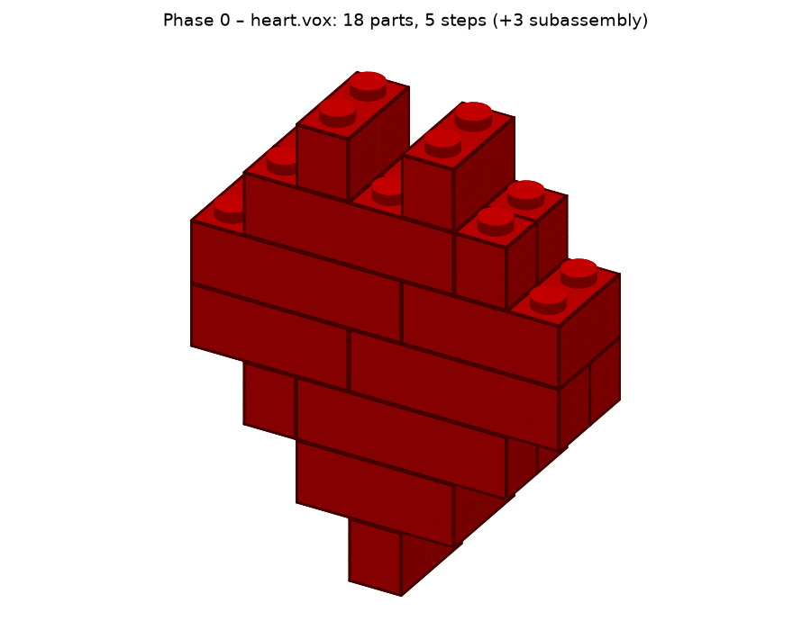

# Projektstatus

Stand: 2026-11-01 · Aktuelle Phase: **0 – Gerüst: abgeschlossen ✅** · Nächste: **Phase 1 – Ingest + Voxelisierung**
Repo: https://github.com/leckermatz79/mesh2brick (öffentlich) · CI grün auf Linux + macOS, Python 3.12/3.13
Plan für Phase 0–2: [PLAN.md](PLAN.md)

## Fazit in zwei Sätzen

Das Grundgerüst steht. mesh2brick kann bereits ein fertiges Voxelmodell (das Herz-Beispiel)
an legolization übergeben und bekommt ein stabiles Modell mit 18 Steinen in 8 Bauschritten
zurück, inklusive LDraw-Datei und Vorschaubild. Der Mesh-Import (STL/3MF …) fehlt noch, er ist
das Thema von Phase 1.

## Erledigt (Phase 0)

- Projekt mit `uv`, Python 3.12, alle Werkzeuge eingerichtet (ruff, mypy strict, pytest, pre-commit, GitHub Actions für Linux + macOS × Python 3.12/3.13).
- legolization 0.5.0, pyldraw3 1.7.0 und rebrickable 1.1.0 eingebunden und exakt gepinnt.
- Komplette Konfiguration nach SPEC §4 mit verständlichen Fehlermeldungen. Jede Einstellung lässt sich per `--set bereich.feld=wert` überschreiben.
- Adapter zu legolization: Gitter → Platzierung → Stabilität → Bauschritte → `.ldr`/`.mpd`. Bauteile, die separat vorgebaut und dann angesetzt werden (Unterbaugruppen), sind korrekt erfasst.
- Eigener Vorschau-Renderer (Steine mit Kanten und Noppen, einzelne Bauschritte darstellbar).
- CLI: `place` und `render` funktionieren, die anderen Befehle sagen, in welcher Phase sie kommen.
- 137 automatische Tests (95 % Abdeckung), darunter:
  - der Smoke-Test (Herz → `.ldr`),
  - ein Test, dass die Umrechnung ins LDraw-Koordinatensystem für jeden Stein stimmt,
  - ein Test, dass nur der Adapter die Fremdbibliotheken benutzt,
  - ein Test, dass jede Datei den Lizenz-Header hat.
- Dokumente: README (de/en), CLAUDE.md, ADR 0001/0002, Lizenzübersicht, Upstream-Liste.
- GitHub: öffentliches Repo, Tag `v0.0.0`, Issues #1–#9 (eins pro Phase mit Abnahme-Checkliste), `main` geschützt (Änderungen ab jetzt per Pull Request).
- Commits laufen unter deiner GitHub-noreply-Adresse; die gmx-Adresse taucht im Repo nirgends auf.

## Als Nächstes

Phase 1 (Issue #2): Mesh-Import (STL/OBJ/3MF/PLY) und eigene Voxelisierung, siehe PLAN.md.

## Bekannte Einschränkungen

| Was | Einschätzung |
|---|---|
| Viele Einstellungen haben noch keine Wirkung, weil ihre Phase noch nicht dran ist: `input.*`, `voxel.threshold`, `color.*`, `parts.include/exclude/max_parts`, `llm.*`, `output.language/page_size` und die BOM-/PDF-Formate. | eigener Code (Phase 1–7) |
| `steps.keep_symmetry: false` wirkt nicht, weil legolization symmetrische Hälften immer zusammenhält. | akzeptieren; nur bei Bedarf Upstream-Option |
| Bricks und Plates lassen sich nicht abwählen, weil legolization beide immer verwendet. | Phase 4 prüft Whitelists, ggf. Upstream-PR |
| Die Vorschau zeichnet Schrägsteine (Slopes) als Quader. | eigener Code (spätestens Phase 6) |
| Die erste Platzierung dauert ca. 10 s, weil beim Start die Solver-Bibliotheken geladen werden. | akzeptieren |
| In einer flachen `.ldr` sind Unterbaugruppen eingeebnet (5 statt 8 Schritte). In `.mpd` bleiben sie erhalten. | so gewollt (legolization-Verhalten) |

## Umgebung (gut zu wissen)

- Die Python-Umgebung liegt außerhalb von Nextcloud (`.venv` ist ein Symlink nach `~/.local/share/venvs/mesh2brick`).
- Die LDraw-Teilebibliothek (147 MB Download, 623 MB entpackt) liegt in `~/Library/Caches/pyldraw3`.
- `samples/` (Duo) ist von Git ausgeschlossen: zu groß und markenrechtlich nicht für ein öffentliches Repo geeignet.

## Deine Entscheidungen

| Datum | Frage | Entscheidung |
|---|---|---|
| 2026-11-01 | Erster echter Testfall? | Duo (Eule aus `samples/`), **nur lokal**: nicht im Repo, nicht in der Galerie. |
| 2026-11-01 | Typische Modellgröße? | **32 Noppen** auf der längsten Achse (≈ 26 cm) als Standard, 48 erst später. Ist in Config, Beispieldatei und SPEC §4 eingetragen. |
| 2026-11-01 | LeoCAD für PDF-Schrittbilder installieren? | **Ja**, per Homebrew zu Beginn von Phase 2. |

## Fragen an dich

Keine offenen Fragen.

## Offene Kleinigkeit

Die Release-Seite für `v0.0.0` auf GitHub fehlt noch, der Tag existiert. Das Anlegen der
öffentlichen Seite wurde vom Rechtesystem blockiert. Wer sie haben möchte:
`awk '/^## \[0.0.0\]/{f=1;next} /^## \[/{f=0} f' CHANGELOG.md | gh release create v0.0.0 --prerelease --title "v0.0.0 – Phase 0: skeleton" --notes-file -`
