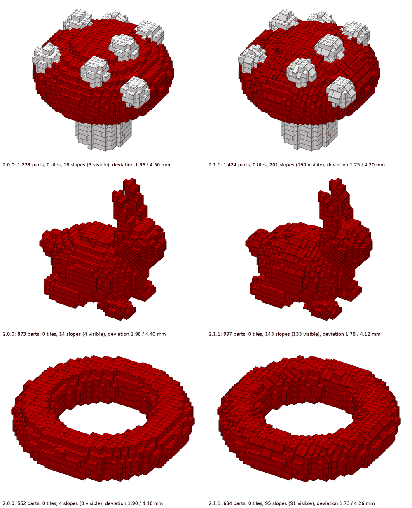

# Projektstatus

Stand: 2026-11-16 · **ROADMAP 8 – mehr Dachsteine ([#51](https://github.com/leckermatz79/mesh2brick/issues/51)): fertig, PR wartet auf dich** (Ziel-Release 2.1.0) · davor [2.0.0 veröffentlicht](https://github.com/leckermatz79/mesh2brick/releases/tag/v2.0.0) (Fliesen standardmäßig an) · Nächster Schritt: deine zwei Fragen unten, dann Merge und Tag v2.1.0
Repo: https://github.com/leckermatz79/mesh2brick (öffentlich) · Plan: [PLAN.md](PLAN.md) · Messwerte: [benchmarks.md](benchmarks.md) · [Beispielgalerie](gallery/README.md) · Was 1.0 kann: [CHANGELOG.md](../CHANGELOG.md)

## Fazit in zwei Sätzen

- **Runde Formen bekommen jetzt Dachsteine, und zwar nur dort, wo ein Dachstein näher am 3D-Modell liegt als die Voxelstufe:** Kugel, Hase, Fliegenpilz und Torus kommen ihrem Modell im Mittel 9–13 % näher (Kugel 2,05 → 1,86 mm), statt 10 sind jetzt 1.080 Dachsteine von außen sichtbar, und alle 15 Läufe bleiben ein stabiles Stück.
- Kästen, Burg und Herz sind Teil für Teil und Pixel für Pixel wie in 2.0.0; der Preis sind mehr Teile (+8 % bis +31 %), darum die erste Frage unten.

## Erledigt: ROADMAP 8 – mehr Dachsteine (Issue #51, PR offen)

- **Zuerst gemessen: legolizations ältere Variante `smooth`.** Sie setzt an runden Modellen 13–27 sichtbare Dachsteine, bei gleicher Teilezahl und stabil, **aber die Abweichung sinkt nicht** (Kugel 2,05 → 2,06 mm, Rakete 1,46 → 1,48 mm). Sie schaut nur auf die Voxel: Bei etwa der Hälfte der Stufen liegt das 3D-Modell dort, wo die Stufe schon näher ist als ein Dachstein.
- **Dabei zwei Fehler in der 2.0-Messgröße gefunden und behoben.** (1) Dachsteine auf der Innenwand hohler Modelle (dorthin setzt legolization die meisten seiner Dachsteine) wurden als Außenfläche gemessen. Die runden Modelle standen in 2.0.0 deshalb zu schlecht da (Kugel 2,35 statt 2,05 mm, Hase 2,04 statt 1,96 mm). (2) Steht neben einem Dachstein ein höherer Stein, ist dessen Seite über der Schräge sichtbar. Diese Fläche fehlte in der Messung und in den Bildern; dort sah man kleine weiße Löcher. Beides ist korrigiert. Alle Vergleiche hier messen 2.0.0 neu mit der korrigierten Messgröße. Kästen, Burg und Duo ändern sich dadurch nicht.
- **Der neue Dachstein-Nachlauf** (eigener Code nach legolizations Platzierung, wie bei den Fliesen; legolization selbst ist unverändert):
  - Beim Voxelisieren prüft mesh2brick jede mögliche Dachstein-Stelle am 3D-Modell: Ist die Fläche dort geneigt und fällt sie in Richtung des Dachsteins ab? Wie viel weniger weicht der Dachstein entlang der senkrechten Strahlen vom Modell ab als die Stufe? Nur Stellen, die mindestens 0,5 mm näher kommen, sind Kandidaten.
  - Nach der Platzierung setzt mesh2brick die besten zuerst: 45° (3040b, zwei nebeneinander als 3039) oder 33° (4286). Ein Dachstein darf die Kante einer Stufe abschneiden oder die Ecke über einer Stufe füllen; dabei kommt Material über die Voxelform hinaus dazu, wo das Modell es hat (dein OK vom 2026-11-15).
  - Die Steine darunter werden zugeschnitten, der Rest wird aus gleich hohen Steinen derselben Farbe neu gebaut und, wo möglich, wieder mit Nachbarn zu größeren Steinen verbunden. Ein Dachstein darf höchstens 2 Teile mehr kosten, und das Modell muss ein Stück bleiben. Danach wird die Stabilität des ganzen Modells neu geprüft; hält es nicht, werden die Dachsteine zurückgenommen. Das ist in keinem Lauf passiert.
  - **Farben:** Gibt es den Dachstein in der Farbe nicht, bleibt die Stufe, und der Lauf zählt sie. Duo: 38 Stufen (bei 48 Noppen 93), weil es 3039 und 4286 nicht in Bright Green gibt. Das übernimmt ROADMAP 12. Neu ist auch: Duo bekommt Dachsteine überhaupt erst jetzt (vorher schloss die Farbregel sie fürs ganze Modell aus).
  - **Zeit:** Fehlt die Zeit für die Stabilitätsprüfung, wird der Nachlauf übersprungen, und Kommandozeile und Deckblatt sagen „Dachsteine übersprungen: Zeitgrenze; empfohlen --time 10min“. Das ist in keinem Lauf passiert.
- **Darstellung und Export:** Dachsteine in allen vier Richtungen in Vorschau, Schrittbildern, „zuerst“-Feldern und Teilekasten („Dachstein 2 × 2“ usw. mit BrickLink-/Rebrickable-Nummer); LDraw-Datei streng wieder eingelesen, Teilelisten stimmen (alle 15 Läufe).
- **Teileschätzung** von `inspect` zählt die Dachsteine jetzt mit; 15 von 15 Läufen im angezeigten Bereich.
- **Einstellungen:** `parts.slopes: mesh` (neu, Standard), `preserve` (wie 2.0.0), `smooth` (legolizations alte Variante); `parts.slopes_max_share` begrenzt die Mehrteile (aus, siehe Frage 1). README (de/en), Beispiel-Config und SPEC §4 erklären es. Begründung: [ADR 0021](adr/0021-slopes-where-they-bring-the-model-closer-to-the-mesh.md).

| Abnahme (Issue #51) | Ergebnis |
|---|---|
| Erst messen: `smooth` statt `preserve` auf allen Testmodellen | **ja**: viele sichtbare Dachsteine, gleiche Teilezahl, stabil, aber keine geringere Abweichung (Tabelle in [benchmarks.md](benchmarks.md), „Slopes (ROADMAP 8)“) |
| Kugel, Hase, Fliegenpilz: Abweichung (Mittel und 95 %) messbar niedriger, 14 von 14 stabil | **ja**: Kugel 2,05 / 4,59 → 1,86 / 4,33 mm, Hase 1,96 / 4,40 → 1,78 / 4,12, Fliegenpilz 1,96 / 4,50 → 1,75 / 4,20; **15 von 15** ein stabiles Stück |
| Sichtbare Dachsteine je Modell deutlich mehr, Zahl ausweisen | **ja**: Hase 4 → 133, Kugel 0 → 272, Fliegenpilz 5 → 197, Torus 0 → 165, Vertex-Kugel 0 → 279, Rakete 0 → 33, Duo 0 → 109 (alle Testmodelle zusammen 10 → 1.080) |
| Hase höchstens doppelt so lange; Burg und Texturwürfel unter 5 Minuten | **ja**: Hase 122 → 138 s (1,13-fach); Burg 249 s, Texturwürfel 243 s |
| Kästen und L-Winkel pixelgleich wie 2.0.0 | **ja**: Würfel (STEP, STL), Texturwürfel, L-Winkel, zwei Körper, dazu Burg und Herz: gleiche Teile, gleiche Schritte, gleiche Bilder |
| Teilezuwachs ausweisen, Richtwert +15 % | **teilweise**: Rakete +8 %, Duo +10 % / +15 %, Hase +14 %, Fliegenpilz +16 %, Kugeln +22 %, **Torus +31 %**; der Lauf meldet alles über 15 % (siehe Frage 1) |
| Dachsteine, die es in der Farbe nicht gibt, bleiben Stufen und werden gezählt | **ja**: Duo 38 (32 Noppen) / 93 (48 Noppen) Stufen, Farbe Bright Green, 3039 und 4286 |
| Abweichung nirgends schlechter | **ja**: Rakete 1,46 → 1,35 mm, Duo 1,72 → 1,61 (32) und 1,76 → 1,64 (48), Burg, Kästen, Herz unverändert |
| Tests: Neigung an Keil 45°, Keil 30°, Kuppel; Ersetzen mit Stabilitätsprüfung; Rücknahme | **ja**: 51 neue Tests, 927 grün |
| Darstellung, Exporte, Schichtschritte, „zuerst“-Felder | **ja** (siehe oben) |
| Texturwürfel-PDF unter 10 MB | **ja**: 9,83 MB (unverändert) |

## Messwerte 2.1 (Release-Lauf, Standardeinstellungen, am Netz)

| Modell | Teile 2.0.0 → 2.1 | Dachsteine (sichtbar) | Abweichung Mittel / 95 % in mm | Zeit |
|---|---|---|---|---|
| Hase | 873 → 997 (+14 %) | 14 (4) → 143 (133) | 1,96 / 4,40 → 1,78 / 4,12 | 122 → 138 s |
| Kugel | 1.499 → 1.826 (+22 %) | 46 (0) → 318 (272) | 2,05 / 4,59 → 1,86 / 4,33 | 263 → 261 s |
| Vertex-Kugel | 1.519 → 1.856 (+22 %) | 46 (0) → 325 (279) | 2,06 / 4,58 → 1,86 / 4,35 | 261 → 263 s |
| Fliegenpilz | 1.239 → 1.431 (+16 %) | 16 (5) → 208 (197) | 1,96 / 4,50 → 1,75 / 4,20 | 255 → 261 s |
| Torus | 552 → 723 (+31 %) | 4 (0) → 169 (165) | 1,90 / 4,46 → 1,65 / 4,12 | 33 → 46 s |
| Rakete | 263 → 285 (+8 %) | 0 → 33 (33) | 1,46 / 3,18 → 1,35 / 3,18 | 18 → 20 s |
| Duo, 32 Noppen (nur lokal) | 1.081 → 1.190 (+10 %) | 0 → 109 (109) | 1,72 / 4,23 → 1,61 / 4,03 | 143 → 156 s |
| Duo, 48 Noppen, 20 min (nur lokal) | 2.308 → 2.650 (+15 %) | 0 → 311 (311) | 1,76 / 4,29 → 1,64 / 4,09 | 1.151 → 1.160 s |
| Würfel, Texturwürfel, L-Winkel, zwei Körper, Burg, Herz | unverändert | unverändert | unverändert | gleich (±4 s) |

Bilder: `out/slopes/vorher-nachher/` (alle Modelle, links 2.0.0, rechts 2.1; Duo nur lokal), Galerie neu mit Dachsteinen. Alle Läufe in `out/slopes/mesh/`, die Grundlinie `smooth` in `out/slopes/smooth/`.

## Davor: 2.0.0 (veröffentlicht 2026-11-15)

- Fliesen standardmäßig an: Wo das 3D-Modell flach ist, liegen glatte Fliesen auf der Höhe der Fläche (Kästen 0,00 mm Abweichung, Burghof und Bergfried glatt); Teile über den Rand einer flachen Fläche werden dort geteilt, eine Fläche bekommt Fliesen nur, wenn mindestens 85 % davon fliesbar sind; Rand-Noppen ist Standard (deine Wahl). Studio-Prüfung von dir bestanden (Duo, keine Überlappungen, keine schwebenden Fliesen). Einzelheiten in [CHANGELOG.md](../CHANGELOG.md) (1.7.0 und 2.0.0) und [ADR 0020](adr/0020-tiles-on-flat-tops.md).

## Als Nächstes

1. **Deine zwei Fragen unten**, dann Merge, Tag v2.1.0 und Release-Seite (Befehle im PR).
2. **ROADMAP 10 – runde Teile** (Reihenfolge in 2.0: 9, 8, dann 10, 11, 12, 13). Die Messgröße zeigt, wo es noch hängt: die Unterseiten runder Formen (dort bräuchte es umgedrehte Dachsteine, die legolizations Katalog nicht hat) und die Stufen, die ein Dachstein zu teuer machen würde. ROADMAP 12 (Farben schon beim Platzieren) bekommt die gezählten Stufen von Duo als Ausgangspunkt. Upstream: Antworten auf legolization #88/#89, #90/#91 und #99 sowie trimesh #2669 abwarten.

Alle früheren Punkte (1.x, Roadmap 1–8 der ersten Liste) sind fertig; Einzelheiten in [CHANGELOG.md](../CHANGELOG.md) und in den [Issues mit Label `roadmap`](https://github.com/leckermatz79/mesh2brick/issues?q=label%3Aroadmap).

## Bekannte Einschränkungen

| Was | Einschätzung |
|---|---|
| KI-Texte können plausibel klingen und trotzdem ungenau sein (z. B. „links“ statt „hinten“). Die Prüfung erkennt falsche Teile und Mengen, aber keine falsche Richtung; Claude sieht nicht jedes Schrittbild. | akzeptieren; mit Bewertungen und Notizen nachsteuern |
| Die KI legt selten Schritte zusammen: Die kleinen hat mesh2brick schon vorher zusammengelegt, und die übrigen Nachbarn verdecken sich meist gegenseitig. | akzeptieren; der Nutzen liegt in Abschnitten und Texten |
| Für Claude-Modelle, deren Preise mesh2brick nicht kennt, gilt die Kostengrenze nicht (der Lauf sagt das). | Preistabelle bei neuen Modellen ergänzen |
| Große Modelle prüfen ihre Zwischenstände in der Zeit, die nach der Platzierung bleibt. In 5 Minuten schaffen die größten Testmodelle 35–76 % (Texturwürfel, Würfel, Burg, Vertex-Modell, Kugel; mit Fliesen und Dachsteinen etwas weniger, weil sie selbst geprüft werden und mehr Teile bringen: Kugel 135 von 242, Fliegenpilz 149 von 200); die ungeprüften stehen oben im Modell. Deckblatt und Kommandozeile sagen, wie viele geprüft sind. | `--time 20min` prüft alle; kein eigener Code nötig |
| Während der Prüfung rechnet mesh2brick auf allen Kernen bis auf einen (bis zu einige Minuten, Lüfter hörbar). | von dir so gewollt (2026-11-09) |
| Kleine Modelle (bis 500 Teile) nutzen weiter legolizations Suche; die geprüfte Schichtfolge wäre auch dort schneller und bräuchte seltener eine Hand (Rakete: 0 statt 11 Schritte). | von dir so entschieden (2026-11-09); Wiedervorlage bei 2.x Punkt 17 |
| Hängen mehrere vorher zusammengesteckte Teile aneinander, wird ein Schritt größer (Kugel bei 32 Noppen: einmal 18 Teile, sonst meist höchstens 10). | selten; eigener Code, falls es stört |
| Bei kleinen Modellen übernimmt legolization die Reihenfolge, bei großen die geprüfte Schichtfolge. Wo die Stabilitätsrechnung „braucht Stütze“ meldet, steht im PDF „Halte das Modell fest“. | akzeptiert |
| „Teile weglassen“ gilt fürs ganze Modell, nicht pro Farbe. | Upstream #9 (nach #8) |
| 1×1-Stein und 1×1-Platte lassen sich weder weglassen noch aufteilen. Gibt es sie in einer Modellfarbe nicht, meldet die Teileliste das. | selten; akzeptiert |
| legolization setzt nur Platten bis 2×8. Größere Platten würden Teile sparen. | Upstream-Kandidat #10 |
| Reine Computer-Grundfarben landen teils auf Nachbarfarben (#FF0000 → „Reddish Orange“). | von dir als Farbmetrik akzeptiert |
| Bemalte Farben aus dem Slicer und Texturen in 3MF werden noch nicht gelesen. | bei Bedarf |
| Eine flache Fläche bekommt Fliesen nur, wenn mindestens 85 % von ihr glatt werden können. Teile über den Rand werden geteilt, aber nur, wenn ein Teil darüber oder darunter den Schnitt hält und das Modell nicht getrennt wird. Bei Duo mit 48 Noppen reicht das nicht: sein Sockel behält alle Noppen. Bei der Burg behalten die Turmränder Noppen (Rand-Noppen, deine Wahl). | akzeptieren; Turmränder mit Fliesen: `--set parts.tiles_overhang=true` |
| L-Winkel und zwei Körper brauchen mit Fliesen knapp 16 % mehr Teile (Richtwert 15 %); der Lauf sagt das. | von dir als Richtwert festgelegt (2026-11-11) |
| Fliesen nur auf waagerechten Flächen. Schräge Flächen bekommen seit 2.1 Dachsteine, aber nur in den drei Neigungen, die legolization kennt (45° und 33°); ein flaches Dach (unter 8°) behält Noppen. | akzeptieren |
| Kleine Modelle mit vielen umgebauten Steinen brauchen etwas länger, weil legolizations Schrittsuche mehr Teile sieht (L-Winkel 30 → 38 s, zwei Körper 163 → 182 s). | akzeptieren |
| Liegt eine flache Fläche mehr als eine Platte von der Voxel-Oberkante entfernt, kommt die Fliese nur eine Platte näher (nur bei der Burg, 32 von 375 Fliesenfeldern). Platten werden nie tiefer gelegt. | akzeptieren |
| Dachsteine kosten Teile: Wo ein Dachstein sitzt, werden die Steine darunter zugeschnitten (im Schnitt gut 1 Teil mehr pro Dachstein). Runde Modelle haben +8 % bis +31 % Teile (Torus am meisten); der Lauf meldet alles über +15 %. Stellen, die mehr als 2 Teile kosten würden, behalten ihre Stufe (30–200 je rundem Modell). | deine Frage 1; Grenze einstellbar mit `--set parts.slopes_max_share=0.15` |
| Nur nach oben gerichtete Flächen bekommen Dachsteine. Die Unterseiten runder Formen (untere Kugelhälfte, Unterseite des Fliegenpilz-Huts) behalten Stufen: Umgedrehte Dachsteine gibt es in legolizations Katalog nicht. | ROADMAP 10 oder später (eigene Teile im Katalog) |
| Dachsteine nur bei geschlossenen 3D-Modellen (innen und außen müssen klar sein) und in Steinhöhe; offene Netze (die Burg aus überlappenden Kästen) und `voxel.height_unit: plate` bekommen nur legolizations eigene Dachsteine. | akzeptieren; bei Bedarf eigener Code |
| Dachsteine, die LEGO in einer Farbe nicht herstellt, bleiben Stufen (Duo: 38 Stufen in Bright Green, 3039 und 4286). | ROADMAP 12 (Farben schon beim Platzieren) |
| Voxelisieren, PDF und Vorschau werden nicht abgebrochen; für sie hält mesh2brick Zeit frei (20 s + 0,03 s pro Teil, gemessen reichte das überall). Auf einem viel langsameren Rechner kann die Umwandlung die Grenze um einen Teil der PDF-Zeit überschreiten; die Kommandozeile sagt das dann. | akzeptieren |
| Wird ein Modell an der Zeitgrenze abgeschnitten, hat es meist etwas mehr Teile (die letzte Optimierung spart Teile) oder ist im ungünstigsten Fall nicht auf Stabilität geprüft. Deckblatt und Kommandozeile sagen das. | mehr Zeit geben (`--set placement.time_limit_s=1200`); Upstream-Kandidat #5 |
| Der schnellere Rechenweg und das Mitlesen der Zwischenstände sind lokale Eingriffe in legolization (UPSTREAM #2 und #5). Ändert legolization diese Stellen, meldet mesh2brick das beim Start. | bei Upstream vorschlagen (#5), wenn #88/#89 Antwort haben |
| Große geschlossene Körper (Würfel, der die ganze 32-Noppen-Box füllt) brauchen für die Platzierung etwa 3 Minuten; den Rest der 5 Minuten verwenden sie für die Prüfung. Auf einem langsameren Laptop bleibt weniger für die Prüfung oder sie werden an der 5-Minuten-Grenze abgeschnitten (bestes stabiles Modell bis dahin), statt länger zu dauern. | Standard bleibt 32 Noppen |
| Der Texturwürfel liegt mit 9,8 MB knapp unter 10 MB; ein noch größerer geschlossener Körper bei 32 Noppen kann darüber liegen. Der Release-Benchmark warnt dann (kB pro Schritt). | akzeptieren; bei Bedarf 100 dpi für sehr große Modelle |
| Die Teileschätzung von `inspect` hängt an legolizations Verhalten. Bei hohlen Böden bis etwa 30 × 30 Noppen baut legolization den Boden mal aus Platten, mal aus kleinen Steinen; dort ist der Bereich breiter (zwei Körper: Faktor 3,9). Nach einem legolization-Update kann sie danebenliegen. | `convert` gibt die genaue Zahl; nach Updates `scripts/benchmark_estimate.py` laufen lassen |
| Spitze Formen werden mit `--size` etwas niedriger als gewünscht: Eine Spitze, die nicht einmal eine halbe Zelle füllt, fällt weg (dieselbe Regel wie bei allen dünnen Details). Rakete: 38,4 statt 40 cm, ihr fehlen oben 2 Lagen der Nasenspitze. Duo trifft die Höhe auf einen halben Stein genau. `inspect` zeigt die echte Höhe vorher. | akzeptieren; eigener Code (Größe nachregeln), falls es stört |
| `.blend`: Blender muss installiert sein. Die Tests mit echtem Blender laufen nur hier auf dem Mac; die automatischen Tests auf GitHub nutzen einen Blender-Ersatz. Verknüpfte Bibliotheken müssen vom Ordner der Datei aus erreichbar sein. | akzeptieren |
| glTF mit Draco-Kompression kann trimesh nicht lesen. | bei Bedarf; in Blender ohne Kompression exportieren |

## Umgebung (gut zu wissen)

- Die Python-Umgebung liegt außerhalb von Nextcloud (`.venv` ist ein Symlink nach `~/.local/share/venvs/mesh2brick`).
- Die LDraw-Teilebibliothek liegt in `~/Library/Caches/pyldraw3`, der Zwischenspeicher für Teilebeschreibungen in `~/Library/Caches/mesh2brick`. `samples/` (Duo) ist von Git ausgeschlossen.
- STEP braucht einmalig `uv sync --extra step`, die KI-Schicht `uv sync --extra llm` (beides zusammen: `uv sync --extra step --extra llm`) und `ANTHROPIC_API_KEY`.
- Der Bewertungsspeicher liegt in `~/Library/Application Support/mesh2brick/feedback.sqlite3` (anderer Ordner mit `MESH2BRICK_DATA_DIR`).
- Die Galeriebilder der PDF-Seiten entstehen mit `pdftoppm` (Homebrew-Paket poppler).
- Lange Messläufe brauchen einen offenen Deckel: Zugeklappt auf Akku schläft der Laptop, und die Prüfprozesse bekommen kaum Rechenzeit (so geschehen beim ersten 1.4-Lauf; die Duo-Fälle wurden wiederholt).
- Blender 4.0.1 liegt unter `/Applications/Blender.app` und wird automatisch gefunden. Ein anderes Blender: `MESH2BRICK_BLENDER=/pfad/zu/blender`.
- Galerie und Abnahme neu erzeugen: `uv run python scripts/benchmark_release.py --out out/release` (dauert etwa 30 Minuten), dann `uv run python scripts/make_gallery.py --results out/release`.

## Deine Entscheidungen

| Datum | Frage | Entscheidung |
|---|---|---|
| 2026-11-01 | Erster echter Testfall? | Duo (Eule aus `samples/`), **nur lokal**: nicht im Repo, nicht in der Galerie. |
| 2026-11-01 | Typische Modellgröße? | **32 Noppen** auf der längsten Achse (≈ 26 cm) als Standard, 48 erst später. |
| 2026-11-01 | LeoCAD für PDF-Schrittbilder installieren? | **Ja**, per Homebrew zu Beginn von Phase 2. Leider nicht möglich (s. o.). |
| 2026-11-01 | Fehlerbericht #2 bei legolization einreichen? | **Ja**, plus PR-Entwurf für das Zeitlimit; mit Hinweis, dass das Problem in einem Vibe-Coding-Projekt aufgefallen ist. Erledigt: Issue #88, Draft-PR #89. |
| 2026-11-01 | Wie lange darf eine Umwandlung dauern? | **5 Minuten.** Phase 2: Duo unter 5 Minuten als Zielmarke, Hebel per Benchmark wählen. Erreicht: 110 s (mit KI-Schicht 161 s). |
| 2026-11-01 | Manuelle Prüfung der `.ldr` in BrickLink Studio? | **Ja, Screenshot kommt später.** Bis dahin gilt der strenge Wieder-Einlese-Test als Prüfung. |
| 2026-11-01 | LeoCAD manuell installieren und nutzen? | **Nein.** Schrittbilder kommen vom eigenen Renderer. |
| 2026-11-01 | Schichtschritte für große Modelle (> 500 Teile)? | **Ja**, in Ordnung. |
| 2026-11-01 | STEP-Zusatzpaket mit 70 MB (über der 50-MB-Regel)? | **In Ordnung.** Ein vollständiger CAD-Kern rechtfertigt die Größe, er wird nur bei Bedarf installiert. Die Rückfrage war richtig: So soll die 50-MB-Regel funktionieren. |
| 2026-11-01 | Farben aus dem Modell automatisch übernehmen? | **Ja.** Einfarbig bleibt per Config erreichbar (`color.mode: single`). |
| 2026-11-01 | Gängige LEGO-Farben statt exakter Farbtöne? | **Ja.** Eine Anleitung, deren Steine man nicht kaufen kann, ist wertlos. Für Spezialfälle gibt es `color.palette: all`. |
| 2026-11-01 | Reines #FF0000 wird „Reddish Orange“ | **Kein Bug, sondern Farbmetrik.** Optional in Phase 4: kleine Ausnahmetabelle für reine Primärfarben. Erwähnen, nicht priorisieren. |
| 2026-11-01 | Upstream-Vorschlag „erlaubte Teile direkt angeben“ (#8) einreichen? | **Ja, einreichen.** Derselbe Fall wie #88/#89, und den lokalen Patch will man nicht dauerhaft pflegen. Im Issue kurz auf #89 verweisen, weil der Maintainer dort noch nicht reagiert hat, damit er den Zusammenhang sieht. Erledigt: Issue #90, Draft-PR #91. |
| 2026-11-01 | Steine, die es in einer Farbe nicht gibt, automatisch ersetzen? | **Ja, als Zwischenlösung** (1×8 → 2× 1×4, danach Stabilitätsprüfung). Sauber wäre, die Farbverfügbarkeit schon bei der Platzierung zu kennen (hängt am selben Upstream-Thema). **Phase 5 vergleicht beides im Benchmark an Duo:** Aufteilen danach gegen Einschränken davor. |
| 2026-11-01 | Manuelle Prüfung in BrickLink Studio | **Erledigt** (Duo, lokal): keine Überlappungen, keine Duplikate, 0 Stabilitätsprobleme, 31 Clutch-Hinweise (Flügel, Füße). Import hängt auf dem Mac, Datei → Öffnen geht (README). Schrittgrößen → Phase 6. |
| 2026-11-07 | Schritte pro Seite und Optik der Anleitung? | **2 Schritte pro Seite, Optik bleibt so.** |
| 2026-11-07 | Teile unter Überhängen: im selben Schritt oder eigener Mini-Bauabschnitt? | **Im selben Schritt** (vorher in der Hand zusammenstecken, gelbes „zuerst“-Feld). |
| 2026-11-07 | Farbnamen in der deutschen Anleitung? | **Englisch plus deutscher Name in Klammern** („Bright Green (Hellgrün)“). Umgesetzt in Phase 7. |
| 2026-11-07 | KI-Schicht standardmäßig einschalten? | **Nein**, bleibt aus (einschalten mit `--set llm.enabled=true`). |
| 2026-11-07 | Anrede in den Schritttexten? | **„du“** („Setze den Hut auf den Stiel.“). |
| 2026-11-07 | Bauabschnitte auf dem Deckblatt? | **Ja**, als Übersicht mit Seitenzahlen. Umgesetzt im Nachtrag zu Phase 7. |
| 2026-11-07 | Phase 7: Zugang zur Anthropic-API? | **`ANTHROPIC_API_KEY` ist gesetzt.** Für Entwicklung und Messungen dieser Phase wurden insgesamt etwa 1,05 $ verbraucht. |
| 2026-11-07 | Fehlerbericht an trimesh (#14) einreichen? | **Ja.** trimesh ist groß und aktiv gepflegt, da kommen Antworten. Wie bei legolization: Text überfliegen, dann den fertigen Befehl ausführen. Erledigt: [Issue #2669](https://github.com/mikedh/trimesh/issues/2669). |
| 2026-11-07 | Was nach 1.0 zuerst? | **[ROADMAP.md](../ROADMAP.md)**: 1.x = große Modelle (Größe in cm, harte Zeitgrenze, Stabilitätsprüfung, PDF-Größe, Schätzung), 2.0 = Formtreue (Dachsteine, Tiles, Rundungen, SNOT), 2.x = Robustheit und Anleitung. Grund: Wer 40 cm will, bekommt heute gar nichts. 2.0 ist vor allem für Familienbauten; ein persönliches Teilelager ist nicht Teil des Plans; Fork oder Warten bei legolization entscheidest du, wenn der erste 2.0-Punkt daran hängt. |
| 2026-11-07 | Eigenes Modell in der Galerie? | **Duo nein.** Ein selbst entworfenes Fusion-Modell wäre das beste Schaufenster (echtes CAD-Teil statt Testkörper). Es gibt keins (Fusion lässt sich hier nicht ohne Oberfläche steuern), also bleibt die Galerie bei den Testmodellen. |
| 2026-11-07 | Roadmap 1: Was meint „30 cm“? | **Die Höhe.** So denkt man über eine Figur; die längste Kante bleibt über `target_studs` (`--size 40studs`) erreichbar. |
| 2026-11-07 | Eigene kurze Option für die Größe? | **Ja, `--size 30cm`**, versteht auch `300mm` und `40studs`; `--set input.target_cm=30` tippt niemand gern zweimal. Umgesetzt; in der Config heißt der Wert `target_height_cm`, damit klar ist, dass er die Höhe meint. |
| 2026-11-07 | Große Modelle automatisch länger rechnen lassen? | **Nein, aber ein Hinweis.** Vorhersehbares Verhalten ist wichtiger: 5 Minuten sind 5 Minuten. `inspect` und der Start von `convert` sagen ab rund 2.000 geschätzten Teilen „expected about 3,905 parts; recommended: --time 20min“; du entscheidest. Umgesetzt. |
| 2026-11-07 | Kurze Option für die Zeit? | **Ja, `--time 20min`** (auch `90s`, `1h`), aus demselben Grund wie `--size`: Was man beim Ausprobieren tippt, verdient eine kurze Option. Umgesetzt. |
| 2026-11-07 | Schnelleren Rechenweg bei legolization vorschlagen? | **Ja, nach deinem Blick auf den Text.** Er benennt die Ursache statt des Symptoms und ist damit wertvoller als unser Zeitlimit-PR. Kommentar an #89, Verweis in #88. **Erledigt** von dir: [Kommentar an #89](https://github.com/hbmartin/legolization/pull/89#issuecomment-6712391855), [Verweis in #88](https://github.com/hbmartin/legolization/issues/88#issuecomment-6712393969). |
| 2026-11-07 | Vor Roadmap 3: Ist der Slope-Hänger dasselbe Crossover-Problem? | **Gemessen:** nein, ein Simplex-Problem, aber derselbe Ausweg hilft (Hase mit Dachsteinen 147 s → 17,5 s). Vorschlag: Löserreihenfolge zuerst. |
| 2026-11-07 | Reihenfolge nach der Slope-Messung? | **Erst Löserreihenfolge + Dachsteine wieder an als 1.3.0, dann Roadmap 3.** Vorher „Simplex 1 s, dann Innere-Punkte-Löser“ messen; kleine Modelle dürfen nicht spürbar langsamer werden, die 5-s-Grenze pro Versuch bleibt. Dachsteine nur standardmäßig an, wenn alle Testmodelle stabil sind und höchstens die doppelte Zeit brauchen. ROADMAP Punkt 8 ist in die 1.x-Liste gerückt; mehr Dachsteine setzen bleibt in 2.0. |
| 2026-11-09 | Kleine Modelle auch auf die geprüfte Schichtfolge umstellen? | **Nein**, bis 500 Teile bleibt legolizations Suche wie in 1.3. Zum Vergleich die Rakete beide Male als PDF (Befehle unter „Offene Kleinigkeiten“). **Wiedervorlage bei 2.x Punkt 17** (geometrische Baugruppen). |
| 2026-11-09 | Alle Kerne für die Prüfung? | **Ja, alle bis auf einen.** Keine Einstellung dafür. |
| 2026-11-09 | legolization-Issue zu den drei Funden einreichen? | **Ja**, nach deinem Blick auf den Text; mit Halbsatz-Verweis auf #88/#89 (ergänzt). Befehl unter „Offene Kleinigkeiten“. |
| 2026-11-09 | Schrittbilder großer Modelle: schon gebaute Teile ohne Fugen? | **Ja, aber nur für große Modelle** (über 500 Teile), dazu 110 dpi und die sparsamere Farbpalette; kleine Modelle bleiben wie 1.4. Gewählt auf einer Vergleichsseite (wie 1.4 / unsichtbar sparsamer / ohne Fugen). |
| 2026-11-10 | Dürfen die Würfel den Zeithinweis verlieren (Roadmap 5)? | **Ja.** Der Hinweis bleibt an die Schwelle von 2.000 erwarteten Teilen gebunden. Die Würfel werden in gut vier Minuten fertig, und ein knappes Zeitbudget führt seit 1.4 nur zu weniger geprüften Zwischenständen, nicht zum Abbruch. |
| 2026-11-10 | Welcher 2.0-Punkt zuerst: ROADMAP 8 (mehr Dachsteine) oder 9 (Tiles)? | **Erst 9 (Tiles), dann 8.** Reihenfolge in 2.0: 9, 8, 10, 11, 12, 13. Grund: Tiles brauchen keine Änderung an der Platzierung und keine Upstream-Antwort. [ROADMAP.md](../ROADMAP.md) ist angepasst. |
| 2026-11-11 | Fliesen standardmäßig an (ROADMAP 9)? | **Vorerst aus, Release 1.7.0 wie im PR.** Grund: An der Burg wirkt das Ergebnis fleckig (Turmränder und Teilflächen behalten Noppen). Einschalten mit `tile` in `parts.categories`. |
| 2026-11-11 | Fliesen auch auf Treppen runder Formen? | **Nein.** `parts.tiles: flat` bleibt Standard (`all` nur auf Wunsch). |
| 2026-11-11 | Unterste Lage (Sockel) ohne Fliesen? | **Nein, der Sockel bekommt Fliesen** (`parts.tiles_on_base: true` bleibt Standard). |
| 2026-11-11 | Was kommt vor ROADMAP 8? | **Ein eigenes Issue ([#44](https://github.com/leckermatz79/mesh2brick/issues/44)):** Eine flache Fläche wird nur gefliest, wenn mindestens 85 % ihrer freiliegenden Oberseite fliesbar sind, sonst behält die ganze Fläche Noppen. Abnahme an Burg und Duo per Vergleichsbild durch dich. Überzeugt es, gehen Fliesen standardmäßig an und es wird 2.0.0. |
| 2026-11-11 | KI-Live-Test mit Fliesen (offen aus ROADMAP 9) | **Von dir gemacht:** L-Winkel mit Fliesen, 177 Teile, 39 von 39 Schritttexten, keine Probleme, 6,5 Cent. |
| 2026-11-11 | Überzeugt die 85-%-Regel (#44)? | **B: erst Randteile aufteilen.** Bilder gesehen: Die zwei Körper überzeugen, Burg und Duo haben mit der 85-%-Regel keine Fliesen mehr. Fliesen bleiben vorerst aus. #44 ist geschlossen, weiter in [#46](https://github.com/leckermatz79/mesh2brick/issues/46). |
| 2026-11-11 | Wie sollen Randteile geteilt werden (#46)? | **An der Flächengrenze, bevor die 85-%-Regel greift:** innen Platte + Fliese, außen bleibt der Stein. Erst messen (geteilte Teile und Teilezuwachs je Fläche für Burg und Duo). Höchstens +15 % Teile pro Modell, darüber behält die Fläche Noppen. Stabilität nach dem Teilen neu prüfen, besonders unter Mauern. Die vier Kästen bleiben unverändert. Abnahme durch dich an Vergleichsbildern von Burg und Duo: überzeugt es, Fliesen standardmäßig an und 2.0.0; sonst Variante A (Fliesen an nur mit der 85-%-Regel, 2.0.0). |
| 2026-11-12 | Überzeugt das Teilen am Flächenrand (#46)? | **Ja im Grundsatz:** Fliesen mit Teilen standardmäßig an, Release 2.0.0, aber erst nach drei Bedingungen in einem weiteren PR: (1) **Zeitreserve:** Burg dreimal hintereinander mit Standardeinstellungen (5 min), jedes Mal alle Fliesen da; die Reserve für die Fliesen-Stabilitätsprüfung aus der Teilezahl schätzen statt fester Wert (wie `export_reserve_s`); fallen Fliesen trotzdem der Zeitgrenze zum Opfer, sagen es Kommandozeile und Deckblatt klar („Fliesen übersprungen: Zeitgrenze; empfohlen --time 10min“). (2) **Voxel-Eingaben** (.vox, .npy, .grid.npz) ohne Netz bekommen standardmäßig keine Fliesen (nur mit `parts.tiles=all`); das Herz bleibt bei 12 Teilen. (3) **Burgtürme:** Die vier identischen Türme bekommen vier verschiedene Oberseiten, einer gar keine Fliesen. Je Turm den Grund nennen und gleiche Flächen gleich behandeln; als Variante prüfen, ob Zellen, die höchstens eine Zelle über das Eingabenetz hinausstehen, zur flachen Fläche zählen. Beide Varianten der Burg als Vergleichsbild (`castle-rand-noppen.png`, `castle-rand-fliesen.png`); du entscheidest am Bild. Danach Galerie erneuern, CHANGELOG 2.0.0, STATUS; Befehle mit `git pull` vor dem Tag. |
| 2026-11-15 | Turmränder: Noppen oder Fliesen? | **Rand-Noppen bleibt Standard.** Für die Burg gefallen dir die Noppen auf den Türmen besser; das liegt an dieser Burg, beide Varianten sind sehr gut. „Rand-Fliesen“ bleibt als Einstellung (`--set parts.tiles_overhang=true`). Weiter mit Galerie, CHANGELOG 2.0.0 und Tag. |
| 2026-11-15 | Studio-Prüfung mit Fliesen (Abnahme #42) | **Erledigt** (Duo, 2.0.0, lokal): keine Überlappungen, keine schwebenden Fliesen, Fliesen als „Tile“ angezeigt. 2.0.0 ist veröffentlicht. |
| 2026-11-15 | Wie geht ROADMAP 8 (mehr Dachsteine)? | **Eigener Nachlauf in `place/` wie bei den Fliesen, kein Eingriff in legolization** (damit hängt nichts an einem Upstream-PR, die Fork-Frage stellt sich nicht). Erst `smooth` gegen `preserve` messen; Messgröße ist die Oberflächenabweichung; ein Dachstein darf Material über die Voxelform hinaus hinzufügen, wenn er dem Netz näher kommt; Dachsteine, die es in der Farbe nicht gibt, bleiben Stufen und werden gezählt (für Punkt 12); Burg und Texturwürfel unter 5 Minuten; Teilezuwachs ausweisen, Richtwert +15 %. Ziel-Release 2.1.0. Umgesetzt in [#51](https://github.com/leckermatz79/mesh2brick/issues/51). |

## Fragen an dich

Die Bilder dazu: [gallery/roadmap8b-slopes-2.1.png](gallery/roadmap8b-slopes-2.1.png) und lokal `out/slopes/vorher-nachher/` (alle Modelle, links 2.0.0, rechts 2.1).

1. **Obergrenze für die Mehrteile durch Dachsteine?** Ohne Grenze: Torus +31 % Teile, Kugeln +22 %, Fliegenpilz +16 %, Hase +14 %, Duo +10 %. Mit `--set parts.slopes_max_share=0.15` (die wertvollsten Dachsteine zuerst, der Rest bleibt Stufe): Torus +15 % und 1,74 statt 1,66 mm Abweichung (ein Drittel des Gewinns weg), Kugel +15 % und 1,89 statt 1,87 mm (kaum ein Unterschied). **Standardannahme: keine Grenze, der Lauf meldet nur mehr als +15 %** (wie bei den Fliesen); die Grenze bleibt als Einstellung.
2. **Gefällt dir die Optik der Rundungen?** Dachsteine stehen nur dort, wo sie dem Modell näher kommen. Darum wechseln sich auf einer Rundung Dachsteine und Stufen ab (etwa die Hälfte der Stufen bleibt), und Dachsteine zeigen in alle vier Richtungen. Ganz vereinzelte Dachsteine sind selten (0–3 % an Kugel, Hase, Fliegenpilz, Torus; 7 % an Duo, 12 % an der Rakete). Von der Seite, auf die man blickt, wirkt die Fläche glatter; Schrägen, die vom Betrachter weg abfallen, sieht man nur als schmale Kanten. **Standardannahme: so lassen.** Wenn dir ruhigere Flächen lieber sind, wäre eine Regel wie bei den Fliesen denkbar („nur zusammenhängende Dachstein-Flächen“).

## Offene Kleinigkeiten

- **Upstream-Kandidat #18** (Maske für legolizations `apply_tiles`, auch Steine, alle Fliesengrößen) und **neu #19** (legolizations Dachstein-Durchgang auf vorgegebene Stellen, damit andere eine bessere Bewertung nutzen können): Text steht in [UPSTREAM.md](UPSTREAM.md); einreichen nur nach deinem OK, eilt nicht.
- **Selbst vergleichen:** dasselbe Modell mit und ohne die neuen Dachsteine:
  `uv run mesh2brick convert tests/fixtures/toadstool.obj -o out/pilz-2.1`
  `uv run mesh2brick convert tests/fixtures/toadstool.obj -o out/pilz-2.0 --set parts.slopes=preserve`
- **Rakete im Vergleich** (Wiedervorlage bei 2.x Punkt 17): legolizations Suche (Standard, mit blauen Baugruppen) gegen die geprüfte Schichtfolge mit Mini-Vorbauten:
  `uv run mesh2brick convert tests/fixtures/rocket.blend -o out/rocket-suche`
  `uv run mesh2brick convert tests/fixtures/rocket.blend -o out/rocket-schichten --set steps.sequencing=checked-layers`
  Danach `out/rocket-suche/rocket.pdf` und `out/rocket-schichten/rocket.pdf` nebeneinanderlegen (gemessen: 11 gegen 0 Schritte mit „Halte fest“).
