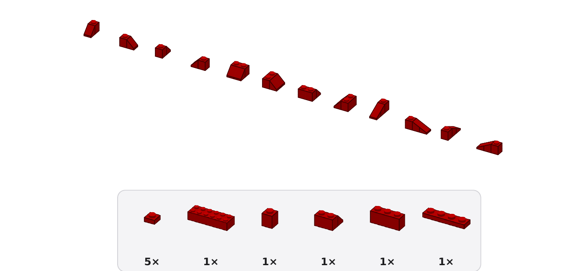

# Projektstatus

Stand: 2026-11-07 · **1.3.0 – Löserreihenfolge + Dachsteine wieder an fertig** ([#34](https://github.com/leckermatz79/mesh2brick/issues/34), ROADMAP Punkt 8) · davor 1.2.0 (harte Zeitgrenze, [Release](https://github.com/leckermatz79/mesh2brick/releases/tag/v1.2.0)) · Nächster Punkt: **Roadmap 3 – Stabilitätsprüfung für große Modelle** ([#26](https://github.com/leckermatz79/mesh2brick/issues/26), [ROADMAP.md](../ROADMAP.md))
Repo: https://github.com/leckermatz79/mesh2brick (öffentlich) · Plan: [PLAN.md](PLAN.md) · Messwerte: [benchmarks.md](benchmarks.md) · [Beispielgalerie](gallery/README.md) · Was 1.0 kann: [CHANGELOG.md](../CHANGELOG.md)

## Fazit in zwei Sätzen

- **Dachsteine sind wieder an, und große Modelle rechnen schneller:** Der Löser probiert erst 3 s den Simplex und dann den Innere-Punkte-Weg ohne Crossover. Kleine Modelle brauchen genauso lange wie in 1.2, große bis zu 32 s weniger (Fliegenpilz 164 → 132 s, Duo 95 → 77 s); mit Dachsteinen bleibt jedes Testmodell stabil und braucht höchstens das 1,45-Fache.
- **Ehrlich dazu:** legolization setzt im heutigen Modus nur wenige Dachsteine, und die meisten liegen innen in der hohlen Wand (von 130 sind 10 von außen sichtbar). Sichtbar mehr Dachsteine bleibt die Arbeit für 2.0.

| Dachsteine werden jetzt als Dachsteine gezeichnet: die drei Sorten in allen vier Drehungen, darunter ein Callout aus der Anleitung des Hasen |
|---|
|  |

## Erledigt (1.3.0, ROADMAP Punkt 8)

- **Erst gemessen, wie von dir verlangt:** „Simplex 1 s, dann Innere-Punkte“ machte kleine Modelle spürbar langsamer (L-Winkel +27 %, Torus doppelt so lang), weil 15 von 89 einfachen Rechnungen im Simplex 1–2,3 s brauchen. Mit **3 s** bleiben sie genau so schnell wie in 1.2. Die 5-s-Grenze für den zweiten Simplex-Versuch bleibt. Die neue Reihenfolge gilt in beiden Rechenwegen von legolization, auch beim Planen der Bauschritte.
- **Deine Bedingungen für „Dachsteine standardmäßig an“ sind erfüllt:** Alle 14 Testmodelle bleiben mit Dachsteinen stabil, aus einem Stück und bestehen alle Prüfungen; die Zeit steigt höchstens auf das 1,45-Fache (Torus), sonst 1,0–1,3. Die 5 Minuten reichen weiter (längster Fall bis 2.000 Teile mit Dachsteinen: Burg 223 s). Ausschalten: `--set "parts.categories=[brick, plate]"`.
- **Dachsteine sehen in Vorschau und PDF wie Dachsteine aus:** Noppen auf der hohen Reihe, Schräge bis zu einer halben Platte hohen Kante, genau wie die LDraw-Teile 3039, 3040b und 4286 (vorher: Quader ohne Noppen).
- **Ehrliche Einschränkung:** Der heutige Modus von legolization tauscht nur Stellen, deren Form genau passt. Bei Kugel, PLY-Modell und Torus liegen deshalb alle Dachsteine innen; beim Hasen sind 4 von 14 außen, beim Fliegenpilz 5 von 16, bei der Burg 1 von 4.
- **Abnahme (Issue #34):**

| Kriterium | Ergebnis |
|---|---|
| Kleine Modelle nicht spürbar langsamer als 1.2 | **ja**: höchstens +0,7 s (Rakete), im Rauschen; größere 8–32 s schneller |
| 5-s-Grenze pro Versuch bleibt | **ja** (Simplex ohne Vorverarbeitung 5 s; der erste Simplex-Versuch 3 s) |
| Dachsteine standardmäßig an: alle stabil, höchstens doppelte Zeit | **ja**: 14 von 14 stabil, höchstens 1,45-fach |
| Dachsteine in Vorschau und PDF als Dachsteine | **ja** |
| 5 Minuten reichen bis 2.000 Teile | **ja**: längster Fall 223 s |

## Messwerte 1.3 (in Klammern 1.2)

| Modell | Teile | Zeit ohne Dachsteine | Zeit mit Dachsteinen (Standard) | stabil |
|---|---|---|---|---|
| Rakete (`.blend`, 32 Noppen) | 263 | 16 s (15 s) | 19 s | ja |
| Hase (32) | 873 | 69 s (71 s) | 81 s | ja |
| Fliegenpilz (32) | 1.240 / 1.239 mit Dachsteinen | 132 s (164 s) | 157 s | ja |
| Kugel (32) | 1.499 | 97 s (109 s) | 126 s | ja |
| STEP-Burg (32, `--config`) | 1.651 / 1.657 | 188 s (202 s) | 223 s | ja |
| STEP-Würfel (32) | 1.952 | 216 s (232 s) | 220 s | ja |
| Texturwürfel (32) | 2.280 | 229 s (246 s) | 231 s | ja |
| Duo (32, nur lokal) | 1.025 | 77 s (95 s) | 78 s | ja |
| Duo (48, nur lokal, 20 min, Stand 1.2) | 2.308 | 733 s | – | ja |

Alle Zahlen: [benchmarks.md](benchmarks.md), Abschnitte „Hard time limit“ und „Solver order and slopes back on“.

## Als Nächstes

Was kommt und in welcher Reihenfolge, steht in [ROADMAP.md](../ROADMAP.md) (von dir, 2026-11-07). Die Punkte 1–7 haben je ein [Issue mit Label `roadmap`](https://github.com/leckermatz79/mesh2brick/issues?q=label%3Aroadmap) (#24–#30) mit Abnahmekriterien, wie die Phasen.

**1.x – große Modelle möglich machen** (keine neuen Steinarten):

1. ~~Roadmap 1 – Größe in Zentimetern~~ ([#24](https://github.com/leckermatz79/mesh2brick/issues/24)): **fertig**, siehe oben.
2. ~~Roadmap 2 – harte Zeitgrenze~~ ([#25](https://github.com/leckermatz79/mesh2brick/issues/25)): **fertig**, siehe oben.
3. ~~Löserreihenfolge + Dachsteine wieder an~~ (ROADMAP Punkt 8, [#34](https://github.com/leckermatz79/mesh2brick/issues/34)): **fertig in 1.3.0**, siehe oben.
4. **Roadmap 3 – Stabilitätsprüfung auch für große Modelle** ([#26](https://github.com/leckermatz79/mesh2brick/issues/26), nächster Punkt): Modelle über 500 Teilen bekommen Schritte Schicht für Schicht ohne Prüfung jedes Zwischenstands. Die schnellere Rechnung aus Punkt 8 hilft hier mit.
5. Roadmap 4 ([#27](https://github.com/leckermatz79/mesh2brick/issues/27)) – kleinere PDFs bei großen geschlossenen Körpern (Ziel < 10 MB).
6. Roadmap 5 ([#28](https://github.com/leckermatz79/mesh2brick/issues/28)) – bessere Teileschätzung in `inspect` (15 von 15 im Bereich).
7. Roadmap 6 ([#29](https://github.com/leckermatz79/mesh2brick/issues/29)) – Bewertungsskala (1–5, 5 = am besten) in Hilfe und README.
8. Roadmap 7 ([#30](https://github.com/leckermatz79/mesh2brick/issues/30)) – Aufräumen: trimesh-Bericht (erledigt, [#2669](https://github.com/mikedh/trimesh/issues/2669)), optional alte Release-Seiten.

**Danach 2.0 – Formtreue:** mehr Dachsteine, Tiles, runde Teile, SNOT (Roadmap 8–13). Upstream: Antworten auf legolization #88/#89 und #90/#91 sowie trimesh #2669 abwarten.

## Bekannte Einschränkungen

| Was | Einschätzung |
|---|---|
| KI-Texte können plausibel klingen und trotzdem ungenau sein (z. B. „links“ statt „hinten“). Die Prüfung erkennt falsche Teile und Mengen, aber keine falsche Richtung; Claude sieht nicht jedes Schrittbild. | akzeptieren; mit Bewertungen und Notizen nachsteuern |
| Die KI legt selten Schritte zusammen: Die kleinen hat mesh2brick schon vorher zusammengelegt, und die übrigen Nachbarn verdecken sich meist gegenseitig. | akzeptieren; der Nutzen liegt in Abschnitten und Texten |
| Für Claude-Modelle, deren Preise mesh2brick nicht kennt, gilt die Kostengrenze nicht (der Lauf sagt das). | Preistabelle bei neuen Modellen ergänzen |
| Große Modelle (> 500 Teile) bekommen Schritte Schicht für Schicht, nicht jeder Zwischenstand ist auf Standfestigkeit geprüft. | von dir akzeptiert; das Deckblatt sagt es in einem Satz; Roadmap 3 |
| Hängen mehrere vorher zusammengesteckte Teile aneinander, wird ein Schritt größer (Kugel bei 32 Noppen: einmal 18 Teile, sonst meist höchstens 10). | selten; eigener Code, falls es stört |
| Bei kleinen Modellen übernimmt legolization die Reihenfolge. Wo es selbst „braucht Stütze“ meldet, steht im PDF „Halte das Modell fest“. | akzeptiert |
| „Teile weglassen“ gilt fürs ganze Modell, nicht pro Farbe. | Upstream #9 (nach #8) |
| 1×1-Stein und 1×1-Platte lassen sich weder weglassen noch aufteilen. Gibt es sie in einer Modellfarbe nicht, meldet die Teileliste das. | selten; akzeptiert |
| legolization setzt nur Platten bis 2×8. Größere Platten würden Teile sparen. | Upstream-Kandidat #10 |
| Reine Computer-Grundfarben landen teils auf Nachbarfarben (#FF0000 → „Reddish Orange“). | von dir als Farbmetrik akzeptiert |
| Bemalte Farben aus dem Slicer und Texturen in 3MF werden noch nicht gelesen. | bei Bedarf |
| Dachsteine sind an, aber legolization setzt nur wenige, und die meisten liegen innen in der hohlen Wand (10 von 130 sichtbar). | eigener Code in 2.0 (ROADMAP Punkt 8, zweiter Teil) |
| Voxelisieren, PDF und Vorschau werden nicht abgebrochen; für sie hält mesh2brick Zeit frei (20 s + 0,03 s pro Teil, gemessen reichte das überall). Auf einem viel langsameren Rechner kann die Umwandlung die Grenze um einen Teil der PDF-Zeit überschreiten; die Kommandozeile sagt das dann. | akzeptieren |
| Wird ein Modell an der Zeitgrenze abgeschnitten, hat es meist etwas mehr Teile (die letzte Optimierung spart Teile) oder ist im ungünstigsten Fall nicht auf Stabilität geprüft. Deckblatt und Kommandozeile sagen das. | mehr Zeit geben (`--set placement.time_limit_s=1200`); Upstream-Kandidat #5 |
| Der schnellere Rechenweg und das Mitlesen der Zwischenstände sind lokale Eingriffe in legolization (UPSTREAM #2 und #5). Ändert legolization diese Stellen, meldet mesh2brick das beim Start. | bei Upstream vorschlagen (#5), wenn #88/#89 Antwort haben |
| Große geschlossene Körper (Würfel, der die ganze 32-Noppen-Box füllt) brauchen etwa 4 Minuten (232–246 s). Auf einem langsameren Laptop werden sie an der 5-Minuten-Grenze abgeschnitten (bestes stabiles Modell bis dahin), statt länger zu dauern. Ihre PDFs sind 20–23 MB groß. | Standard bleibt 32 Noppen; PDF-Größe: Roadmap 4 |
| Die Teileschätzung von `inspect` ist grob (Bereich etwa Faktor 2) und liegt bei dünnen, großen Platten zu niedrig. | `convert` gibt die genaue Zahl; Roadmap 5 |
| Spitze Formen werden mit `--size` etwas niedriger als gewünscht: Eine Spitze, die nicht einmal eine halbe Zelle füllt, fällt weg (dieselbe Regel wie bei allen dünnen Details). Rakete: 38,4 statt 40 cm, ihr fehlen oben 2 Lagen der Nasenspitze. Duo trifft die Höhe auf einen halben Stein genau. `inspect` zeigt die echte Höhe vorher. | akzeptieren; eigener Code (Größe nachregeln), falls es stört |
| `.blend`: Blender muss installiert sein. Die Tests mit echtem Blender laufen nur hier auf dem Mac; die automatischen Tests auf GitHub nutzen einen Blender-Ersatz. Verknüpfte Bibliotheken müssen vom Ordner der Datei aus erreichbar sein. | akzeptieren |
| glTF mit Draco-Kompression kann trimesh nicht lesen. | bei Bedarf; in Blender ohne Kompression exportieren |

## Umgebung (gut zu wissen)

- Die Python-Umgebung liegt außerhalb von Nextcloud (`.venv` ist ein Symlink nach `~/.local/share/venvs/mesh2brick`).
- Die LDraw-Teilebibliothek liegt in `~/Library/Caches/pyldraw3`, der Zwischenspeicher für Teilebeschreibungen in `~/Library/Caches/mesh2brick`. `samples/` (Duo) ist von Git ausgeschlossen.
- STEP braucht einmalig `uv sync --extra step`, die KI-Schicht `uv sync --extra llm` (beides zusammen: `uv sync --extra step --extra llm`) und `ANTHROPIC_API_KEY`.
- Der Bewertungsspeicher liegt in `~/Library/Application Support/mesh2brick/feedback.sqlite3` (anderer Ordner mit `MESH2BRICK_DATA_DIR`).
- Die Galeriebilder der PDF-Seiten entstehen mit `pdftoppm` (Homebrew-Paket poppler).
- Blender 4.0.1 liegt unter `/Applications/Blender.app` und wird automatisch gefunden. Ein anderes Blender: `MESH2BRICK_BLENDER=/pfad/zu/blender`.
- Galerie und Abnahme neu erzeugen: `uv run python scripts/benchmark_release.py --out out/release` (dauert etwa 30 Minuten), dann `uv run python scripts/make_gallery.py --results out/release`.

## Deine Entscheidungen

| Datum | Frage | Entscheidung |
|---|---|---|
| 2026-11-01 | Erster echter Testfall? | Duo (Eule aus `samples/`), **nur lokal**: nicht im Repo, nicht in der Galerie. |
| 2026-11-01 | Typische Modellgröße? | **32 Noppen** auf der längsten Achse (≈ 26 cm) als Standard, 48 erst später. |
| 2026-11-01 | LeoCAD für PDF-Schrittbilder installieren? | **Ja**, per Homebrew zu Beginn von Phase 2. Leider nicht möglich (s. o.). |
| 2026-11-01 | Fehlerbericht #2 bei legolization einreichen? | **Ja**, plus PR-Entwurf für das Zeitlimit; mit Hinweis, dass das Problem in einem Vibe-Coding-Projekt aufgefallen ist. Erledigt: Issue #88, Draft-PR #89. |
| 2026-11-01 | Wie lange darf eine Umwandlung dauern? | **5 Minuten.** Phase 2: Duo unter 5 Minuten als Zielmarke, Hebel per Benchmark wählen. Erreicht: 110 s (mit KI-Schicht 161 s). |
| 2026-11-01 | Manuelle Prüfung der `.ldr` in BrickLink Studio? | **Ja, Screenshot kommt später.** Bis dahin gilt der strenge Wieder-Einlese-Test als Prüfung. |
| 2026-11-01 | LeoCAD manuell installieren und nutzen? | **Nein.** Schrittbilder kommen vom eigenen Renderer. |
| 2026-11-01 | Schichtschritte für große Modelle (> 500 Teile)? | **Ja**, in Ordnung. |
| 2026-11-01 | STEP-Zusatzpaket mit 70 MB (über der 50-MB-Regel)? | **In Ordnung.** Ein vollständiger CAD-Kern rechtfertigt die Größe, er wird nur bei Bedarf installiert. Die Rückfrage war richtig: So soll die 50-MB-Regel funktionieren. |
| 2026-11-01 | Farben aus dem Modell automatisch übernehmen? | **Ja.** Einfarbig bleibt per Config erreichbar (`color.mode: single`). |
| 2026-11-01 | Gängige LEGO-Farben statt exakter Farbtöne? | **Ja.** Eine Anleitung, deren Steine man nicht kaufen kann, ist wertlos. Für Spezialfälle gibt es `color.palette: all`. |
| 2026-11-01 | Reines #FF0000 wird „Reddish Orange“ | **Kein Bug, sondern Farbmetrik.** Optional in Phase 4: kleine Ausnahmetabelle für reine Primärfarben. Erwähnen, nicht priorisieren. |
| 2026-11-01 | Upstream-Vorschlag „erlaubte Teile direkt angeben“ (#8) einreichen? | **Ja, einreichen.** Derselbe Fall wie #88/#89, und den lokalen Patch will man nicht dauerhaft pflegen. Im Issue kurz auf #89 verweisen, weil der Maintainer dort noch nicht reagiert hat, damit er den Zusammenhang sieht. Erledigt: Issue #90, Draft-PR #91. |
| 2026-11-01 | Steine, die es in einer Farbe nicht gibt, automatisch ersetzen? | **Ja, als Zwischenlösung** (1×8 → 2× 1×4, danach Stabilitätsprüfung). Sauber wäre, die Farbverfügbarkeit schon bei der Platzierung zu kennen (hängt am selben Upstream-Thema). **Phase 5 vergleicht beides im Benchmark an Duo:** Aufteilen danach gegen Einschränken davor. |
| 2026-11-01 | Manuelle Prüfung in BrickLink Studio | **Erledigt** (Duo, lokal): keine Überlappungen, keine Duplikate, 0 Stabilitätsprobleme, 31 Clutch-Hinweise (Flügel, Füße). Import hängt auf dem Mac, Datei → Öffnen geht (README). Schrittgrößen → Phase 6. |
| 2026-11-07 | Schritte pro Seite und Optik der Anleitung? | **2 Schritte pro Seite, Optik bleibt so.** |
| 2026-11-07 | Teile unter Überhängen: im selben Schritt oder eigener Mini-Bauabschnitt? | **Im selben Schritt** (vorher in der Hand zusammenstecken, gelbes „zuerst“-Feld). |
| 2026-11-07 | Farbnamen in der deutschen Anleitung? | **Englisch plus deutscher Name in Klammern** („Bright Green (Hellgrün)“). Umgesetzt in Phase 7. |
| 2026-11-07 | KI-Schicht standardmäßig einschalten? | **Nein**, bleibt aus (einschalten mit `--set llm.enabled=true`). |
| 2026-11-07 | Anrede in den Schritttexten? | **„du“** („Setze den Hut auf den Stiel.“). |
| 2026-11-07 | Bauabschnitte auf dem Deckblatt? | **Ja**, als Übersicht mit Seitenzahlen. Umgesetzt im Nachtrag zu Phase 7. |
| 2026-11-07 | Phase 7: Zugang zur Anthropic-API? | **`ANTHROPIC_API_KEY` ist gesetzt.** Für Entwicklung und Messungen dieser Phase wurden insgesamt etwa 1,05 $ verbraucht. |
| 2026-11-07 | Fehlerbericht an trimesh (#14) einreichen? | **Ja.** trimesh ist groß und aktiv gepflegt, da kommen Antworten. Wie bei legolization: Text überfliegen, dann den fertigen Befehl ausführen. Erledigt: [Issue #2669](https://github.com/mikedh/trimesh/issues/2669). |
| 2026-11-07 | Was nach 1.0 zuerst? | **[ROADMAP.md](../ROADMAP.md)**: 1.x = große Modelle (Größe in cm, harte Zeitgrenze, Stabilitätsprüfung, PDF-Größe, Schätzung), 2.0 = Formtreue (Dachsteine, Tiles, Rundungen, SNOT), 2.x = Robustheit und Anleitung. Grund: Wer 40 cm will, bekommt heute gar nichts. 2.0 ist vor allem für Familienbauten; ein persönliches Teilelager ist nicht Teil des Plans; Fork oder Warten bei legolization entscheidest du, wenn der erste 2.0-Punkt daran hängt. |
| 2026-11-07 | Eigenes Modell in der Galerie? | **Duo nein.** Ein selbst entworfenes Fusion-Modell wäre das beste Schaufenster (echtes CAD-Teil statt Testkörper). Es gibt keins (Fusion lässt sich hier nicht ohne Oberfläche steuern), also bleibt die Galerie bei den Testmodellen. |
| 2026-11-07 | Roadmap 1: Was meint „30 cm“? | **Die Höhe.** So denkt man über eine Figur; die längste Kante bleibt über `target_studs` (`--size 40studs`) erreichbar. |
| 2026-11-07 | Eigene kurze Option für die Größe? | **Ja, `--size 30cm`**, versteht auch `300mm` und `40studs`; `--set input.target_cm=30` tippt niemand gern zweimal. Umgesetzt; in der Config heißt der Wert `target_height_cm`, damit klar ist, dass er die Höhe meint. |
| 2026-11-07 | Große Modelle automatisch länger rechnen lassen? | **Nein, aber ein Hinweis.** Vorhersehbares Verhalten ist wichtiger: 5 Minuten sind 5 Minuten. `inspect` und der Start von `convert` sagen ab rund 2.000 geschätzten Teilen „expected about 3,905 parts; recommended: --time 20min“; du entscheidest. Umgesetzt. |
| 2026-11-07 | Kurze Option für die Zeit? | **Ja, `--time 20min`** (auch `90s`, `1h`), aus demselben Grund wie `--size`: Was man beim Ausprobieren tippt, verdient eine kurze Option. Umgesetzt. |
| 2026-11-07 | Schnelleren Rechenweg bei legolization vorschlagen? | **Ja, nach deinem Blick auf den Text.** Er benennt die Ursache statt des Symptoms und ist damit wertvoller als unser Zeitlimit-PR. Kommentar an #89, Verweis in #88. **Erledigt** von dir: [Kommentar an #89](https://github.com/hbmartin/legolization/pull/89#issuecomment-6712391855), [Verweis in #88](https://github.com/hbmartin/legolization/issues/88#issuecomment-6712393969). |
| 2026-11-07 | Vor Roadmap 3: Ist der Slope-Hänger dasselbe Crossover-Problem? | **Gemessen:** nein, ein Simplex-Problem, aber derselbe Ausweg hilft (Hase mit Dachsteinen 147 s → 17,5 s). Vorschlag: Löserreihenfolge zuerst. |
| 2026-11-07 | Reihenfolge nach der Slope-Messung? | **Erst Löserreihenfolge + Dachsteine wieder an als 1.3.0, dann Roadmap 3.** Vorher „Simplex 1 s, dann Innere-Punkte-Löser“ messen; kleine Modelle dürfen nicht spürbar langsamer werden, die 5-s-Grenze pro Versuch bleibt. Dachsteine nur standardmäßig an, wenn alle Testmodelle stabil sind und höchstens die doppelte Zeit brauchen. ROADMAP Punkt 8 ist in die 1.x-Liste gerückt; mehr Dachsteine setzen bleibt in 2.0. |

## Fragen an dich

Zurzeit keine. Deine Antworten zu Roadmap 2 und zur Reihenfolge stehen unter „Deine Entscheidungen“.

## Offene Kleinigkeiten

- **Ältere Release-Seiten** (v0.0.0 bis v0.7.0) fehlen weiterhin; die Tags existieren, v1.0.0 hat seine Seite (Roadmap 7, #30). Befehl für `v0.0.0`:
  `awk '/^## \[0.0.0\]/{f=1;next} /^## \[/{f=0} f' CHANGELOG.md | gh release create v0.0.0 --prerelease --title "v0.0.0 – Phase 0: skeleton" --notes-file -`
