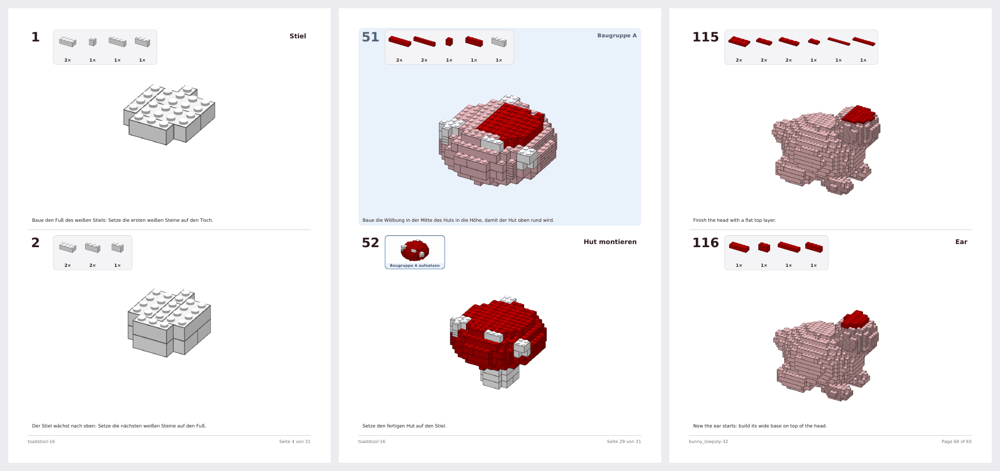
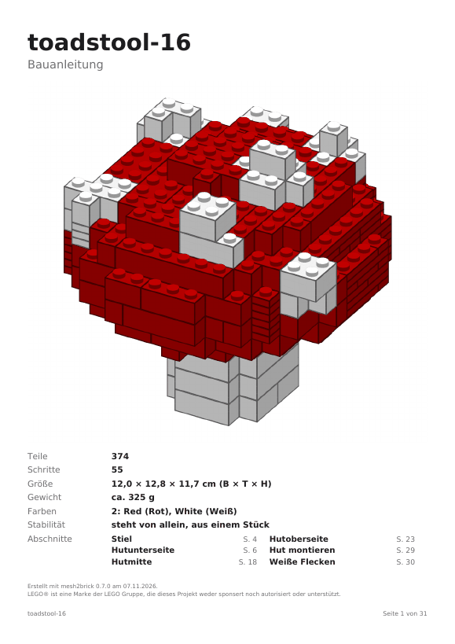

# Projektstatus

Stand: 2026-11-07 · Aktuelle Phase: **7 – KI-Schicht: fertig** ([PR #19](https://github.com/leckermatz79/mesh2brick/pull/19) gemergt, Tag `v0.7.0`; Nachtrag Deckblatt-Übersicht: [PR #20](https://github.com/leckermatz79/mesh2brick/pull/20) offen) · Nächste: **Phase 8 – Blender, Politur, v1.0**
Repo: https://github.com/leckermatz79/mesh2brick (öffentlich) · Plan: [PLAN.md](PLAN.md) · Messwerte: [benchmarks.md](benchmarks.md)

## Fazit in zwei Sätzen

- **Claude hilft bei der Anleitung, wenn du willst:** Mit `--set llm.enabled=true` bekommt das PDF Bauabschnitte mit Titeln („Stiel“, „Hut aufsetzen“, „Weiße Flecken“) und unter jedem Schritt einen kurzen Satz wie „Setze den fertigen Hut auf den Stiel.“ Das kostet pro Modell etwa 6 bis 20 Cent und eine knappe Minute.
- **Nichts davon wird ungeprüft übernommen:** mesh2brick kontrolliert jeden Vorschlag am Modell und wirft weg, was nicht passt. Ohne KI sieht die Anleitung aus wie bisher, jetzt mit deutschen Farbnamen in Klammern.

| Galerie: Fliegenpilz auf Deutsch (Abschnitt „Stiel“, Hut aufsetzen) und Hase auf Englisch (Abschnitt „Ear“), Texte von Claude |
|---|
|  |

| Nachtrag (deine Antwort 3): Deckblatt mit Übersicht der Bauabschnitte und Seitenzahlen |
|---|
|  |

## Erledigt (Phase 7)

- **Deine drei Antworten aus Phase 6** sind eingetragen (siehe „Deine Entscheidungen“). Umgesetzt: deutsche Farbnamen in Klammern, z. B. „Bright Green (Hellgrün)“, auf Deckblatt, Teileliste und im Hinweis zu nicht hergestellten Teilen. Die Teilelisten-Dateien für BrickLink und Rebrickable bleiben englisch.
- **KI-Schicht** (ADR 0013), drei Aufgaben:

| Aufgabe | Was Claude macht | Was mesh2brick prüft |
|---|---|---|
| Schritte gliedern | Bauabschnitte benennen; Schritte zusammenlegen, die man in einem Zug baut | Zusammenlegen nur von direkt aufeinanderfolgenden Schritten: dabei kann nichts in der Luft hängen. Abgelehnt wird, wenn Baugruppen gemischt würden, mehr als 10 Teile entstünden, Teile verdeckt würden oder eine „Halte fest“-Stelle verschwände. |
| Schritttexte | Ein Satz pro Schritt, was er baut und wo die Teile hinkommen | Jedes genannte neue Teil muss in dem Schritt vorkommen; jede Zahl muss eine Menge aus dem Schritt sein; höchstens 140 Zeichen. |
| Ersatzteile (nur auf Wunsch) | Wählt Ersatz für Teile, die LEGO in der Farbe nicht herstellt | Die Auswahl kommt aus dem Katalog: kürzere Teile derselben Farbe oder dasselbe Teil in einer Nachbarfarbe, die LEGO herstellt. |

- **Was nicht passt, fällt weg.** Claude bekommt die Fehler einmal zurück und darf nachbessern; der Rest bleibt wie ohne KI. Ein API-Fehler, eine Ablehnung oder das Kostenlimit beenden nur die betroffene Aufgabe.
- **Claude darf nachschauen:** im Teilekatalog, ob ein Zusammenlegen erlaubt wäre (mit derselben Prüfung, die später entscheidet), und Schrittbilder ansehen. Pro Schritt bekommt es außerdem gesagt, worauf die neuen Teile sitzen („auf Baugruppe A“). Das hat falsche Ortsangaben beseitigt.
- **Kosten werden mitgeschrieben:** in `out/<name>.llm.json` (was übernommen wurde, Tokens, Kosten), auf der Konsole und im Bewertungsspeicher. Standardgrenze 1 $ pro Lauf.

| Modell | Teile | Schritte | Abschnitte | Texte übernommen | Kosten | Zeit KI |
|---|---|---|---|---|---|---|
| Fliegenpilz (16 Noppen, de) | 374 | 55 | 6 | 55 von 55 | 0,06 $ | 21 s |
| Kugel (16 Noppen, de) | 268 | 47 (1 zusammengelegt) | 8 | 48 von 48 | 0,06 $ | 21 s |
| Hase (32 Noppen, en) | 873 | 125 | 7 | 125 von 125 | 0,12 $ | 37 s |
| Duo (32 Noppen, de, nur lokal) | 1.025 | 153 | 5 | 153 von 153 | 0,20 $ | 57 s |

- **Bewerten:** `mesh2brick feedback --rate 4 --note "Texte etwas lang"` bewertet den letzten Lauf. Läufe mit 4 oder 5 Punkten werden zu Beispielen für spätere Läufe, Notizen gibt mesh2brick an Claude weiter. `mesh2brick feedback` listet die Läufe, `--export laeufe.jsonl` schreibt sie für ein späteres Fine-Tuning. Alles bleibt auf deinem Rechner.
- **Nachtrag nach deinen Antworten:** Das Deckblatt listet die Bauabschnitte mit ihren Seitenzahlen (bis 4 Abschnitte in einer Spalte, mehr in zwei). Ohne KI gibt es keine Abschnitte und das Deckblatt bleibt wie bisher.
- **Kleiner Fehler aus Phase 6 behoben:** Dreistellige Schrittnummern (ab Schritt 100) überlappten den Teile-Kasten.
- **Abnahme:** `convert` mit KI an und aus liefert beide gültige Ergebnisse (automatischer Test), die Kosten jedes Laufs stehen im Bericht.

## Als Nächstes

1. **Du:** PR #20 „Abschnitte auf dem Deckblatt“ prüfen und mergen (Befehl unten unter „Offene Kleinigkeiten“).
2. **Optional, du:** eine Anleitung mit KI erzeugen, ansehen und bewerten. Damit lernt die KI deinen Geschmack:
   `uv run mesh2brick convert tests/fixtures/toadstool.obj -o out/ --set input.target_studs=16 --set llm.enabled=true`
   dann `out/toadstool.pdf` öffnen und z. B. `uv run mesh2brick feedback --rate 4 --note "..."`.
3. **Phase 8:** `.blend`-Dateien einlesen, `mesh2brick inspect` mit Vorschaubild, Doku und Beispielgalerie vervollständigen, `v1.0.0`.
4. Upstream: Antworten auf #88/#89 und #90/#91 abwarten.

## Bekannte Einschränkungen

| Was | Einschätzung |
|---|---|
| KI-Texte können plausibel klingen und trotzdem ungenau sein (z. B. „links“ statt „hinten“). Die Prüfung erkennt falsche Teile und Mengen, aber keine falsche Richtung; Claude sieht nicht jedes Schrittbild. | akzeptieren; mit Bewertungen und Notizen nachsteuern |
| Die KI legt selten Schritte zusammen: Die kleinen hat mesh2brick schon vorher zusammengelegt, und die übrigen Nachbarn verdecken sich meist gegenseitig. | akzeptieren; der Nutzen liegt in Abschnitten und Texten |
| Für Claude-Modelle, deren Preise mesh2brick nicht kennt, gilt die Kostengrenze nicht (der Lauf sagt das). | Preistabelle bei neuen Modellen ergänzen |
| Große Modelle (> 500 Teile) bekommen Schritte Schicht für Schicht, nicht jeder Zwischenstand ist auf Standfestigkeit geprüft. | von dir akzeptiert; das Deckblatt sagt es in einem Satz |
| Hängen mehrere vorher zusammengesteckte Teile aneinander, wird ein Schritt größer (Kugel bei 32 Noppen: einmal 18 Teile, sonst meist höchstens 10). | selten; eigener Code, falls es stört |
| Bei kleinen Modellen übernimmt legolization die Reihenfolge. Wo es selbst „braucht Stütze“ meldet, steht im PDF „Halte das Modell fest“. | akzeptiert |
| Dachsteine (Slopes) erscheinen in den Bildern als Quader. | eigener Code, wenn Slopes wieder an sind |
| „Teile weglassen“ gilt fürs ganze Modell, nicht pro Farbe. | Upstream #9 (nach #8) |
| 1×1-Stein und 1×1-Platte lassen sich weder weglassen noch aufteilen. Gibt es sie in einer Modellfarbe nicht, meldet die Teileliste das. | selten; akzeptiert |
| legolization setzt nur Platten bis 2×8. Größere Platten würden Teile sparen. | Upstream-Kandidat #10 |
| Reine Computer-Grundfarben landen teils auf Nachbarfarben (#FF0000 → „Reddish Orange“). | von dir als Farbmetrik akzeptiert |
| Bemalte Farben aus dem Slicer und Texturen in 3MF werden noch nicht gelesen. | bei Bedarf |
| Die letzte Optimierung in legolization („remerge“) lässt sich nicht begrenzen. | Upstream-Kandidat #5 |
| Slopes vorerst aus (legolization-Hänger, Upstream #2 offen). | nach Upstream-Fix wieder an |

## Umgebung (gut zu wissen)

- Die Python-Umgebung liegt außerhalb von Nextcloud (`.venv` ist ein Symlink nach `~/.local/share/venvs/mesh2brick`).
- Die LDraw-Teilebibliothek liegt in `~/Library/Caches/pyldraw3`, der Zwischenspeicher für Teilebeschreibungen in `~/Library/Caches/mesh2brick`. `samples/` (Duo) ist von Git ausgeschlossen.
- STEP braucht einmalig `uv sync --extra step`, die KI-Schicht `uv sync --extra llm` (beides zusammen: `uv sync --extra step --extra llm`) und `ANTHROPIC_API_KEY`.
- Der Bewertungsspeicher liegt in `~/Library/Application Support/mesh2brick/feedback.sqlite3` (anderer Ordner mit `MESH2BRICK_DATA_DIR`).
- Die Galeriebilder der PDF-Seiten entstehen mit `pdftoppm` (Homebrew-Paket poppler).

## Deine Entscheidungen

| Datum | Frage | Entscheidung |
|---|---|---|
| 2026-11-01 | Erster echter Testfall? | Duo (Eule aus `samples/`), **nur lokal**: nicht im Repo, nicht in der Galerie. |
| 2026-11-01 | Typische Modellgröße? | **32 Noppen** auf der längsten Achse (≈ 26 cm) als Standard, 48 erst später. |
| 2026-11-01 | LeoCAD für PDF-Schrittbilder installieren? | **Ja**, per Homebrew zu Beginn von Phase 2. Leider nicht möglich (s. o.). |
| 2026-11-01 | Fehlerbericht #2 bei legolization einreichen? | **Ja**, plus PR-Entwurf für das Zeitlimit; mit Hinweis, dass das Problem in einem Vibe-Coding-Projekt aufgefallen ist. Erledigt: Issue #88, Draft-PR #89. |
| 2026-11-01 | Wie lange darf eine Umwandlung dauern? | **5 Minuten.** Phase 2: Duo unter 5 Minuten als Zielmarke, Hebel per Benchmark wählen. Erreicht: 110 s (mit KI-Schicht 161 s). |
| 2026-11-01 | Manuelle Prüfung der `.ldr` in BrickLink Studio? | **Ja, Screenshot kommt später.** Bis dahin gilt der strenge Wieder-Einlese-Test als Prüfung. |
| 2026-11-01 | LeoCAD manuell installieren und nutzen? | **Nein.** Schrittbilder kommen vom eigenen Renderer. |
| 2026-11-01 | Schichtschritte für große Modelle (> 500 Teile)? | **Ja**, in Ordnung. |
| 2026-11-01 | STEP-Zusatzpaket mit 70 MB (über der 50-MB-Regel)? | **In Ordnung.** Ein vollständiger CAD-Kern rechtfertigt die Größe, er wird nur bei Bedarf installiert. Die Rückfrage war richtig: So soll die 50-MB-Regel funktionieren. |
| 2026-11-01 | Farben aus dem Modell automatisch übernehmen? | **Ja.** Einfarbig bleibt per Config erreichbar (`color.mode: single`). |
| 2026-11-01 | Gängige LEGO-Farben statt exakter Farbtöne? | **Ja.** Eine Anleitung, deren Steine man nicht kaufen kann, ist wertlos. Für Spezialfälle gibt es `color.palette: all`. |
| 2026-11-01 | Reines #FF0000 wird „Reddish Orange“ | **Kein Bug, sondern Farbmetrik.** Optional in Phase 4: kleine Ausnahmetabelle für reine Primärfarben. Erwähnen, nicht priorisieren. |
| 2026-11-01 | Upstream-Vorschlag „erlaubte Teile direkt angeben“ (#8) einreichen? | **Ja, einreichen.** Derselbe Fall wie #88/#89, und den lokalen Patch will man nicht dauerhaft pflegen. Im Issue kurz auf #89 verweisen, weil der Maintainer dort noch nicht reagiert hat, damit er den Zusammenhang sieht. Erledigt: Issue #90, Draft-PR #91. |
| 2026-11-01 | Steine, die es in einer Farbe nicht gibt, automatisch ersetzen? | **Ja, als Zwischenlösung** (1×8 → 2× 1×4, danach Stabilitätsprüfung). Sauber wäre, die Farbverfügbarkeit schon bei der Platzierung zu kennen (hängt am selben Upstream-Thema). **Phase 5 vergleicht beides im Benchmark an Duo:** Aufteilen danach gegen Einschränken davor. |
| 2026-11-01 | Manuelle Prüfung in BrickLink Studio | **Erledigt** (Duo, lokal): keine Überlappungen, keine Duplikate, 0 Stabilitätsprobleme, 31 Clutch-Hinweise (Flügel, Füße). Import hängt auf dem Mac, Datei → Öffnen geht (README). Schrittgrößen → Phase 6. |
| 2026-11-07 | Schritte pro Seite und Optik der Anleitung? | **2 Schritte pro Seite, Optik bleibt so.** |
| 2026-11-07 | Teile unter Überhängen: im selben Schritt oder eigener Mini-Bauabschnitt? | **Im selben Schritt** (vorher in der Hand zusammenstecken, gelbes „zuerst“-Feld). |
| 2026-11-07 | Farbnamen in der deutschen Anleitung? | **Englisch plus deutscher Name in Klammern** („Bright Green (Hellgrün)“). Umgesetzt in Phase 7. |
| 2026-11-07 | KI-Schicht standardmäßig einschalten? | **Nein**, bleibt aus (einschalten mit `--set llm.enabled=true`). |
| 2026-11-07 | Anrede in den Schritttexten? | **„du“** („Setze den Hut auf den Stiel.“). |
| 2026-11-07 | Bauabschnitte auf dem Deckblatt? | **Ja**, als Übersicht mit Seitenzahlen. Umgesetzt im Nachtrag zu Phase 7. |
| 2026-11-07 | Phase 7: Zugang zur Anthropic-API? | **`ANTHROPIC_API_KEY` ist gesetzt.** Für Entwicklung und Messungen dieser Phase wurden insgesamt etwa 1,05 $ verbraucht. |

## Fragen an dich

Zurzeit keine. Neue Fragen kommen mit Phase 8.

## Offene Kleinigkeiten

- **Release-Seiten** auf GitHub fehlen, die Tags existieren. Das Anlegen öffentlicher Seiten blockiert das Rechtesystem. Befehl für `v0.0.0`:
  `awk '/^## \[0.0.0\]/{f=1;next} /^## \[/{f=0} f' CHANGELOG.md | gh release create v0.0.0 --prerelease --title "v0.0.0 – Phase 0: skeleton" --notes-file -`
- **Nachtrag mergen:** `gh pr merge 20 --squash --delete-branch`. Kein eigener Tag nötig; der Nachtrag kommt mit `v0.8.0`.
