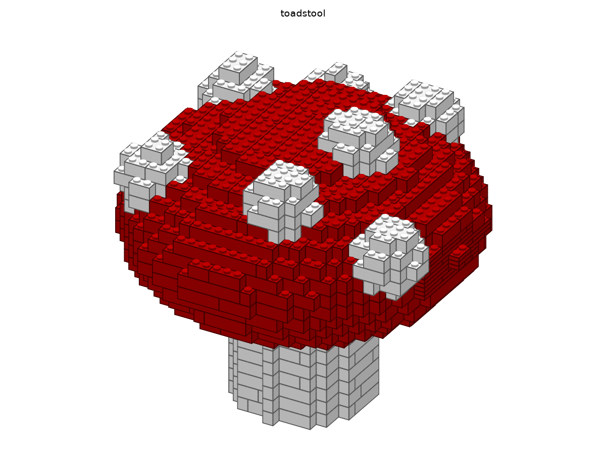

# Projektstatus

Stand: 2026-11-01 · Aktuelle Phase: **4 – Katalog und Whitelist: in Arbeit** · Zuletzt fertig: **Phase 3 – STEP + Farben (`v0.3.0`)**
Repo: https://github.com/leckermatz79/mesh2brick (öffentlich) · Plan: [PLAN.md](PLAN.md) · Messwerte: [benchmarks.md](benchmarks.md)

## Fazit in zwei Sätzen

Modelle kommen jetzt **in ihren eigenen Farben** heraus:
- aus Slicer-Projekten (Bambu Studio, Orca, PrusaSlicer),
- aus CAD-Dateien,
- aus OBJ, glTF und PLY mit Materialien, Vertexfarben oder Texturen.

Zusätzlich liest mesh2brick **STEP-Dateien**. Duo wird in 137 Sekunden in Weiß, Grün, Hellgrün, Orange und Schwarz gebaut: 1.013 Teile, stabil, alle Teile in allen drei Teilelisten.

| Galerie: Fliegenpilz (OBJ mit Materialien, 32 Noppen, 1.240 Teile) |
|---|
|  |

## Erledigt (Phase 3)

- **STEP-Import** (`.step`, `.stp`):
  - Über ein optionales Zusatzpaket: `uv sync --extra step`.
  - Liest Baugruppen, Körper und Farben. Die Genauigkeit ist in Millimetern einstellbar, egal in welcher Einheit die Datei ist.
  - Ein STEP-Würfel ergibt exakt dasselbe Gitter wie der gleiche Würfel als STL. Das war die Abnahme der SPEC.
- **Mehrere Körper in einer Datei:** Sie werden vereinigt (Standard) oder auf Wunsch abgelehnt (`input.multi_body: error`).
- **Farben aus dem Modell:** neuer Standard `color.mode: auto`.
  - **3MF:** Materialfarben und die Filamentzuordnung aus Slicer-Projekten. Die Filamente gewinnen, weil sie zeigen, was wirklich gedruckt wird.
  - **STEP:** Körper- und Flächenfarben.
  - **OBJ, glTF und PLY:** Materialfarben, Vertexfarben und Bildtexturen.
- **Nur sichtbare Flächen zählen:**
  - Bei Duo stecken Teile ineinander, etwa Pupillen halb im Auge oder das Gesicht auf dem Körper. Verdeckte Flächen bestimmen deshalb keine Farbe.
  - Dünne Beschichtungen, die keinen eigenen Stein füllen, färben den Stein dahinter.
- **Gängige LEGO-Farben:**
  - Modellfarben werden auf die rund 40 Farben abgebildet, die LEGO heute in vielen Teilen herstellt. Die Zahlen dazu kommen aus der Statistik von Rebrickable.
  - Ohne diese Grenze wurde Duos Orange zu „Warm Yellowish Orange“. Diese Farbe gab es 2004 in 19 Teilen, man bekäme sie kaum.
  - Metallic-Töne gibt es nur auf Wunsch (`color.palette: all`).
- **Slicer-Hilfskörper** (Modifier, Negativ-Körper, Stützblocker) wurden bisher als Geometrie mitgelesen. Jetzt werden sie übersprungen.
- **Teilelisten:** Rebrickable-Farbnummern werden jetzt auch über den exakten Namen gefunden, für 90 statt 69 Farben. Eine falsche Zahl in ADR 0005 ist korrigiert.
- **Testdateien:** STEP-Würfel, zwei farbige STEP-Körper, Fliegenpilz, Kugel mit Vertexfarben und Würfel mit Textur. Alle sind selbst erzeugt und gemeinfrei.
- 381 automatische Tests, 96 % Abdeckung.

## So sieht Duo jetzt aus (lokal, nicht im Repo)

| Filament (Bambu) | wird zu LEGO-Farbe | Teile |
|---|---|---:|
| Weiß (Augen, Sockel) | White | 209 |
| Grasgrün (Körper, Flügel) | Bright Green | 603 |
| Apfelgrün (Gesicht, Federn) | Lime | 114 |
| Mandarin-Orange (Schnabel, Füße) | Orange | 81 |
| Schwarz (Pupillen) | Black | 6 |

137 s gesamt (Import 13 s, Steine 104 s, PDF 20 s), 158 Schritte, stabil, ein Stück. Die Farbübertragung selbst kostet bei 2,1 Mio. Dreiecken etwa 0,6 s.

## Was ich entschieden habe (Details in den ADRs)

| Entscheidung | Warum | ADR |
|---|---|---|
| STEP über **cascadio** statt cadquery | Gleiche Technik (OpenCASCADE). Der Download ist 22 statt 63 MB, und es braucht keine Zusatzpakete (siehe Frage 1). | 0007 |
| Standard `color.mode: auto` statt `single` | Wer ein farbiges Modell lädt, erwartet seine Farben. Modelle ohne Farben sehen aus wie bisher (siehe Frage 2). | 0008 |
| Standard `color.palette: common` (~40 heutige LEGO-Farben) | Kaufbare Steine statt exakter, aber seltener Farbtöne (siehe Frage 3). | 0008 |
| Farbabstand von legolization übernommen | Er ist erprobt und darauf abgestimmt, dass Grau grau und Schwarz schwarz bleibt. Keine eigene Farbformel. | 0008 |

## Lückenliste: legolizations PDF gegen SPEC §1 (unverändert, wird in Phase 6 geschlossen)

| Anforderung | Stand | Lücke |
|---|---|---|
| Deckblatt mit Bild, Teilezahl, Maßen | Titel, Teilezahl, Gewicht, Stabilitätsurteil | kein Modellbild, keine Maße in cm |
| Teileliste | Liste mit Anzahl, LDraw-Nummer, Farbe, Gewicht | interne Namen (`brick_2x4`), keine Teilebilder |
| Schrittseiten mit Teile-Callouts | Bild pro Schritt, neue Teile hervorgehoben, Callouts als Text | Callouts ohne Teilebilder; Modell im Bild recht klein |
| Gedimmte Vorschritte | ja (unser Renderer) | – |
| 1–4 Schritte pro Seite | fest 2 | Einstellung noch nicht nach außen geführt |
| Deutsch und Englisch | nur Englisch | Übersetzung fehlt (legolization kennt nur Englisch) |
| Unterbaugruppen als eigene Abschnitte | ja bei geprüfter Schrittplanung | bei Schicht-Reihenfolge (große Modelle) keine |
| Verständliche Hinweise | Warnungen wie „prefix unstable (score 1.00)" | Fachjargon |
| Schriften | Helvetica, nicht eingebettet | manche Betrachter zeigen dann keinen Text (z. B. `pdftoppm` hier); Ghostscript/Vorschau zeigen ihn |
| Größe | Hase 4,8 MB, Duo 10 MB | Ziel < 10 MB für den Hasen schon erfüllt |

## Als Nächstes

1. **Phase 4 (Issue #5): Katalog und Whitelist.**
   - Teile und Farben offline aus Rebrickable.
   - Welche Teile gibt es in welcher Farbe wirklich?
   - Ein vollständiger Farbabgleich LDraw ↔ BrickLink ↔ Rebrickable. Dann kommt zum Beispiel Dunkellila dazu: LDraw nennt es inzwischen „Medium Lilac“, die Kataloge „Dark Purple“.

## Bekannte Einschränkungen

| Was | Einschätzung |
|---|---|
| Ob ein Teil in einer Farbe wirklich existiert (z. B. Platte 1×2 in Coral), wird noch nicht geprüft. | Phase 4 |
| Reine Computer-Grundfarben landen teils auf Nachbarfarben, etwa #FF0000 auf „Reddish Orange“. LEGOs Rot ist deutlich dunkler. Echte Filament- und CAD-Rottöne werden zu Red. | von dir als Farbmetrik akzeptiert; optional eine kleine Ausnahmetabelle für reine Primärfarben (niedrige Priorität) |
| Lila wird zu Blau, weil Dunkellila wegen der Umbenennung noch nicht in der Palette ist. | Phase 4 |
| Bemalte Farben aus dem Slicer (Multi-Material-Painting) und Texturen in 3MF werden noch nicht gelesen. Das Programm sagt es. | bei Bedarf |
| Große Modelle (> 500 Teile) bekommen Schritte in Schicht-Reihenfolge ohne Stabilitätsprüfung. | von dir akzeptiert; Verbesserung in Phase 5/6 bzw. Upstream |
| Die letzte Optimierung in legolization („remerge“) lässt sich nicht begrenzen. Die 5 Minuten sind eine Zielmarke; Überschreitungen werden gemeldet. | Upstream-Kandidat #5 |
| Slopes vorerst aus (legolization-Hänger, Upstream #2 offen). | nach Upstream-Fix wieder an |
| PDF-Text englisch. | Phase 6 |
| Whitelists (Phase 4) und `llm.*` (Phase 7) sind noch ohne Wirkung. | geplant |

## Umgebung (gut zu wissen)

- Die Python-Umgebung liegt außerhalb von Nextcloud (`.venv` ist ein Symlink nach `~/.local/share/venvs/mesh2brick`).
- Die LDraw-Teilebibliothek liegt in `~/Library/Caches/pyldraw3`. `samples/` (Duo) ist von Git ausgeschlossen.
- STEP braucht einmalig `uv sync --extra step`.

## Deine Entscheidungen

| Datum | Frage | Entscheidung |
|---|---|---|
| 2026-11-01 | Erster echter Testfall? | Duo (Eule aus `samples/`), **nur lokal**: nicht im Repo, nicht in der Galerie. |
| 2026-11-01 | Typische Modellgröße? | **32 Noppen** auf der längsten Achse (≈ 26 cm) als Standard, 48 erst später. |
| 2026-11-01 | LeoCAD für PDF-Schrittbilder installieren? | **Ja**, per Homebrew zu Beginn von Phase 2. Leider nicht möglich (s. o.). |
| 2026-11-01 | Fehlerbericht #2 bei legolization einreichen? | **Ja**, plus PR-Entwurf für das Zeitlimit; mit Hinweis, dass das Problem in einem Vibe-Coding-Projekt aufgefallen ist. Erledigt: Issue #88, Draft-PR #89. |
| 2026-11-01 | Wie lange darf eine Umwandlung dauern? | **5 Minuten.** Phase 2: Duo unter 5 Minuten als Zielmarke, Hebel per Benchmark wählen. Erreicht: 110 s. |
| 2026-11-01 | Manuelle Prüfung der `.ldr` in BrickLink Studio? | **Ja, Screenshot kommt später.** Bis dahin gilt der strenge Wieder-Einlese-Test als Prüfung. |
| 2026-11-01 | LeoCAD manuell installieren und nutzen? | **Nein.** Schrittbilder kommen vom eigenen Renderer. |
| 2026-11-01 | Schichtschritte für große Modelle (> 500 Teile)? | **Ja**, in Ordnung. |
| 2026-11-01 | STEP-Zusatzpaket mit 70 MB (über der 50-MB-Regel)? | **In Ordnung.** Ein vollständiger CAD-Kern rechtfertigt die Größe, er wird nur bei Bedarf installiert. Die Rückfrage war richtig: So soll die 50-MB-Regel funktionieren. |
| 2026-11-01 | Farben aus dem Modell automatisch übernehmen? | **Ja.** Einfarbig bleibt per Config erreichbar (`color.mode: single`). |
| 2026-11-01 | Gängige LEGO-Farben statt exakter Farbtöne? | **Ja.** Eine Anleitung, deren Steine man nicht kaufen kann, ist wertlos. Für Spezialfälle gibt es `color.palette: all`. |
| 2026-11-01 | Reines #FF0000 wird „Reddish Orange“ | **Kein Bug, sondern Farbmetrik.** Optional in Phase 4: kleine Ausnahmetabelle für reine Primärfarben. Erwähnen, nicht priorisieren. |

## Fragen an dich

Keine offenen Fragen. Noch ausstehend von dir: ein Screenshot einer erzeugten `.ldr` aus BrickLink Studio. Bis dahin gilt der strenge Wieder-Einlese-Test.

## Offene Kleinigkeit

Die Release-Seiten auf GitHub fehlen, die Tags existieren. Das Anlegen öffentlicher Seiten wurde vom
Rechtesystem blockiert. Befehl für `v0.0.0`:
`awk '/^## \[0.0.0\]/{f=1;next} /^## \[/{f=0} f' CHANGELOG.md | gh release create v0.0.0 --prerelease --title "v0.0.0 – Phase 0: skeleton" --notes-file -`
