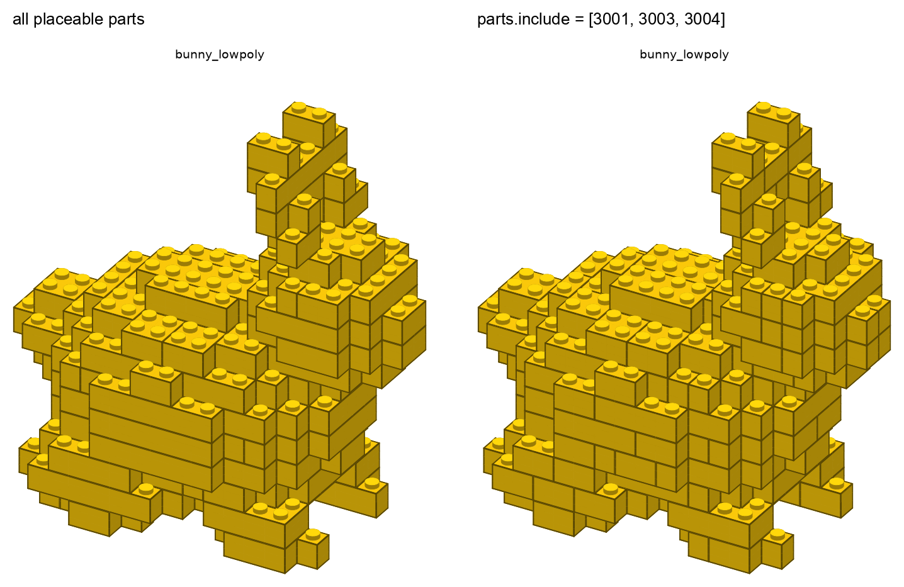

# Projektstatus

Stand: 2026-11-01 · Aktuelle Phase: **4 – Katalog und Whitelist: fertig, wartet auf Merge** · Nächste: **Phase 5 – eigene Platzierungs-/Stabilitätserweiterungen (nur bei Bedarf)**
Repo: https://github.com/leckermatz79/mesh2brick (öffentlich) · Plan: [PLAN.md](PLAN.md) · Messwerte: [benchmarks.md](benchmarks.md)

## Fazit in zwei Sätzen

mesh2brick hat jetzt einen **Teilekatalog**, der offline funktioniert.
- `mesh2brick catalog list` und `catalog show` zeigen zu jedem Teil:
  - Größe und Noppen (aus der LDraw-Geometrie),
  - BrickLink- und Rebrickable-Nummer, Namen,
  - die Farben, in denen LEGO das Teil herstellt.
- Mit `parts.include` und `parts.exclude` legst du fest, welche Teile verwendet werden dürfen.

Die Teileliste zeigt jetzt Rebrickable-Namen und warnt, wenn ein Teil in einer Farbe gar nicht produziert wird.

| Galerie: derselbe Hase mit allen Teilen (links) und nur mit 2×4, 2×2, 1×2 (rechts) |
|---|
|  |

## Erledigt (Phase 4)

- **Teilekatalog** (`mesh2brick catalog list --category slope`, `catalog show 3001`):
  - Er läuft offline; ein Test sperrt dabei jeden Netzwerkzugriff.
  - Größe, Höhe, Noppen und Kategorie werden aus der LDraw-Geometrie berechnet und pro LDraw-Version zwischengespeichert.
  - Abgleich mit legolizations eigenem Modell: Alle 29 platzierbaren Teile stimmen überein.
  - `--all` zeigt zusätzlich Teile aus der LDraw-Bibliothek, die legolization (noch) nicht setzen kann. Das sind z. B. 218 Slopes ohne bedruckte Varianten.
- **Whitelist und Blacklist** wirken jetzt bei der Platzierung.
  - Unmögliches wird mit klarer Meldung abgelehnt: ein Tippfehler in der Teilenummer, ein Teil, das legolization nicht setzen kann, oder das Entfernen der unverzichtbaren 1×1-Teile.
  - Grund für Letzteres: legolization braucht 1×1-Stein und 1×1-Platte, um beliebige Formen zu füllen. Das habe ich gemessen, indem ich jedes Teil einzeln entfernt habe.
- **Teileliste:** Spalten für den Rebrickable-Namen und „in dieser Farbe produziert“, dazu eine Warnung bei Kombinationen, die es nicht gibt.
- **Farbabgleich verbessert:** LDraw hat einige Farben auf LEGOs offizielle Namen umbenannt. Sie werden jetzt über Nummer und Farbwert sicher zugeordnet.
  - Dunkellila („Medium Lilac“ = „Dark Purple“) ist dadurch in der Standardpalette. Lila wird nicht mehr zu Blau.
  - Hellorange („Spud Orange“ = „Light Orange“) ist ebenfalls zugeordnet, ist aber eine alte Farbe und daher nicht in der Standardpalette.
- **Daten:** Rebrickable-Namen und die Verfügbarkeit (welches Teil gibt es in welcher Farbe) stecken in der mitgelieferten Tabelle. Es braucht keinen Download, kein Konto und keine große Datenbank (ADR 0009).
- 424 automatische Tests, 96 % Abdeckung.

## Ein echter Fund bei Duo

Duo wird mit **20 Steinen 2×8 und 16 Steinen 1×8 in Bright Green** gebaut. Diese Kombination stellt LEGO laut Rebrickable gar nicht her. Die Teileliste sagt das jetzt.

- **Abhilfe heute:** `--set "parts.exclude=[3007, 3008]"`. Dann nimmt legolization kürzere Steine, allerdings in allen Farben.
- **Besser wäre**, solche Steine automatisch durch kürzere gleicher Farbe zu ersetzen (siehe Frage 2).

## Was ich entschieden habe (Details in ADR 0009)

| Entscheidung | Warum |
|---|---|
| Katalogdaten in der mitgelieferten Tabelle statt in der Datenbank des `rebrickable`-Pakets | Die Datenbank wäre ein großer Download (alle Rebrickable-Tabellen inkl. Set-Inventare). BrickLink-Nummern bekäme man dort nur mit API-Schlüssel. So funktioniert alles offline und ohne Konto. |
| Whitelist über einen eng begrenzten lokalen Patch | legolization nimmt im Hauptablauf immer den vollen Katalog. Der Patch gilt nur während der Platzierung und wird danach (auch bei Fehlern) zurückgenommen. Ein Upstream-Vorschlag liegt bereit (Frage 1). |
| Fehlende 1×1-Teile in einer Whitelist werden ergänzt (mit Hinweis), statt einen Fehler zu melden | Wer „nur 2×4 und 2×2“ schreibt, meint die großen Steine. Ohne 1×1 ginge es gar nicht. |

## Lückenliste: legolizations PDF gegen SPEC §1 (unverändert, wird in Phase 6 geschlossen)

| Anforderung | Stand | Lücke |
|---|---|---|
| Deckblatt mit Bild, Teilezahl, Maßen | Titel, Teilezahl, Gewicht, Stabilitätsurteil | kein Modellbild, keine Maße in cm |
| Teileliste | Liste mit Anzahl, LDraw-Nummer, Farbe, Gewicht | interne Namen (`brick_2x4`), keine Teilebilder |
| Schrittseiten mit Teile-Callouts | Bild pro Schritt, neue Teile hervorgehoben, Callouts als Text | Callouts ohne Teilebilder; Modell im Bild recht klein |
| Gedimmte Vorschritte | ja (unser Renderer) | – |
| 1–4 Schritte pro Seite | fest 2 | Einstellung noch nicht nach außen geführt |
| Deutsch und Englisch | nur Englisch | Übersetzung fehlt (legolization kennt nur Englisch) |
| Unterbaugruppen als eigene Abschnitte | ja bei geprüfter Schrittplanung | bei Schicht-Reihenfolge (große Modelle) keine |
| Verständliche Hinweise | Warnungen wie „prefix unstable (score 1.00)" | Fachjargon |
| Schriften | Helvetica, nicht eingebettet | manche Betrachter zeigen dann keinen Text (z. B. `pdftoppm` hier); Ghostscript/Vorschau zeigen ihn |
| Größe | Hase 4,8 MB, Duo 10 MB | Ziel < 10 MB für den Hasen schon erfüllt |

## Als Nächstes

1. **Phase 5 (Issue #6): Benchmark aller legolization-Strategien, eigene Erweiterungen nur bei messbaren Lücken.**
   - Kandidat aus Phase 4: Teile, die es in einer Farbe nicht gibt, automatisch ersetzen (Frage 2).

## Bekannte Einschränkungen

| Was | Einschätzung |
|---|---|
| Teile, die es in einer Farbe nicht gibt, werden nur gemeldet, nicht vermieden (Duo: 2×8 und 1×8 in Bright Green). | Frage 2 / Phase 5 |
| Sehr schmale Whitelists kosten Teile und Zeit: Hase mit nur 2×4/2×2/1×2 hat 356 statt 177 Teile und braucht 85 statt 5 s. | in Ordnung, ist dokumentiert |
| legolization setzt nur 29 Teile (Platten bis 2×8, keine großen Platten, keine Ecken). `catalog list --all` zeigt mehr, die lassen sich aber nicht verwenden. | Phase 5 bzw. Upstream |
| Reine Computer-Grundfarben landen teils auf Nachbarfarben (#FF0000 → „Reddish Orange“). | von dir als Farbmetrik akzeptiert; optional eine kleine Ausnahmetabelle für reine Primärfarben (niedrige Priorität) |
| Bemalte Farben aus dem Slicer und Texturen in 3MF werden noch nicht gelesen. | bei Bedarf |
| Große Modelle (> 500 Teile) bekommen Schritte in Schicht-Reihenfolge ohne Stabilitätsprüfung. | von dir akzeptiert; Verbesserung in Phase 5/6 bzw. Upstream |
| Die letzte Optimierung in legolization („remerge“) lässt sich nicht begrenzen. | Upstream-Kandidat #5 |
| Slopes vorerst aus (legolization-Hänger, Upstream #2 offen). | nach Upstream-Fix wieder an |
| PDF-Text englisch. | Phase 6 |
| `llm.*` (Phase 7) ist noch ohne Wirkung. | geplant |

## Umgebung (gut zu wissen)

- Die Python-Umgebung liegt außerhalb von Nextcloud (`.venv` ist ein Symlink nach `~/.local/share/venvs/mesh2brick`).
- Die LDraw-Teilebibliothek liegt in `~/Library/Caches/pyldraw3`. `samples/` (Duo) ist von Git ausgeschlossen.
- Neu: mesh2brick legt einen kleinen Zwischenspeicher für Teilebeschreibungen in `~/Library/Caches/mesh2brick` an. Er lässt sich gefahrlos löschen.
- STEP braucht einmalig `uv sync --extra step`.

## Deine Entscheidungen

| Datum | Frage | Entscheidung |
|---|---|---|
| 2026-11-01 | Erster echter Testfall? | Duo (Eule aus `samples/`), **nur lokal**: nicht im Repo, nicht in der Galerie. |
| 2026-11-01 | Typische Modellgröße? | **32 Noppen** auf der längsten Achse (≈ 26 cm) als Standard, 48 erst später. |
| 2026-11-01 | LeoCAD für PDF-Schrittbilder installieren? | **Ja**, per Homebrew zu Beginn von Phase 2. Leider nicht möglich (s. o.). |
| 2026-11-01 | Fehlerbericht #2 bei legolization einreichen? | **Ja**, plus PR-Entwurf für das Zeitlimit; mit Hinweis, dass das Problem in einem Vibe-Coding-Projekt aufgefallen ist. Erledigt: Issue #88, Draft-PR #89. |
| 2026-11-01 | Wie lange darf eine Umwandlung dauern? | **5 Minuten.** Phase 2: Duo unter 5 Minuten als Zielmarke, Hebel per Benchmark wählen. Erreicht: 110 s. |
| 2026-11-01 | Manuelle Prüfung der `.ldr` in BrickLink Studio? | **Ja, Screenshot kommt später.** Bis dahin gilt der strenge Wieder-Einlese-Test als Prüfung. |
| 2026-11-01 | LeoCAD manuell installieren und nutzen? | **Nein.** Schrittbilder kommen vom eigenen Renderer. |
| 2026-11-01 | Schichtschritte für große Modelle (> 500 Teile)? | **Ja**, in Ordnung. |
| 2026-11-01 | STEP-Zusatzpaket mit 70 MB (über der 50-MB-Regel)? | **In Ordnung.** Ein vollständiger CAD-Kern rechtfertigt die Größe, er wird nur bei Bedarf installiert. Die Rückfrage war richtig: So soll die 50-MB-Regel funktionieren. |
| 2026-11-01 | Farben aus dem Modell automatisch übernehmen? | **Ja.** Einfarbig bleibt per Config erreichbar (`color.mode: single`). |
| 2026-11-01 | Gängige LEGO-Farben statt exakter Farbtöne? | **Ja.** Eine Anleitung, deren Steine man nicht kaufen kann, ist wertlos. Für Spezialfälle gibt es `color.palette: all`. |
| 2026-11-01 | Reines #FF0000 wird „Reddish Orange“ | **Kein Bug, sondern Farbmetrik.** Optional in Phase 4: kleine Ausnahmetabelle für reine Primärfarben. Erwähnen, nicht priorisieren. |

## Fragen an dich

Wenn keine Antwort kommt, gilt jeweils die Standardannahme.

1. **Darf ich bei legolization vorschlagen, dass man die erlaubten Teile direkt angeben kann (Issue plus PR-Entwurf, mit dem Vibe-Coding-Hinweis wie bei #88)?**
   - Dann könnten wir unseren lokalen Patch irgendwann streichen.
   - Der Text liegt in `docs/UPSTREAM.md` (#8).
   - *Annahme: nein, er bleibt Entwurf, bis du zustimmst.*
2. **Sollen Steine, die es in einer Farbe nicht gibt, automatisch durch kürzere gleicher Farbe ersetzt werden?** Beispiel: 1×8 in Bright Green wird zu 1×4 + 1×4. Das Modell hat dann etwas mehr Teile, und die Stabilität wird neu geprüft. *Annahme: ja, als Teil von Phase 5.*

Noch ausstehend von dir: ein Screenshot einer erzeugten `.ldr` aus BrickLink Studio. Bis dahin gilt der strenge Wieder-Einlese-Test.

## Offene Kleinigkeit

Die Release-Seiten auf GitHub fehlen, die Tags existieren. Das Anlegen öffentlicher Seiten wurde vom
Rechtesystem blockiert. Befehl für `v0.0.0`:
`awk '/^## \[0.0.0\]/{f=1;next} /^## \[/{f=0} f' CHANGELOG.md | gh release create v0.0.0 --prerelease --title "v0.0.0 – Phase 0: skeleton" --notes-file -`
