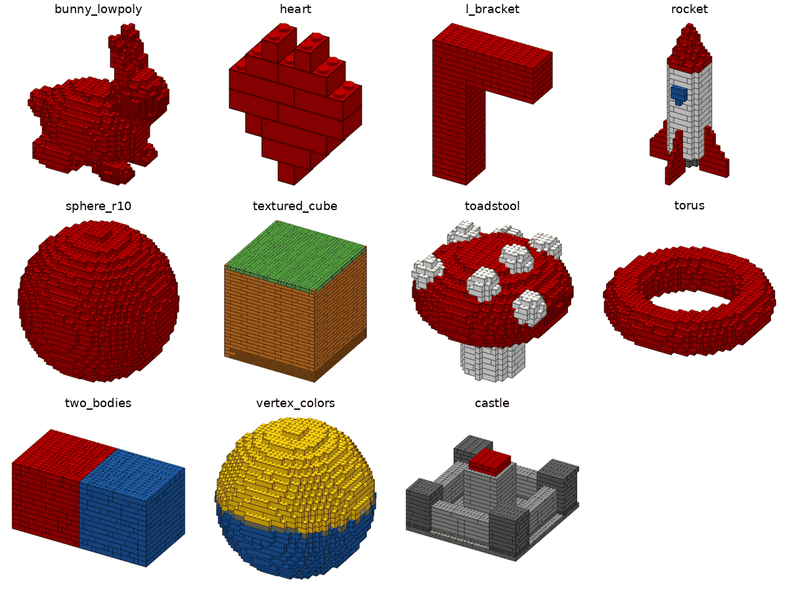
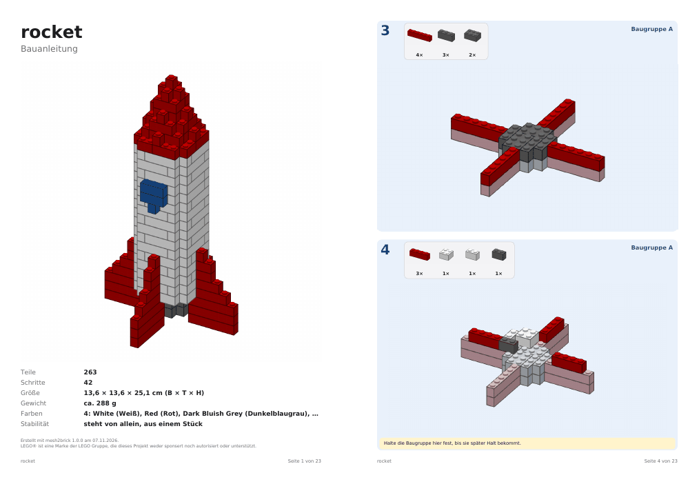

# Projektstatus

Stand: 2026-11-07 · Aktuelle Phase: **8 – Blender, Politur, v1.0: fertig** ([PR #21](https://github.com/leckermatz79/mesh2brick/pull/21) gemergt) · **[Version 1.0.0 veröffentlicht](https://github.com/leckermatz79/mesh2brick/releases/tag/v1.0.0)**; alle Phasen der SPEC sind umgesetzt
Repo: https://github.com/leckermatz79/mesh2brick (öffentlich) · Plan: [PLAN.md](PLAN.md) · Messwerte: [benchmarks.md](benchmarks.md) · [Beispielgalerie](gallery/README.md)

## Fazit in zwei Sätzen

- **Blender-Dateien gehen jetzt direkt:** `mesh2brick convert rakete.blend` startet dein Blender unsichtbar im Hintergrund, nimmt alle sichtbaren Objekte mit ihren Farben und Modifiern und macht daraus in 14 Sekunden eine Rakete aus 263 Steinen, die stabil steht.
- **Vorher schauen, was herauskommt:** `mesh2brick inspect` zeigt in wenigen Sekunden ein Bild „Modell ↔ Noppen“, die Größe in cm, die LEGO-Farben und ungefähr die Teilezahl. Damit ist der Plan aus der SPEC komplett, und mesh2brick kann als Version 1.0 erscheinen.

| Von Blender zu LEGO: `rocket.blend` wie eingelesen, als Noppen-Gitter, als fertiges Modell |
|---|
|  |

| Beispielgalerie: alle Beispielmodelle bei Standardgröße (32 Noppen), alle stabil |
|---|
|  |

| Raketen-Anleitung: Deckblatt und eine Seite mit Baugruppe |
|---|
|  |

## Erledigt (Phase 8)

- **`.blend`-Dateien** (ADR 0014). mesh2brick ruft dein installiertes Blender auf (gefunden unter `/Applications`, über `PATH` oder `MESH2BRICK_BLENDER`). Blender läuft mit Werkseinstellungen und führt keine in der Datei gespeicherten Skripte aus; die Datei wird nur gelesen. Übernommen werden die **sichtbaren** Objekte der aktiven Szene, mit angewendeten Modifiern; Kurven und Text werden zu Flächen, versteckte Objekte, Kamera und Licht bleiben weg. Die Einheiten der Szene zählen (eine „Millimeter-Szene“ bleibt in Millimetern). Blender braucht etwa 1 Sekunde pro Datei.
- **glTF-Dateien** (`.glb`, `.gltf`) gehen auch direkt, mit den Regeln des Formats (Y nach oben, Meter, Farben in linearem Licht).
- **Fehler in trimesh gefunden und umgangen:** Vertexfarben, die Blender standardmäßig mit 16 Bit speichert, kamen falsch an (Orange wurde zu Gelb-Orange). mesh2brick rechnet sie jetzt selbst um. Ein fertiger Fehlerbericht für trimesh liegt in `docs/UPSTREAM.md` (#14, Frage 1 unten).
- **`mesh2brick inspect`** ersetzt den Platzhalter. Ausgabe für die Rakete (gekürzt):

```
rocket.blend: 578 triangles, 5 part(s) (Fins, Nozzle, Window, Nose, Body)
  size in the file: 52.0 x 52.0 x 100.0 mm, closed
  colours in the file: part/material colours on 100 % of the surface
  grid: 17 x 17 studs x 26 bricks, 1,012 filled cells
  LEGO size: 13.6 x 13.6 x 25.0 cm
  LEGO colours: White 66 %, Red 27 %, Dark Bluish Grey 6 %, Blue 2 %
  rough estimate: about 291 parts (202-448); `convert` gives the exact count
```

- Das Bild dazu zeigt links das Modell, wie mesh2brick es einliest, rechts die Noppen-Voxel, beide aus demselben Blickwinkel. Dafür gibt es einen kleinen eigenen Renderer, der auch Modelle mit 2 Millionen Dreiecken (Duo) in wenigen Sekunden sauber zeichnet.
- **Teileschätzung:** mesh2brick füllt das Gitter probeweise mit den größten passenden Steinen und rechnet mit der gemessenen Abweichung hoch. Bei 14 von 15 Testläufen lag die echte Teilezahl im angezeigten Bereich. Ausnahme: dünne, große Bodenplatten, die legolization aus vielen Platten baut (Burghof: 1.651 statt geschätzt 602).
- **Testmodell `rocket.blend`** (selbst gebaut, frei verwendbar): Rumpf, Spitze, Fenster, Düse mit Farben; die vier Flossen entstehen aus einer Flosse über einen Modifier; ein verstecktes Hilfsobjekt darf nicht mitkommen.
- **Beispielgalerie** [gallery/README.md](gallery/README.md): jedes Beispielmodell wie eingelesen, als Voxel und als Steine, mit Teilezahl und Zeit.
- **Doku** auf Deutsch und Englisch ergänzt (Blender, glTF, inspect, Galerie).

## v1.0-Abnahme (Definition of Done aus der SPEC)

| Anforderung | Ergebnis |
|---|---|
| `convert model.step --config mesh2brick.yaml` liefert `.mpd`, drei Teilelisten und PDF in < 5 min für ≤ 2.000 Teile | **Erfüllt:** STEP-Burg mit `--config examples/mesh2brick.yaml` 1.651 Teile in 239 s; STEP-Würfel 1.952 Teile in 265 s |
| Alle Beispielmodelle zusammenhängend und stabil, Dateien fehlerfrei | **Erfüllt:** alle 12 Beispielmodelle (und die Burg) stabil, aus einem Stück; Teileliste = Teilezahl = Teile in der LDraw-Datei (strenges Wieder-Einlesen). Studio-Prüfung durch dich: Duo, Phase 5 |
| Testabdeckung ≥ 80 %, CI grün | **Erfüllt:** 96 %, 636 Tests (CI siehe PR) |
| Doku Deutsch/Englisch, Lizenz- und Upstream-Übersicht aktuell | **Erfüllt:** README/README.de, THIRD_PARTY, UPSTREAM (#14 neu) |

| Modell | Teile | Zeit | stabil |
|---|---|---|---|
| Rakete (`.blend`, 32 Noppen) | 263 | 14 s | ja |
| Hase (32) | 873 | 73 s | ja |
| Fliegenpilz (32) | 1.240 | 174 s | ja |
| Kugel (32) | 1.499 | 113 s | ja |
| STEP-Burg (32, `--config`) | 1.651 | 239 s | ja |
| STEP-Würfel (32) | 1.952 | 265 s | ja |
| Texturwürfel (32) | 2.280 | 294 s | ja |
| Duo (32, nur lokal) | 1.025 | 100 s | ja |
| Duo (48, nur lokal) | 2.313 | 479 s | **nein** |

Alle Zahlen und die übrigen Modelle: [benchmarks.md](benchmarks.md), Abschnitt „v1.0 acceptance“.

## Als Nächstes

1. **Du:** den trimesh-Fehlerbericht einreichen (Befehl unter „Offene Kleinigkeiten“; Text einmal überfliegen).
2. **Nächste Version 1.1 – große Modelle** (deine Entscheidung, siehe [PLAN.md](PLAN.md), „Fahrplan nach 1.0“): Größe in cm als Einstellung und eine harte Zeitgrenze über alle Schritte mit dem Ergebnis „bestes stabiles Modell bis dahin“. Bis dahin gehen 40 cm nur über Noppen (`--set input.target_studs=50`, 50 × 0,8 cm) und hängen dann an der Zeitgrenze.
3. **Danach Version 2.0 – Formtreue:** Dachsteine, Tiles, Rundungen.
4. Upstream: Antworten auf legolization #88/#89 und #90/#91 abwarten, dazu den trimesh-Bericht.

## Bekannte Einschränkungen

| Was | Einschätzung |
|---|---|
| KI-Texte können plausibel klingen und trotzdem ungenau sein (z. B. „links“ statt „hinten“). Die Prüfung erkennt falsche Teile und Mengen, aber keine falsche Richtung; Claude sieht nicht jedes Schrittbild. | akzeptieren; mit Bewertungen und Notizen nachsteuern |
| Die KI legt selten Schritte zusammen: Die kleinen hat mesh2brick schon vorher zusammengelegt, und die übrigen Nachbarn verdecken sich meist gegenseitig. | akzeptieren; der Nutzen liegt in Abschnitten und Texten |
| Für Claude-Modelle, deren Preise mesh2brick nicht kennt, gilt die Kostengrenze nicht (der Lauf sagt das). | Preistabelle bei neuen Modellen ergänzen |
| Große Modelle (> 500 Teile) bekommen Schritte Schicht für Schicht, nicht jeder Zwischenstand ist auf Standfestigkeit geprüft. | von dir akzeptiert; das Deckblatt sagt es in einem Satz |
| Hängen mehrere vorher zusammengesteckte Teile aneinander, wird ein Schritt größer (Kugel bei 32 Noppen: einmal 18 Teile, sonst meist höchstens 10). | selten; eigener Code, falls es stört |
| Bei kleinen Modellen übernimmt legolization die Reihenfolge. Wo es selbst „braucht Stütze“ meldet, steht im PDF „Halte das Modell fest“. | akzeptiert |
| Dachsteine (Slopes) erscheinen in den Bildern als Quader. | eigener Code, wenn Slopes wieder an sind |
| „Teile weglassen“ gilt fürs ganze Modell, nicht pro Farbe. | Upstream #9 (nach #8) |
| 1×1-Stein und 1×1-Platte lassen sich weder weglassen noch aufteilen. Gibt es sie in einer Modellfarbe nicht, meldet die Teileliste das. | selten; akzeptiert |
| legolization setzt nur Platten bis 2×8. Größere Platten würden Teile sparen. | Upstream-Kandidat #10 |
| Reine Computer-Grundfarben landen teils auf Nachbarfarben (#FF0000 → „Reddish Orange“). | von dir als Farbmetrik akzeptiert |
| Bemalte Farben aus dem Slicer und Texturen in 3MF werden noch nicht gelesen. | bei Bedarf |
| Die letzte Optimierung in legolization („remerge“) lässt sich nicht begrenzen. | Upstream-Kandidat #5 |
| Slopes vorerst aus (legolization-Hänger, Upstream #2 offen). | nach Upstream-Fix wieder an |
| Duo bei 48 Noppen: 2.313 Teile, 8 Minuten, nicht stabil. Mit 20 statt 5 Minuten Zeitgrenze war der Lauf nach über einer Stunde noch nicht fertig (abgebrochen): Der letzte Optimierungsschritt in legolization hält sich an keine Zeitgrenze. 48 Noppen liegen über der 2.000-Teile-Grenze der SPEC. | Upstream-Kandidat #5; 48 Noppen erst danach angehen (Frage 2) |
| Große geschlossene Körper (Würfel, der die ganze 32-Noppen-Box füllt) brauchen 4,5–5 Minuten; auf einem langsameren Laptop kann es länger dauern. Ihre PDFs sind 20–23 MB groß. | akzeptieren; Standard bleibt 32 Noppen |
| Die Teileschätzung von `inspect` ist grob (Bereich etwa Faktor 2) und liegt bei dünnen, großen Platten zu niedrig. | akzeptieren; `convert` gibt die genaue Zahl |
| `.blend`: Blender muss installiert sein. Die Tests mit echtem Blender laufen nur hier auf dem Mac; die automatischen Tests auf GitHub nutzen einen Blender-Ersatz. Verknüpfte Bibliotheken müssen vom Ordner der Datei aus erreichbar sein. | akzeptieren |
| glTF mit Draco-Kompression kann trimesh nicht lesen. | bei Bedarf; in Blender ohne Kompression exportieren |

## Umgebung (gut zu wissen)

- Die Python-Umgebung liegt außerhalb von Nextcloud (`.venv` ist ein Symlink nach `~/.local/share/venvs/mesh2brick`).
- Die LDraw-Teilebibliothek liegt in `~/Library/Caches/pyldraw3`, der Zwischenspeicher für Teilebeschreibungen in `~/Library/Caches/mesh2brick`. `samples/` (Duo) ist von Git ausgeschlossen.
- STEP braucht einmalig `uv sync --extra step`, die KI-Schicht `uv sync --extra llm` (beides zusammen: `uv sync --extra step --extra llm`) und `ANTHROPIC_API_KEY`.
- Der Bewertungsspeicher liegt in `~/Library/Application Support/mesh2brick/feedback.sqlite3` (anderer Ordner mit `MESH2BRICK_DATA_DIR`).
- Die Galeriebilder der PDF-Seiten entstehen mit `pdftoppm` (Homebrew-Paket poppler).
- Blender 4.0.1 liegt unter `/Applications/Blender.app` und wird automatisch gefunden. Ein anderes Blender: `MESH2BRICK_BLENDER=/pfad/zu/blender`.
- Galerie und Abnahme neu erzeugen: `uv run python scripts/benchmark_release.py --out out/release` (dauert etwa 30 Minuten), dann `uv run python scripts/make_gallery.py --results out/release`.

## Deine Entscheidungen

| Datum | Frage | Entscheidung |
|---|---|---|
| 2026-11-01 | Erster echter Testfall? | Duo (Eule aus `samples/`), **nur lokal**: nicht im Repo, nicht in der Galerie. |
| 2026-11-01 | Typische Modellgröße? | **32 Noppen** auf der längsten Achse (≈ 26 cm) als Standard, 48 erst später. |
| 2026-11-01 | LeoCAD für PDF-Schrittbilder installieren? | **Ja**, per Homebrew zu Beginn von Phase 2. Leider nicht möglich (s. o.). |
| 2026-11-01 | Fehlerbericht #2 bei legolization einreichen? | **Ja**, plus PR-Entwurf für das Zeitlimit; mit Hinweis, dass das Problem in einem Vibe-Coding-Projekt aufgefallen ist. Erledigt: Issue #88, Draft-PR #89. |
| 2026-11-01 | Wie lange darf eine Umwandlung dauern? | **5 Minuten.** Phase 2: Duo unter 5 Minuten als Zielmarke, Hebel per Benchmark wählen. Erreicht: 110 s (mit KI-Schicht 161 s). |
| 2026-11-01 | Manuelle Prüfung der `.ldr` in BrickLink Studio? | **Ja, Screenshot kommt später.** Bis dahin gilt der strenge Wieder-Einlese-Test als Prüfung. |
| 2026-11-01 | LeoCAD manuell installieren und nutzen? | **Nein.** Schrittbilder kommen vom eigenen Renderer. |
| 2026-11-01 | Schichtschritte für große Modelle (> 500 Teile)? | **Ja**, in Ordnung. |
| 2026-11-01 | STEP-Zusatzpaket mit 70 MB (über der 50-MB-Regel)? | **In Ordnung.** Ein vollständiger CAD-Kern rechtfertigt die Größe, er wird nur bei Bedarf installiert. Die Rückfrage war richtig: So soll die 50-MB-Regel funktionieren. |
| 2026-11-01 | Farben aus dem Modell automatisch übernehmen? | **Ja.** Einfarbig bleibt per Config erreichbar (`color.mode: single`). |
| 2026-11-01 | Gängige LEGO-Farben statt exakter Farbtöne? | **Ja.** Eine Anleitung, deren Steine man nicht kaufen kann, ist wertlos. Für Spezialfälle gibt es `color.palette: all`. |
| 2026-11-01 | Reines #FF0000 wird „Reddish Orange“ | **Kein Bug, sondern Farbmetrik.** Optional in Phase 4: kleine Ausnahmetabelle für reine Primärfarben. Erwähnen, nicht priorisieren. |
| 2026-11-01 | Upstream-Vorschlag „erlaubte Teile direkt angeben“ (#8) einreichen? | **Ja, einreichen.** Derselbe Fall wie #88/#89, und den lokalen Patch will man nicht dauerhaft pflegen. Im Issue kurz auf #89 verweisen, weil der Maintainer dort noch nicht reagiert hat, damit er den Zusammenhang sieht. Erledigt: Issue #90, Draft-PR #91. |
| 2026-11-01 | Steine, die es in einer Farbe nicht gibt, automatisch ersetzen? | **Ja, als Zwischenlösung** (1×8 → 2× 1×4, danach Stabilitätsprüfung). Sauber wäre, die Farbverfügbarkeit schon bei der Platzierung zu kennen (hängt am selben Upstream-Thema). **Phase 5 vergleicht beides im Benchmark an Duo:** Aufteilen danach gegen Einschränken davor. |
| 2026-11-01 | Manuelle Prüfung in BrickLink Studio | **Erledigt** (Duo, lokal): keine Überlappungen, keine Duplikate, 0 Stabilitätsprobleme, 31 Clutch-Hinweise (Flügel, Füße). Import hängt auf dem Mac, Datei → Öffnen geht (README). Schrittgrößen → Phase 6. |
| 2026-11-07 | Schritte pro Seite und Optik der Anleitung? | **2 Schritte pro Seite, Optik bleibt so.** |
| 2026-11-07 | Teile unter Überhängen: im selben Schritt oder eigener Mini-Bauabschnitt? | **Im selben Schritt** (vorher in der Hand zusammenstecken, gelbes „zuerst“-Feld). |
| 2026-11-07 | Farbnamen in der deutschen Anleitung? | **Englisch plus deutscher Name in Klammern** („Bright Green (Hellgrün)“). Umgesetzt in Phase 7. |
| 2026-11-07 | KI-Schicht standardmäßig einschalten? | **Nein**, bleibt aus (einschalten mit `--set llm.enabled=true`). |
| 2026-11-07 | Anrede in den Schritttexten? | **„du“** („Setze den Hut auf den Stiel.“). |
| 2026-11-07 | Bauabschnitte auf dem Deckblatt? | **Ja**, als Übersicht mit Seitenzahlen. Umgesetzt im Nachtrag zu Phase 7. |
| 2026-11-07 | Phase 7: Zugang zur Anthropic-API? | **`ANTHROPIC_API_KEY` ist gesetzt.** Für Entwicklung und Messungen dieser Phase wurden insgesamt etwa 1,05 $ verbraucht. |
| 2026-11-07 | Fehlerbericht an trimesh (#14) einreichen? | **Ja.** trimesh ist groß und aktiv gepflegt, da kommen Antworten. Wie bei legolization: Text überfliegen, dann den fertigen Befehl ausführen. |
| 2026-11-07 | Was nach 1.0 zuerst? | **1.1 = große Modelle:** Größe in cm als Einstellung, harte Zeitgrenze über alle Schritte, Ergebnis „bestes stabiles Modell bis dahin“. Grund: Wer 40 cm will, bekommt heute gar nichts (Duo bei 48 Noppen wird nicht fertig). **2.0 = Formtreue** mit Dachsteinen, Tiles, Rundungen. So gehen große Modelle sofort, während die schönen Formen reifen. |
| 2026-11-07 | Eigenes Modell in der Galerie? | **Duo nein.** Ein selbst entworfenes Fusion-Modell wäre das beste Schaufenster (echtes CAD-Teil statt Testkörper). Es gibt keins (Fusion lässt sich hier nicht ohne Oberfläche steuern), also bleibt die Galerie bei den Testmodellen. |

## Fragen an dich

Zurzeit keine. Deine Antworten zu Phase 8 stehen unter „Deine Entscheidungen“.

## Offene Kleinigkeiten

- **Ältere Release-Seiten** (v0.0.0 bis v0.7.0) fehlen weiterhin; die Tags existieren, v1.0.0 hat seine Seite. Befehl für `v0.0.0`:
  `awk '/^## \[0.0.0\]/{f=1;next} /^## \[/{f=0} f' CHANGELOG.md | gh release create v0.0.0 --prerelease --title "v0.0.0 – Phase 0: skeleton" --notes-file -`
- **trimesh-Fehlerbericht (#14), von dir freigegeben:** Text in `docs/UPSTREAM.md`, Abschnitt „Draft #14“. Einreichen:
  `awk '/^## Draft #14/{f=1;next} /^## /{f=0} f' docs/UPSTREAM.md | gh issue create --repo mikedh/trimesh --title "glTF: normalized integer COLOR_0 (e.g. UNSIGNED_SHORT) is truncated modulo 256" --body-file -`
