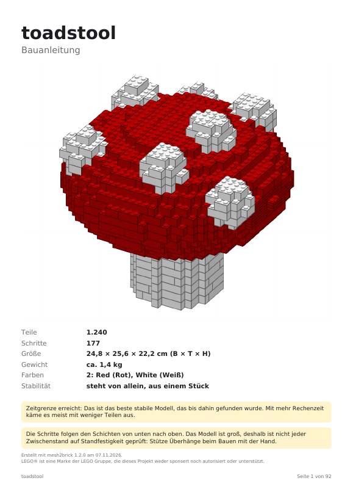

# Projektstatus

Stand: 2026-11-07 · **Roadmap 2 – harte Zeitgrenze fertig** ([#25](https://github.com/leckermatz79/mesh2brick/issues/25), wird Version 1.2.0) · Nächster Punkt: **deine Entscheidung zur Reihenfolge** (Rechenreihenfolge + Dachsteine oder Roadmap 3 – Stabilitätsprüfung für große Modelle, [#26](https://github.com/leckermatz79/mesh2brick/issues/26)), [ROADMAP.md](../ROADMAP.md), [Issues mit Label `roadmap`](https://github.com/leckermatz79/mesh2brick/issues?q=label%3Aroadmap))
Repo: https://github.com/leckermatz79/mesh2brick (öffentlich) · Plan: [PLAN.md](PLAN.md) · Messwerte: [benchmarks.md](benchmarks.md) · [Beispielgalerie](gallery/README.md) · Was 1.0 kann: [CHANGELOG.md](../CHANGELOG.md)

## Fazit in zwei Sätzen

- **Die Zeitgrenze hält jetzt wirklich:** Eine Umwandlung hält `placement.time_limit_s` ein (Standard 5 Minuten); legolization wird notfalls mitten in der Rechnung gestoppt. Ist ein Modell bis dahin nicht fertig optimiert, bekommst du das beste stabile Modell, das bis dahin gefunden wurde, und das Deckblatt sagt das.
- **Große Modelle gehen:** Duo bei 48 Noppen (2.308 Teile) ist mit 20 Minuten Zeit nach gut 12 Minuten fertig und steht stabil; vorher lief derselbe Fall über eine Stunde und wurde abgebrochen. Mit den Standard-5-Minuten kommt er nach 289 s als ehrlich markierter Zwischenstand.

| Fliegenpilz mit nur 2 Minuten Zeit: legolization wurde während der letzten Optimierung gestoppt, das Modell (1.240 Teile, stabil) ist trotzdem fertig, der gelbe Kasten sagt es |
|---|
|  |

## Erledigt (Roadmap 2)

- **Warum Duo bei 48 Noppen über eine Stunde lief:** Nicht der letzte Optimierungsschritt war schuld, wie vermutet, sondern schon die *erste* Stabilitätsberechnung nach dem Platzieren. Das ist eine große Rechenaufgabe (2.392 Teile), an der der Löser in der Einstellung von legolization stundenlang hängt. In einer anderen Einstellung (ohne den Abschlussschritt „crossover“) ist sie in 49 Sekunden gelöst.
- **Schnellerer Rechenweg für große Modelle:** mesh2brick probiert diese Einstellung jetzt, bevor es auf die langsame zurückfällt. Damit es nichts verschlechtert, habe ich an fünf Modellen alle 34 Stabilitätsberechnungen auf beiden Wegen gemacht: **34 von 34 Urteilen gleich** („stabil“/„nicht stabil“).
- **Harte Grenze:** legolization läuft jetzt in einem eigenen Prozess und meldet jeden Zwischenstand. Ist die Zeit um (abzüglich der Zeit, die PDF und Teilelisten brauchen), wird der Prozess beendet, egal wo er gerade rechnet. Genommen wird der beste Zwischenstand: geprüft stabil vor geprüft instabil vor ungeprüft.
- **Ehrlich markiert:** Auf dem Deckblatt steht dann „Zeitgrenze erreicht: Das ist das beste stabile Modell, das bis dahin gefunden wurde. Mit mehr Rechenzeit käme es meist mit weniger Teilen aus.“ Gab es noch kein stabiles Modell, steht dort „der letzte Zwischenstand“. Die Kommandozeile sagt zusätzlich, nach welchem Schritt und mit wie vielen Teilen.
- **Keine losen Steine mehr bei Duo:** Duo bei 48 Noppen hatte zuerst genau einen losen 1×2-Stein. Der Grund war ein kleiner Stummel im Modell, der seitlich absteht, ohne etwas darüber oder darunter. LEGO-Steine halten nur über die Noppen, also kann ihn kein Stein halten. Solche Zellen entfernt mesh2brick jetzt beim Voxelisieren, mit Hinweis; in keinem anderen Testmodell gibt es sie (0 von 15 geprüften Läufen). Danach blieb ein einzelner 1×1-Stein unter einem Überhang lose, weil legolization ihn nicht mit dem Nachbarn verbindet. Höchstens drei solche losen Teile nimmt mesh2brick nach dem Platzieren heraus und prüft die Stabilität neu, mit Hinweis; mehr bleiben drin und werden gemeldet.
- **Mehr Zeit gibst du selbst (deine Entscheidung):** `convert --time 20min` (auch `90s`, `1h`). Die Grenze wächst nie von allein. Dafür sagen `inspect` und der Start von `convert` ab rund 2.000 geschätzten Teilen „expected about 3,905 parts; recommended: --time 20min“ (so bei Duo mit 40 cm).
- **Kleinigkeiten:** Die KI-Schicht wird übersprungen (mit Hinweis), wenn vor dem Export weniger als 30 s übrig sind. Ist die Zeit schon vor dem Platzieren um, gibt es eine klare Fehlermeldung. Jede Umwandlung braucht etwa 1 s mehr für den Start des zweiten Prozesses.
- **Abnahme:**

| Abnahme (Issue #25) | Ergebnis |
|---|---|
| Duo bei 48 Noppen in ≤ 20 min, stabil oder klarer Bericht | **12 min, stabil, aus einem Stück** (2.308 Teile; 1.0: über 1 Stunde, abgebrochen) |
| 5 Minuten reichen weiter bis 2.000 Teile | **ja**: alle 13 öffentlichen Modelle wie in 1.0 (gleiche Teilezahlen, alle stabil), keins abgeschnitten, längster Fall bis 2.000 Teile 232 s (1.0: 265 s); der Texturwürfel mit 2.280 Teilen braucht 246 s (1.0: 294 s) |
| Harte Grenze am echten Modell | Duo bei 48 Noppen mit 5 Minuten: legolization nach 198 s gestoppt, fertig nach 289 s |

## Messwerte 1.2 (in Klammern 1.0)

| Modell | Teile | Zeit | stabil |
|---|---|---|---|
| Rakete (`.blend`, 32 Noppen) | 263 (263) | 15 s (14 s) | ja |
| Hase (32) | 873 (873) | 71 s (73 s) | ja |
| Fliegenpilz (32) | 1.240 (1.240) | 164 s (174 s) | ja |
| Kugel (32) | 1.499 (1.499) | 109 s (113 s) | ja |
| STEP-Burg (32, `--config`) | 1.651 (1.651) | 202 s (239 s) | ja |
| STEP-Würfel (32) | 1.952 (1.952) | 232 s (265 s) | ja |
| Texturwürfel (32) | 2.280 (2.280) | 246 s (294 s) | ja |
| Duo (32, nur lokal) | 1.025 (1.025) | 95 s (100 s) | ja |
| Duo (48, nur lokal, 5 min) | 2.371 (2.313) | **289 s** (479 s) | nein, abgeschnitten |
| Duo (48, nur lokal, 20 min) | 2.308 (–) | **733 s** (über 1 Stunde, abgebrochen) | **ja** |

Alle Zahlen: [benchmarks.md](benchmarks.md), Abschnitte „v1.0 acceptance“ und „Hard time limit“.

## Als Nächstes

Was kommt und in welcher Reihenfolge, steht in [ROADMAP.md](../ROADMAP.md) (von dir, 2026-11-07). Die Punkte 1–7 haben je ein [Issue mit Label `roadmap`](https://github.com/leckermatz79/mesh2brick/issues?q=label%3Aroadmap) (#24–#30) mit Abnahmekriterien, wie die Phasen.

**1.x – große Modelle möglich machen** (keine neuen Steinarten):

1. ~~Roadmap 1 – Größe in Zentimetern~~ ([#24](https://github.com/leckermatz79/mesh2brick/issues/24)): **fertig**, siehe oben.
2. ~~Roadmap 2 – harte Zeitgrenze~~ ([#25](https://github.com/leckermatz79/mesh2brick/issues/25)): **fertig**, siehe oben.
3. **Roadmap 3 – Stabilitätsprüfung auch für große Modelle** ([#26](https://github.com/leckermatz79/mesh2brick/issues/26)): Modelle über 500 Teilen bekommen Schritte Schicht für Schicht ohne Prüfung jedes Zwischenstands. **Vorher vielleicht:** die bessere Rechenreihenfolge und Dachsteine (siehe „Fragen an dich“), die du nach der Slope-Messung entscheidest.
4. Roadmap 4 ([#27](https://github.com/leckermatz79/mesh2brick/issues/27)) – kleinere PDFs bei großen geschlossenen Körpern (Ziel < 10 MB).
5. Roadmap 5 ([#28](https://github.com/leckermatz79/mesh2brick/issues/28)) – bessere Teileschätzung in `inspect` (15 von 15 im Bereich).
6. Roadmap 6 ([#29](https://github.com/leckermatz79/mesh2brick/issues/29)) – Bewertungsskala (1–5, 5 = am besten) in Hilfe und README.
7. Roadmap 7 ([#30](https://github.com/leckermatz79/mesh2brick/issues/30)) – Aufräumen: trimesh-Bericht (erledigt, [#2669](https://github.com/mikedh/trimesh/issues/2669)), optional alte Release-Seiten.

**Danach 2.0 – Formtreue:** Dachsteine, Tiles, runde Teile, SNOT (Roadmap 8–13). Upstream: Antworten auf legolization #88/#89 und #90/#91 sowie trimesh #2669 abwarten.

## Bekannte Einschränkungen

| Was | Einschätzung |
|---|---|
| KI-Texte können plausibel klingen und trotzdem ungenau sein (z. B. „links“ statt „hinten“). Die Prüfung erkennt falsche Teile und Mengen, aber keine falsche Richtung; Claude sieht nicht jedes Schrittbild. | akzeptieren; mit Bewertungen und Notizen nachsteuern |
| Die KI legt selten Schritte zusammen: Die kleinen hat mesh2brick schon vorher zusammengelegt, und die übrigen Nachbarn verdecken sich meist gegenseitig. | akzeptieren; der Nutzen liegt in Abschnitten und Texten |
| Für Claude-Modelle, deren Preise mesh2brick nicht kennt, gilt die Kostengrenze nicht (der Lauf sagt das). | Preistabelle bei neuen Modellen ergänzen |
| Große Modelle (> 500 Teile) bekommen Schritte Schicht für Schicht, nicht jeder Zwischenstand ist auf Standfestigkeit geprüft. | von dir akzeptiert; das Deckblatt sagt es in einem Satz; Roadmap 3 |
| Hängen mehrere vorher zusammengesteckte Teile aneinander, wird ein Schritt größer (Kugel bei 32 Noppen: einmal 18 Teile, sonst meist höchstens 10). | selten; eigener Code, falls es stört |
| Bei kleinen Modellen übernimmt legolization die Reihenfolge. Wo es selbst „braucht Stütze“ meldet, steht im PDF „Halte das Modell fest“. | akzeptiert |
| Dachsteine (Slopes) erscheinen in den Bildern als Quader. | eigener Code, wenn Slopes wieder an sind (Roadmap 8) |
| „Teile weglassen“ gilt fürs ganze Modell, nicht pro Farbe. | Upstream #9 (nach #8) |
| 1×1-Stein und 1×1-Platte lassen sich weder weglassen noch aufteilen. Gibt es sie in einer Modellfarbe nicht, meldet die Teileliste das. | selten; akzeptiert |
| legolization setzt nur Platten bis 2×8. Größere Platten würden Teile sparen. | Upstream-Kandidat #10 |
| Reine Computer-Grundfarben landen teils auf Nachbarfarben (#FF0000 → „Reddish Orange“). | von dir als Farbmetrik akzeptiert |
| Bemalte Farben aus dem Slicer und Texturen in 3MF werden noch nicht gelesen. | bei Bedarf |
| Slopes vorerst aus (legolization-Hänger, Upstream #2 offen). | nach Upstream-Fix wieder an (Roadmap 8) |
| Voxelisieren, PDF und Vorschau werden nicht abgebrochen; für sie hält mesh2brick Zeit frei (20 s + 0,03 s pro Teil, gemessen reichte das überall). Auf einem viel langsameren Rechner kann die Umwandlung die Grenze um einen Teil der PDF-Zeit überschreiten; die Kommandozeile sagt das dann. | akzeptieren |
| Wird ein Modell an der Zeitgrenze abgeschnitten, hat es meist etwas mehr Teile (die letzte Optimierung spart Teile) oder ist im ungünstigsten Fall nicht auf Stabilität geprüft. Deckblatt und Kommandozeile sagen das. | mehr Zeit geben (`--set placement.time_limit_s=1200`); Upstream-Kandidat #5 |
| Der schnellere Rechenweg und das Mitlesen der Zwischenstände sind lokale Eingriffe in legolization (UPSTREAM #2 und #5). Ändert legolization diese Stellen, meldet mesh2brick das beim Start. | bei Upstream vorschlagen (#5), wenn #88/#89 Antwort haben |
| Große geschlossene Körper (Würfel, der die ganze 32-Noppen-Box füllt) brauchen etwa 4 Minuten (232–246 s). Auf einem langsameren Laptop werden sie an der 5-Minuten-Grenze abgeschnitten (bestes stabiles Modell bis dahin), statt länger zu dauern. Ihre PDFs sind 20–23 MB groß. | Standard bleibt 32 Noppen; PDF-Größe: Roadmap 4 |
| Die Teileschätzung von `inspect` ist grob (Bereich etwa Faktor 2) und liegt bei dünnen, großen Platten zu niedrig. | `convert` gibt die genaue Zahl; Roadmap 5 |
| Spitze Formen werden mit `--size` etwas niedriger als gewünscht: Eine Spitze, die nicht einmal eine halbe Zelle füllt, fällt weg (dieselbe Regel wie bei allen dünnen Details). Rakete: 38,4 statt 40 cm, ihr fehlen oben 2 Lagen der Nasenspitze. Duo trifft die Höhe auf einen halben Stein genau. `inspect` zeigt die echte Höhe vorher. | akzeptieren; eigener Code (Größe nachregeln), falls es stört |
| `.blend`: Blender muss installiert sein. Die Tests mit echtem Blender laufen nur hier auf dem Mac; die automatischen Tests auf GitHub nutzen einen Blender-Ersatz. Verknüpfte Bibliotheken müssen vom Ordner der Datei aus erreichbar sein. | akzeptieren |
| glTF mit Draco-Kompression kann trimesh nicht lesen. | bei Bedarf; in Blender ohne Kompression exportieren |

## Umgebung (gut zu wissen)

- Die Python-Umgebung liegt außerhalb von Nextcloud (`.venv` ist ein Symlink nach `~/.local/share/venvs/mesh2brick`).
- Die LDraw-Teilebibliothek liegt in `~/Library/Caches/pyldraw3`, der Zwischenspeicher für Teilebeschreibungen in `~/Library/Caches/mesh2brick`. `samples/` (Duo) ist von Git ausgeschlossen.
- STEP braucht einmalig `uv sync --extra step`, die KI-Schicht `uv sync --extra llm` (beides zusammen: `uv sync --extra step --extra llm`) und `ANTHROPIC_API_KEY`.
- Der Bewertungsspeicher liegt in `~/Library/Application Support/mesh2brick/feedback.sqlite3` (anderer Ordner mit `MESH2BRICK_DATA_DIR`).
- Die Galeriebilder der PDF-Seiten entstehen mit `pdftoppm` (Homebrew-Paket poppler).
- Blender 4.0.1 liegt unter `/Applications/Blender.app` und wird automatisch gefunden. Ein anderes Blender: `MESH2BRICK_BLENDER=/pfad/zu/blender`.
- Galerie und Abnahme neu erzeugen: `uv run python scripts/benchmark_release.py --out out/release` (dauert etwa 30 Minuten), dann `uv run python scripts/make_gallery.py --results out/release`.

## Deine Entscheidungen

| Datum | Frage | Entscheidung |
|---|---|---|
| 2026-11-01 | Erster echter Testfall? | Duo (Eule aus `samples/`), **nur lokal**: nicht im Repo, nicht in der Galerie. |
| 2026-11-01 | Typische Modellgröße? | **32 Noppen** auf der längsten Achse (≈ 26 cm) als Standard, 48 erst später. |
| 2026-11-01 | LeoCAD für PDF-Schrittbilder installieren? | **Ja**, per Homebrew zu Beginn von Phase 2. Leider nicht möglich (s. o.). |
| 2026-11-01 | Fehlerbericht #2 bei legolization einreichen? | **Ja**, plus PR-Entwurf für das Zeitlimit; mit Hinweis, dass das Problem in einem Vibe-Coding-Projekt aufgefallen ist. Erledigt: Issue #88, Draft-PR #89. |
| 2026-11-01 | Wie lange darf eine Umwandlung dauern? | **5 Minuten.** Phase 2: Duo unter 5 Minuten als Zielmarke, Hebel per Benchmark wählen. Erreicht: 110 s (mit KI-Schicht 161 s). |
| 2026-11-01 | Manuelle Prüfung der `.ldr` in BrickLink Studio? | **Ja, Screenshot kommt später.** Bis dahin gilt der strenge Wieder-Einlese-Test als Prüfung. |
| 2026-11-01 | LeoCAD manuell installieren und nutzen? | **Nein.** Schrittbilder kommen vom eigenen Renderer. |
| 2026-11-01 | Schichtschritte für große Modelle (> 500 Teile)? | **Ja**, in Ordnung. |
| 2026-11-01 | STEP-Zusatzpaket mit 70 MB (über der 50-MB-Regel)? | **In Ordnung.** Ein vollständiger CAD-Kern rechtfertigt die Größe, er wird nur bei Bedarf installiert. Die Rückfrage war richtig: So soll die 50-MB-Regel funktionieren. |
| 2026-11-01 | Farben aus dem Modell automatisch übernehmen? | **Ja.** Einfarbig bleibt per Config erreichbar (`color.mode: single`). |
| 2026-11-01 | Gängige LEGO-Farben statt exakter Farbtöne? | **Ja.** Eine Anleitung, deren Steine man nicht kaufen kann, ist wertlos. Für Spezialfälle gibt es `color.palette: all`. |
| 2026-11-01 | Reines #FF0000 wird „Reddish Orange“ | **Kein Bug, sondern Farbmetrik.** Optional in Phase 4: kleine Ausnahmetabelle für reine Primärfarben. Erwähnen, nicht priorisieren. |
| 2026-11-01 | Upstream-Vorschlag „erlaubte Teile direkt angeben“ (#8) einreichen? | **Ja, einreichen.** Derselbe Fall wie #88/#89, und den lokalen Patch will man nicht dauerhaft pflegen. Im Issue kurz auf #89 verweisen, weil der Maintainer dort noch nicht reagiert hat, damit er den Zusammenhang sieht. Erledigt: Issue #90, Draft-PR #91. |
| 2026-11-01 | Steine, die es in einer Farbe nicht gibt, automatisch ersetzen? | **Ja, als Zwischenlösung** (1×8 → 2× 1×4, danach Stabilitätsprüfung). Sauber wäre, die Farbverfügbarkeit schon bei der Platzierung zu kennen (hängt am selben Upstream-Thema). **Phase 5 vergleicht beides im Benchmark an Duo:** Aufteilen danach gegen Einschränken davor. |
| 2026-11-01 | Manuelle Prüfung in BrickLink Studio | **Erledigt** (Duo, lokal): keine Überlappungen, keine Duplikate, 0 Stabilitätsprobleme, 31 Clutch-Hinweise (Flügel, Füße). Import hängt auf dem Mac, Datei → Öffnen geht (README). Schrittgrößen → Phase 6. |
| 2026-11-07 | Schritte pro Seite und Optik der Anleitung? | **2 Schritte pro Seite, Optik bleibt so.** |
| 2026-11-07 | Teile unter Überhängen: im selben Schritt oder eigener Mini-Bauabschnitt? | **Im selben Schritt** (vorher in der Hand zusammenstecken, gelbes „zuerst“-Feld). |
| 2026-11-07 | Farbnamen in der deutschen Anleitung? | **Englisch plus deutscher Name in Klammern** („Bright Green (Hellgrün)“). Umgesetzt in Phase 7. |
| 2026-11-07 | KI-Schicht standardmäßig einschalten? | **Nein**, bleibt aus (einschalten mit `--set llm.enabled=true`). |
| 2026-11-07 | Anrede in den Schritttexten? | **„du“** („Setze den Hut auf den Stiel.“). |
| 2026-11-07 | Bauabschnitte auf dem Deckblatt? | **Ja**, als Übersicht mit Seitenzahlen. Umgesetzt im Nachtrag zu Phase 7. |
| 2026-11-07 | Phase 7: Zugang zur Anthropic-API? | **`ANTHROPIC_API_KEY` ist gesetzt.** Für Entwicklung und Messungen dieser Phase wurden insgesamt etwa 1,05 $ verbraucht. |
| 2026-11-07 | Fehlerbericht an trimesh (#14) einreichen? | **Ja.** trimesh ist groß und aktiv gepflegt, da kommen Antworten. Wie bei legolization: Text überfliegen, dann den fertigen Befehl ausführen. Erledigt: [Issue #2669](https://github.com/mikedh/trimesh/issues/2669). |
| 2026-11-07 | Was nach 1.0 zuerst? | **[ROADMAP.md](../ROADMAP.md)**: 1.x = große Modelle (Größe in cm, harte Zeitgrenze, Stabilitätsprüfung, PDF-Größe, Schätzung), 2.0 = Formtreue (Dachsteine, Tiles, Rundungen, SNOT), 2.x = Robustheit und Anleitung. Grund: Wer 40 cm will, bekommt heute gar nichts. 2.0 ist vor allem für Familienbauten; ein persönliches Teilelager ist nicht Teil des Plans; Fork oder Warten bei legolization entscheidest du, wenn der erste 2.0-Punkt daran hängt. |
| 2026-11-07 | Eigenes Modell in der Galerie? | **Duo nein.** Ein selbst entworfenes Fusion-Modell wäre das beste Schaufenster (echtes CAD-Teil statt Testkörper). Es gibt keins (Fusion lässt sich hier nicht ohne Oberfläche steuern), also bleibt die Galerie bei den Testmodellen. |
| 2026-11-07 | Roadmap 1: Was meint „30 cm“? | **Die Höhe.** So denkt man über eine Figur; die längste Kante bleibt über `target_studs` (`--size 40studs`) erreichbar. |
| 2026-11-07 | Eigene kurze Option für die Größe? | **Ja, `--size 30cm`**, versteht auch `300mm` und `40studs`; `--set input.target_cm=30` tippt niemand gern zweimal. Umgesetzt; in der Config heißt der Wert `target_height_cm`, damit klar ist, dass er die Höhe meint. |
| 2026-11-07 | Große Modelle automatisch länger rechnen lassen? | **Nein, aber ein Hinweis.** Vorhersehbares Verhalten ist wichtiger: 5 Minuten sind 5 Minuten. `inspect` und der Start von `convert` sagen ab rund 2.000 geschätzten Teilen „expected about 3,905 parts; recommended: --time 20min“; du entscheidest. Umgesetzt. |
| 2026-11-07 | Kurze Option für die Zeit? | **Ja, `--time 20min`** (auch `90s`, `1h`), aus demselben Grund wie `--size`: Was man beim Ausprobieren tippt, verdient eine kurze Option. Umgesetzt. |
| 2026-11-07 | Schnelleren Rechenweg bei legolization vorschlagen? | **Ja, nach deinem Blick auf den Text.** Er benennt die Ursache statt des Symptoms und ist damit wertvoller als unser Zeitlimit-PR. Kommentar an #89, Verweis in #88. Text liegt bereit (Offene Kleinigkeiten). |
| 2026-11-07 | Vor Roadmap 3: Ist der Slope-Hänger dasselbe Crossover-Problem? | **Gemessen:** nein, ein Simplex-Problem, aber derselbe Ausweg hilft (Hase mit Dachsteinen 147 s → 17,5 s). Vorschlag zur Reihenfolge unter „Fragen an dich“. |

## Fragen an dich

1. **Roadmap-Reihenfolge: Dachsteine (Roadmap 8) vor Roadmap 3?** Deine Vermutung war fast richtig. Der Slope-Hänger ist nicht derselbe Crossover-Schritt, aber dieselbe Heilung wirkt. Bei Dachstein-Layouts bleibt der *Simplex*-Löser hängen; der Innere-Punkte-Löser ohne Crossover schafft dieselben Rechnungen in unter 1 s. Probiert man ihn zuerst, braucht der Hase mit Dachsteinen 17,5 s statt 147 s (ohne Dachsteine: 17 s), bei 32 Noppen 49 s statt 99 s, schneller als heute ganz ohne Dachsteine (53 s). Mein Vorschlag als nächster Punkt: **„Rechenreihenfolge + Dachsteine wieder an“**. Simplex bekommt nur 1 s, damit kleine Modelle nicht langsamer werden (sonst 7,8 → 17 s), danach der schnelle Weg. Dann prüfe ich, ob Dachsteine standardmäßig an sein können: alle Testmodelle stabil, höchstens doppelte Zeit. Danach erst Roadmap 3, die vom schnelleren Rechnen auch profitiert. Achtung: legolization setzt im heutigen Modus nur wenige Dachsteine (4 bei 224 Teilen, 14 bei 873); *mehr* Dachsteine bleiben die eigentliche Arbeit von Roadmap 8. *Standard, wenn du nichts sagst:* so machen (Rechenreihenfolge als nächster Punkt, Dachsteine nur bei sauberer Abnahme standardmäßig an).
2. **Kommentar für legolization:** Der Text für #89 und der Verweis für #88 stehen in [UPSTREAM.md](UPSTREAM.md), Entwurf #2b (auf Englisch). Wenn er dir passt, führst du die zwei fertigen Befehle aus, die ich dir im Chat gebe. *Standard:* Ohne dein OK geht nichts raus.

## Offene Kleinigkeiten

- **Ältere Release-Seiten** (v0.0.0 bis v0.7.0) fehlen weiterhin; die Tags existieren, v1.0.0 hat seine Seite (Roadmap 7, #30). Befehl für `v0.0.0`:
  `awk '/^## \[0.0.0\]/{f=1;next} /^## \[/{f=0} f' CHANGELOG.md | gh release create v0.0.0 --prerelease --title "v0.0.0 – Phase 0: skeleton" --notes-file -`
