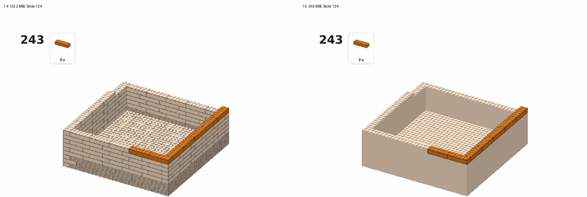

# Projektstatus

Stand: 2026-11-09 · **1.5.0 – kleinere PDFs bei großen Modellen fertig** ([#27](https://github.com/leckermatz79/mesh2brick/issues/27), ROADMAP Punkt 4) · davor 1.4.0 (Stabilitätsprüfung für große Modelle, [Release](https://github.com/leckermatz79/mesh2brick/releases/tag/v1.4.0)) · Nächster Punkt: **Roadmap 5 – bessere Teileschätzung in `inspect`** ([#28](https://github.com/leckermatz79/mesh2brick/issues/28), [ROADMAP.md](../ROADMAP.md))
Repo: https://github.com/leckermatz79/mesh2brick (öffentlich) · Plan: [PLAN.md](PLAN.md) · Messwerte: [benchmarks.md](benchmarks.md) · [Beispielgalerie](gallery/README.md) · Was 1.0 kann: [CHANGELOG.md](../CHANGELOG.md)

## Fazit in zwei Sätzen

- **Jede Anleitung der Testmodelle ist jetzt kleiner als 10 MB:** Texturwürfel 23,2 → 9,6 MB, Würfel 20,4 → 6,4 MB, Burg 19,4 → 5,1 MB. Fast das ganze PDF waren die Schrittbilder; bei großen Modellen sind die schon gebauten Teile darin jetzt ruhige Flächen mit Noppen, aber ohne Fugen, wie du es auf der Vergleichsseite gewählt hast. Dadurch springen die neuen Teile mehr ins Auge, und das PDF ist auch schneller fertig.
- **Kleine Modelle bis 500 Teile sehen genau aus wie in 1.4**, Seite für Seite pixelgleich.

| Gleiche Schrittseite des Texturwürfels: links 1.4, rechts 1.5 (große Modelle) |
|---|
|  |

## Erledigt (1.5.0, ROADMAP Punkt 4)

- **Erst gemessen, wo die Bytes liegen:** Bei großen Modellen sind 85–95 % des PDFs die Schrittbilder; Teilebilder, Deckblatt, Text und Schriften zusammen nur 0,4–1,3 MB. Ein Schrittbild wird so groß, wie viel Fläche das Modell darin bedeckt, und die Bytes stecken in den Kanten: Fugen zwischen den Teilen und Noppenränder.
- **Die Hebel einzeln gemessen** (Zahlen in [benchmarks.md](benchmarks.md), „PDF size“, Begründung in ADR 0018):
  - a) Eine andere Farbpalette (Octree statt Median-Cut) spart 27–42 % ohne sichtbaren Unterschied (höchstens eine Farbstufe). Bessere Kompression bringt kaum etwas (unter 2 %). Ohne Kantenglättung wären es zwei Drittel weniger, aber mit treppigen, dickeren Fugen.
  - b) Mit 110 statt 130 dpi wird es ein Fünftel kleiner; ein Teil ist immer noch klar zu erkennen.
  - c) Vektorgrafik statt Bild wäre 6–15-mal **größer**. Sie lohnt sich nur bei ein oder zwei Teilen und fällt deshalb weg.
  - d) Ohne Fugen auf den schon gebauten Teilen halbiert sich ein Bild, und das neue Teil sticht heraus. Ohne deren Noppen wäre es noch kleiner, aber dann könntest du keine Position mehr abzählen; das habe ich verworfen.
- **Deine Entscheidung (Vergleichsseite):** d) nur für große Modelle, dazu a) und b). Nur so kommt der Texturwürfel mit seinem zweifarbigen Muster unter 10 MB; a) und b) allein hätten bei ihm 13 MB ergeben.
- **Damit es nicht wieder wächst:** Der Release-Benchmark zeigt kB pro Schritt und warnt ab 40 kB bei großen Modellen (1.4: 43–75 kB, jetzt 21–29 kB); ein Test begrenzt die Größe eines Schrittbilds.

| Abnahme (Issue #27) | Ergebnis |
|---|---|
| Texturwürfel, Würfel und Burg unter 10 MB; Kugel und Vertex-Modell deutlich darunter | **ja**: 9,56 / 6,39 / 5,11 MB; Kugel 4,39, Vertex-Modell 5,58 MB |
| Neues Teil in jedem Schritt klar erkennbar (A4, 100 % und Druck); Vorher-/Nachher-Seite je Testmodell | **ja**, Seiten zum Vergleichen in `out/pdf-size/vorher-nachher/` (eine je Modell) |
| Kleine Modelle: PDF nicht größer, Seiten pixelgleich | **ja**: Herz 0,29, L-Winkel 1,22, Rakete 1,19 MB wie 1.4, alle Schrittseiten pixelgleich |
| Text bleibt Vektor; Teilebilder, Callouts, Deckblatt unverändert | **ja** |
| PDF-Zeit höchstens +50 % | **schneller**: Texturwürfel 52 → 31 s, Würfel 42 → 26 s, Kugel 43 → 24 s |
| Alle unter 5 Minuten, Teile und Schritte unverändert, Seitenzahl gleich | **ja**: längster Fall 261 s, Teile, Schritte und Seiten wie 1.4 |
| Tests: Größen-Obergrenze je Schrittbild (künstliches großes Modell), Rundreise mit pypdf | **ja** |

## Messwerte 1.5 (in Klammern 1.4)

| Modell | Teile | Schritte | PDF | PDF-Zeit | Umwandlung gesamt |
|---|---|---|---|---|---|
| Herz | 12 | 7 | 0,29 MB (0,29) | 0 s | 4 s (4 s) |
| L-Winkel | 153 | 37 | 1,22 MB (1,22) | 3 s | 30 s (29 s) |
| Rakete (`.blend`) | 263 | 42 | 1,19 MB (1,19) | 3 s | 19 s (19 s) |
| Torus | 552 | 74 | 1,98 MB (4,11) | 5 s | 33 s (36 s) |
| Zwei Körper (STEP) | 606 | 83 | 2,24 MB (4,22) | 6 s | 163 s (166 s) |
| Hase | 873 | 126 | 2,62 MB (5,59) | 9 s | 121 s (125 s) |
| Duo (32, nur lokal) | 1.025 | 153 | 3,74 MB (6,99) | 11 s | 128 s (139 s) |
| Fliegenpilz | 1.239 | 178 | 3,88 MB (7,61) | 16 s | 250 s (259 s) |
| Kugel | 1.499 | 207 | 4,39 MB (10,11) | 24 s | 261 s (280 s) |
| Vertex-Modell (PLY) | 1.519 | 212 | 5,58 MB (9,91) | 24 s | 260 s (281 s) |
| STEP-Burg (`--config`) | 1.657 | 234 | 5,11 MB (19,35) | 19 s | 251 s (265 s) |
| STEP-Würfel | 1.952 | 274 | 6,39 MB (20,36) | 26 s | 250 s (265 s) |
| Texturwürfel | 2.280 | 327 | 9,56 MB (23,22) | 31 s | 245 s (266 s) |
| Duo (48, nur lokal, 20 min) | 2.308 | 324 | 7,61 MB (16,43) | 37 s | 1.151 s (1.189 s) |

Alle stabil und aus einem Stück; Dateien, Teilelisten und LDraw-Prüfung bestehen. Die Stabilitätsprüfung nutzt die frei gewordene PDF-Zeit nicht zusätzlich (ihr Zeitpolster richtet sich nach der Teilezahl), deshalb sind große Umwandlungen etwas kürzer.

## Als Nächstes

Was kommt und in welcher Reihenfolge, steht in [ROADMAP.md](../ROADMAP.md) (von dir, 2026-11-07). Die Punkte 1–7 haben je ein [Issue mit Label `roadmap`](https://github.com/leckermatz79/mesh2brick/issues?q=label%3Aroadmap) (#24–#30) mit Abnahmekriterien, wie die Phasen.

**1.x – große Modelle möglich machen** (keine neuen Steinarten):

1. ~~Roadmap 1 – Größe in Zentimetern~~ ([#24](https://github.com/leckermatz79/mesh2brick/issues/24)): **fertig**, siehe oben.
2. ~~Roadmap 2 – harte Zeitgrenze~~ ([#25](https://github.com/leckermatz79/mesh2brick/issues/25)): **fertig**, siehe oben.
3. ~~Löserreihenfolge + Dachsteine wieder an~~ (ROADMAP Punkt 8, [#34](https://github.com/leckermatz79/mesh2brick/issues/34)): **fertig in 1.3.0**, siehe oben.
4. ~~Roadmap 3 – Stabilitätsprüfung auch für große Modelle~~ ([#26](https://github.com/leckermatz79/mesh2brick/issues/26)): **fertig in 1.4.0**, siehe oben.
5. ~~Roadmap 4 – kleinere PDFs~~ ([#27](https://github.com/leckermatz79/mesh2brick/issues/27)): **fertig in 1.5.0**, siehe oben.
6. **Roadmap 5 – bessere Teileschätzung in `inspect`** ([#28](https://github.com/leckermatz79/mesh2brick/issues/28), nächster Punkt): 15 von 15 Testläufen im angezeigten Bereich.
7. Roadmap 6 ([#29](https://github.com/leckermatz79/mesh2brick/issues/29)) – Bewertungsskala (1–5, 5 = am besten) in Hilfe und README.
8. Roadmap 7 ([#30](https://github.com/leckermatz79/mesh2brick/issues/30)) – Aufräumen: trimesh-Bericht (erledigt, [#2669](https://github.com/mikedh/trimesh/issues/2669)), optional alte Release-Seiten.

**Danach 2.0 – Formtreue:** mehr Dachsteine, Tiles, runde Teile, SNOT (Roadmap 8–13). Upstream: Antworten auf legolization #88/#89 und #90/#91 sowie trimesh #2669 abwarten.

## Bekannte Einschränkungen

| Was | Einschätzung |
|---|---|
| KI-Texte können plausibel klingen und trotzdem ungenau sein (z. B. „links“ statt „hinten“). Die Prüfung erkennt falsche Teile und Mengen, aber keine falsche Richtung; Claude sieht nicht jedes Schrittbild. | akzeptieren; mit Bewertungen und Notizen nachsteuern |
| Die KI legt selten Schritte zusammen: Die kleinen hat mesh2brick schon vorher zusammengelegt, und die übrigen Nachbarn verdecken sich meist gegenseitig. | akzeptieren; der Nutzen liegt in Abschnitten und Texten |
| Für Claude-Modelle, deren Preise mesh2brick nicht kennt, gilt die Kostengrenze nicht (der Lauf sagt das). | Preistabelle bei neuen Modellen ergänzen |
| Große Modelle prüfen ihre Zwischenstände in der Zeit, die nach der Platzierung bleibt. In 5 Minuten schaffen die größten Testmodelle 40–87 % (Würfel, Burg, Vertex-Modell, Kugel); die ungeprüften stehen oben im Modell. Deckblatt und Kommandozeile sagen, wie viele geprüft sind. | `--time 20min` prüft alle; kein eigener Code nötig |
| Während der Prüfung rechnet mesh2brick auf allen Kernen bis auf einen (bis zu einige Minuten, Lüfter hörbar). | von dir so gewollt (2026-11-09) |
| Kleine Modelle (bis 500 Teile) nutzen weiter legolizations Suche; die geprüfte Schichtfolge wäre auch dort schneller und bräuchte seltener eine Hand (Rakete: 0 statt 11 Schritte). | von dir so entschieden (2026-11-09); Wiedervorlage bei 2.x Punkt 17 |
| Hängen mehrere vorher zusammengesteckte Teile aneinander, wird ein Schritt größer (Kugel bei 32 Noppen: einmal 18 Teile, sonst meist höchstens 10). | selten; eigener Code, falls es stört |
| Bei kleinen Modellen übernimmt legolization die Reihenfolge, bei großen die geprüfte Schichtfolge. Wo die Stabilitätsrechnung „braucht Stütze“ meldet, steht im PDF „Halte das Modell fest“. | akzeptiert |
| „Teile weglassen“ gilt fürs ganze Modell, nicht pro Farbe. | Upstream #9 (nach #8) |
| 1×1-Stein und 1×1-Platte lassen sich weder weglassen noch aufteilen. Gibt es sie in einer Modellfarbe nicht, meldet die Teileliste das. | selten; akzeptiert |
| legolization setzt nur Platten bis 2×8. Größere Platten würden Teile sparen. | Upstream-Kandidat #10 |
| Reine Computer-Grundfarben landen teils auf Nachbarfarben (#FF0000 → „Reddish Orange“). | von dir als Farbmetrik akzeptiert |
| Bemalte Farben aus dem Slicer und Texturen in 3MF werden noch nicht gelesen. | bei Bedarf |
| Dachsteine sind an, aber legolization setzt nur wenige, und die meisten liegen innen in der hohlen Wand (10 von 130 sichtbar). | eigener Code in 2.0 (ROADMAP Punkt 8, zweiter Teil) |
| Voxelisieren, PDF und Vorschau werden nicht abgebrochen; für sie hält mesh2brick Zeit frei (20 s + 0,03 s pro Teil, gemessen reichte das überall). Auf einem viel langsameren Rechner kann die Umwandlung die Grenze um einen Teil der PDF-Zeit überschreiten; die Kommandozeile sagt das dann. | akzeptieren |
| Wird ein Modell an der Zeitgrenze abgeschnitten, hat es meist etwas mehr Teile (die letzte Optimierung spart Teile) oder ist im ungünstigsten Fall nicht auf Stabilität geprüft. Deckblatt und Kommandozeile sagen das. | mehr Zeit geben (`--set placement.time_limit_s=1200`); Upstream-Kandidat #5 |
| Der schnellere Rechenweg und das Mitlesen der Zwischenstände sind lokale Eingriffe in legolization (UPSTREAM #2 und #5). Ändert legolization diese Stellen, meldet mesh2brick das beim Start. | bei Upstream vorschlagen (#5), wenn #88/#89 Antwort haben |
| Große geschlossene Körper (Würfel, der die ganze 32-Noppen-Box füllt) brauchen für die Platzierung etwa 3 Minuten; den Rest der 5 Minuten verwenden sie für die Prüfung. Auf einem langsameren Laptop bleibt weniger für die Prüfung oder sie werden an der 5-Minuten-Grenze abgeschnitten (bestes stabiles Modell bis dahin), statt länger zu dauern. | Standard bleibt 32 Noppen |
| Der Texturwürfel liegt mit 9,6 MB knapp unter 10 MB; ein noch größerer geschlossener Körper bei 32 Noppen kann darüber liegen. Der Release-Benchmark warnt dann (kB pro Schritt). | akzeptieren; bei Bedarf 100 dpi für sehr große Modelle |
| Die Teileschätzung von `inspect` ist grob (Bereich etwa Faktor 2) und liegt bei dünnen, großen Platten zu niedrig. | `convert` gibt die genaue Zahl; Roadmap 5 |
| Spitze Formen werden mit `--size` etwas niedriger als gewünscht: Eine Spitze, die nicht einmal eine halbe Zelle füllt, fällt weg (dieselbe Regel wie bei allen dünnen Details). Rakete: 38,4 statt 40 cm, ihr fehlen oben 2 Lagen der Nasenspitze. Duo trifft die Höhe auf einen halben Stein genau. `inspect` zeigt die echte Höhe vorher. | akzeptieren; eigener Code (Größe nachregeln), falls es stört |
| `.blend`: Blender muss installiert sein. Die Tests mit echtem Blender laufen nur hier auf dem Mac; die automatischen Tests auf GitHub nutzen einen Blender-Ersatz. Verknüpfte Bibliotheken müssen vom Ordner der Datei aus erreichbar sein. | akzeptieren |
| glTF mit Draco-Kompression kann trimesh nicht lesen. | bei Bedarf; in Blender ohne Kompression exportieren |

## Umgebung (gut zu wissen)

- Die Python-Umgebung liegt außerhalb von Nextcloud (`.venv` ist ein Symlink nach `~/.local/share/venvs/mesh2brick`).
- Die LDraw-Teilebibliothek liegt in `~/Library/Caches/pyldraw3`, der Zwischenspeicher für Teilebeschreibungen in `~/Library/Caches/mesh2brick`. `samples/` (Duo) ist von Git ausgeschlossen.
- STEP braucht einmalig `uv sync --extra step`, die KI-Schicht `uv sync --extra llm` (beides zusammen: `uv sync --extra step --extra llm`) und `ANTHROPIC_API_KEY`.
- Der Bewertungsspeicher liegt in `~/Library/Application Support/mesh2brick/feedback.sqlite3` (anderer Ordner mit `MESH2BRICK_DATA_DIR`).
- Die Galeriebilder der PDF-Seiten entstehen mit `pdftoppm` (Homebrew-Paket poppler).
- Lange Messläufe brauchen einen offenen Deckel: Zugeklappt auf Akku schläft der Laptop, und die Prüfprozesse bekommen kaum Rechenzeit (so geschehen beim ersten 1.4-Lauf; die Duo-Fälle wurden wiederholt).
- Blender 4.0.1 liegt unter `/Applications/Blender.app` und wird automatisch gefunden. Ein anderes Blender: `MESH2BRICK_BLENDER=/pfad/zu/blender`.
- Galerie und Abnahme neu erzeugen: `uv run python scripts/benchmark_release.py --out out/release` (dauert etwa 30 Minuten), dann `uv run python scripts/make_gallery.py --results out/release`.

## Deine Entscheidungen

| Datum | Frage | Entscheidung |
|---|---|---|
| 2026-11-01 | Erster echter Testfall? | Duo (Eule aus `samples/`), **nur lokal**: nicht im Repo, nicht in der Galerie. |
| 2026-11-01 | Typische Modellgröße? | **32 Noppen** auf der längsten Achse (≈ 26 cm) als Standard, 48 erst später. |
| 2026-11-01 | LeoCAD für PDF-Schrittbilder installieren? | **Ja**, per Homebrew zu Beginn von Phase 2. Leider nicht möglich (s. o.). |
| 2026-11-01 | Fehlerbericht #2 bei legolization einreichen? | **Ja**, plus PR-Entwurf für das Zeitlimit; mit Hinweis, dass das Problem in einem Vibe-Coding-Projekt aufgefallen ist. Erledigt: Issue #88, Draft-PR #89. |
| 2026-11-01 | Wie lange darf eine Umwandlung dauern? | **5 Minuten.** Phase 2: Duo unter 5 Minuten als Zielmarke, Hebel per Benchmark wählen. Erreicht: 110 s (mit KI-Schicht 161 s). |
| 2026-11-01 | Manuelle Prüfung der `.ldr` in BrickLink Studio? | **Ja, Screenshot kommt später.** Bis dahin gilt der strenge Wieder-Einlese-Test als Prüfung. |
| 2026-11-01 | LeoCAD manuell installieren und nutzen? | **Nein.** Schrittbilder kommen vom eigenen Renderer. |
| 2026-11-01 | Schichtschritte für große Modelle (> 500 Teile)? | **Ja**, in Ordnung. |
| 2026-11-01 | STEP-Zusatzpaket mit 70 MB (über der 50-MB-Regel)? | **In Ordnung.** Ein vollständiger CAD-Kern rechtfertigt die Größe, er wird nur bei Bedarf installiert. Die Rückfrage war richtig: So soll die 50-MB-Regel funktionieren. |
| 2026-11-01 | Farben aus dem Modell automatisch übernehmen? | **Ja.** Einfarbig bleibt per Config erreichbar (`color.mode: single`). |
| 2026-11-01 | Gängige LEGO-Farben statt exakter Farbtöne? | **Ja.** Eine Anleitung, deren Steine man nicht kaufen kann, ist wertlos. Für Spezialfälle gibt es `color.palette: all`. |
| 2026-11-01 | Reines #FF0000 wird „Reddish Orange“ | **Kein Bug, sondern Farbmetrik.** Optional in Phase 4: kleine Ausnahmetabelle für reine Primärfarben. Erwähnen, nicht priorisieren. |
| 2026-11-01 | Upstream-Vorschlag „erlaubte Teile direkt angeben“ (#8) einreichen? | **Ja, einreichen.** Derselbe Fall wie #88/#89, und den lokalen Patch will man nicht dauerhaft pflegen. Im Issue kurz auf #89 verweisen, weil der Maintainer dort noch nicht reagiert hat, damit er den Zusammenhang sieht. Erledigt: Issue #90, Draft-PR #91. |
| 2026-11-01 | Steine, die es in einer Farbe nicht gibt, automatisch ersetzen? | **Ja, als Zwischenlösung** (1×8 → 2× 1×4, danach Stabilitätsprüfung). Sauber wäre, die Farbverfügbarkeit schon bei der Platzierung zu kennen (hängt am selben Upstream-Thema). **Phase 5 vergleicht beides im Benchmark an Duo:** Aufteilen danach gegen Einschränken davor. |
| 2026-11-01 | Manuelle Prüfung in BrickLink Studio | **Erledigt** (Duo, lokal): keine Überlappungen, keine Duplikate, 0 Stabilitätsprobleme, 31 Clutch-Hinweise (Flügel, Füße). Import hängt auf dem Mac, Datei → Öffnen geht (README). Schrittgrößen → Phase 6. |
| 2026-11-07 | Schritte pro Seite und Optik der Anleitung? | **2 Schritte pro Seite, Optik bleibt so.** |
| 2026-11-07 | Teile unter Überhängen: im selben Schritt oder eigener Mini-Bauabschnitt? | **Im selben Schritt** (vorher in der Hand zusammenstecken, gelbes „zuerst“-Feld). |
| 2026-11-07 | Farbnamen in der deutschen Anleitung? | **Englisch plus deutscher Name in Klammern** („Bright Green (Hellgrün)“). Umgesetzt in Phase 7. |
| 2026-11-07 | KI-Schicht standardmäßig einschalten? | **Nein**, bleibt aus (einschalten mit `--set llm.enabled=true`). |
| 2026-11-07 | Anrede in den Schritttexten? | **„du“** („Setze den Hut auf den Stiel.“). |
| 2026-11-07 | Bauabschnitte auf dem Deckblatt? | **Ja**, als Übersicht mit Seitenzahlen. Umgesetzt im Nachtrag zu Phase 7. |
| 2026-11-07 | Phase 7: Zugang zur Anthropic-API? | **`ANTHROPIC_API_KEY` ist gesetzt.** Für Entwicklung und Messungen dieser Phase wurden insgesamt etwa 1,05 $ verbraucht. |
| 2026-11-07 | Fehlerbericht an trimesh (#14) einreichen? | **Ja.** trimesh ist groß und aktiv gepflegt, da kommen Antworten. Wie bei legolization: Text überfliegen, dann den fertigen Befehl ausführen. Erledigt: [Issue #2669](https://github.com/mikedh/trimesh/issues/2669). |
| 2026-11-07 | Was nach 1.0 zuerst? | **[ROADMAP.md](../ROADMAP.md)**: 1.x = große Modelle (Größe in cm, harte Zeitgrenze, Stabilitätsprüfung, PDF-Größe, Schätzung), 2.0 = Formtreue (Dachsteine, Tiles, Rundungen, SNOT), 2.x = Robustheit und Anleitung. Grund: Wer 40 cm will, bekommt heute gar nichts. 2.0 ist vor allem für Familienbauten; ein persönliches Teilelager ist nicht Teil des Plans; Fork oder Warten bei legolization entscheidest du, wenn der erste 2.0-Punkt daran hängt. |
| 2026-11-07 | Eigenes Modell in der Galerie? | **Duo nein.** Ein selbst entworfenes Fusion-Modell wäre das beste Schaufenster (echtes CAD-Teil statt Testkörper). Es gibt keins (Fusion lässt sich hier nicht ohne Oberfläche steuern), also bleibt die Galerie bei den Testmodellen. |
| 2026-11-07 | Roadmap 1: Was meint „30 cm“? | **Die Höhe.** So denkt man über eine Figur; die längste Kante bleibt über `target_studs` (`--size 40studs`) erreichbar. |
| 2026-11-07 | Eigene kurze Option für die Größe? | **Ja, `--size 30cm`**, versteht auch `300mm` und `40studs`; `--set input.target_cm=30` tippt niemand gern zweimal. Umgesetzt; in der Config heißt der Wert `target_height_cm`, damit klar ist, dass er die Höhe meint. |
| 2026-11-07 | Große Modelle automatisch länger rechnen lassen? | **Nein, aber ein Hinweis.** Vorhersehbares Verhalten ist wichtiger: 5 Minuten sind 5 Minuten. `inspect` und der Start von `convert` sagen ab rund 2.000 geschätzten Teilen „expected about 3,905 parts; recommended: --time 20min“; du entscheidest. Umgesetzt. |
| 2026-11-07 | Kurze Option für die Zeit? | **Ja, `--time 20min`** (auch `90s`, `1h`), aus demselben Grund wie `--size`: Was man beim Ausprobieren tippt, verdient eine kurze Option. Umgesetzt. |
| 2026-11-07 | Schnelleren Rechenweg bei legolization vorschlagen? | **Ja, nach deinem Blick auf den Text.** Er benennt die Ursache statt des Symptoms und ist damit wertvoller als unser Zeitlimit-PR. Kommentar an #89, Verweis in #88. **Erledigt** von dir: [Kommentar an #89](https://github.com/hbmartin/legolization/pull/89#issuecomment-6712391855), [Verweis in #88](https://github.com/hbmartin/legolization/issues/88#issuecomment-6712393969). |
| 2026-11-07 | Vor Roadmap 3: Ist der Slope-Hänger dasselbe Crossover-Problem? | **Gemessen:** nein, ein Simplex-Problem, aber derselbe Ausweg hilft (Hase mit Dachsteinen 147 s → 17,5 s). Vorschlag: Löserreihenfolge zuerst. |
| 2026-11-07 | Reihenfolge nach der Slope-Messung? | **Erst Löserreihenfolge + Dachsteine wieder an als 1.3.0, dann Roadmap 3.** Vorher „Simplex 1 s, dann Innere-Punkte-Löser“ messen; kleine Modelle dürfen nicht spürbar langsamer werden, die 5-s-Grenze pro Versuch bleibt. Dachsteine nur standardmäßig an, wenn alle Testmodelle stabil sind und höchstens die doppelte Zeit brauchen. ROADMAP Punkt 8 ist in die 1.x-Liste gerückt; mehr Dachsteine setzen bleibt in 2.0. |
| 2026-11-09 | Kleine Modelle auch auf die geprüfte Schichtfolge umstellen? | **Nein**, bis 500 Teile bleibt legolizations Suche wie in 1.3. Zum Vergleich die Rakete beide Male als PDF (Befehle unter „Offene Kleinigkeiten“). **Wiedervorlage bei 2.x Punkt 17** (geometrische Baugruppen). |
| 2026-11-09 | Alle Kerne für die Prüfung? | **Ja, alle bis auf einen.** Keine Einstellung dafür. |
| 2026-11-09 | legolization-Issue zu den drei Funden einreichen? | **Ja**, nach deinem Blick auf den Text; mit Halbsatz-Verweis auf #88/#89 (ergänzt). Befehl unter „Offene Kleinigkeiten“. |
| 2026-11-09 | Schrittbilder großer Modelle: schon gebaute Teile ohne Fugen? | **Ja, aber nur für große Modelle** (über 500 Teile), dazu 110 dpi und die sparsamere Farbpalette; kleine Modelle bleiben wie 1.4. Gewählt auf einer Vergleichsseite (wie 1.4 / unsichtbar sparsamer / ohne Fugen). |

## Fragen an dich

Zurzeit keine. Deine Antwort zur Optik der Schrittbilder (Roadmap 4) steht unter „Deine Entscheidungen“.

## Offene Kleinigkeiten

- **Rakete im Vergleich** (Wiedervorlage bei 2.x Punkt 17): legolizations Suche (Standard, mit blauen Baugruppen) gegen die geprüfte Schichtfolge mit Mini-Vorbauten:
  `uv run mesh2brick convert tests/fixtures/rocket.blend -o out/rocket-suche`
  `uv run mesh2brick convert tests/fixtures/rocket.blend -o out/rocket-schichten --set steps.sequencing=checked-layers`
  Danach `out/rocket-suche/rocket.pdf` und `out/rocket-schichten/rocket.pdf` nebeneinanderlegen (gemessen: 11 gegen 0 Schritte mit „Halte fest“).
- **legolization-Issue** (Entwurf #15–17 in [UPSTREAM.md](UPSTREAM.md), Text in `out/upstream/legolization-step-planning.md`), nach deinem Blick auf den Text:
  `gh issue create --repo hbmartin/legolization --title "Step planning on large hollow models: where the time goes (measurements, two small fixes)" --body-file out/upstream/legolization-step-planning.md`
- **Ältere Release-Seiten** (v0.0.0 bis v0.7.0) fehlen weiterhin; die Tags existieren, v1.0.0 hat seine Seite (Roadmap 7, #30). Befehl für `v0.0.0`:
  `awk '/^## \[0.0.0\]/{f=1;next} /^## \[/{f=0} f' CHANGELOG.md | gh release create v0.0.0 --prerelease --title "v0.0.0 – Phase 0: skeleton" --notes-file -`
