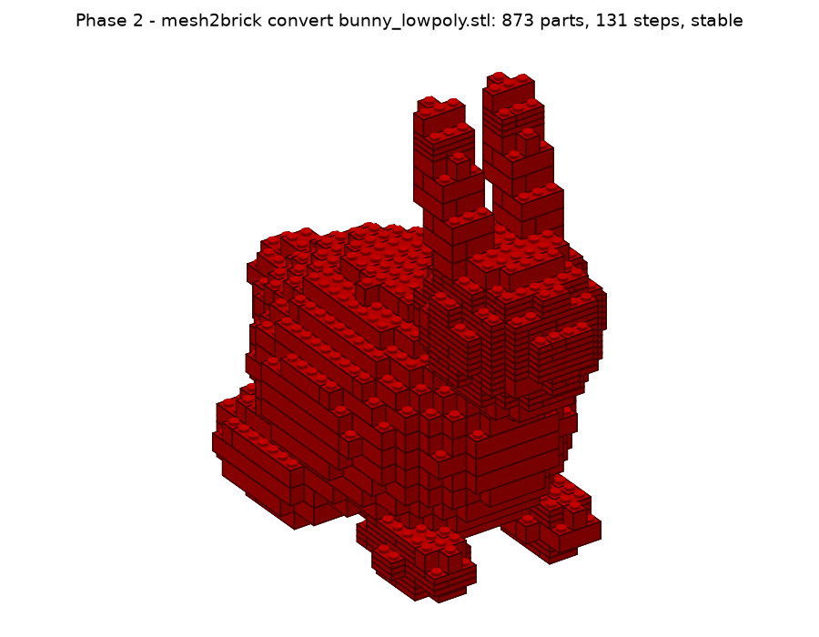
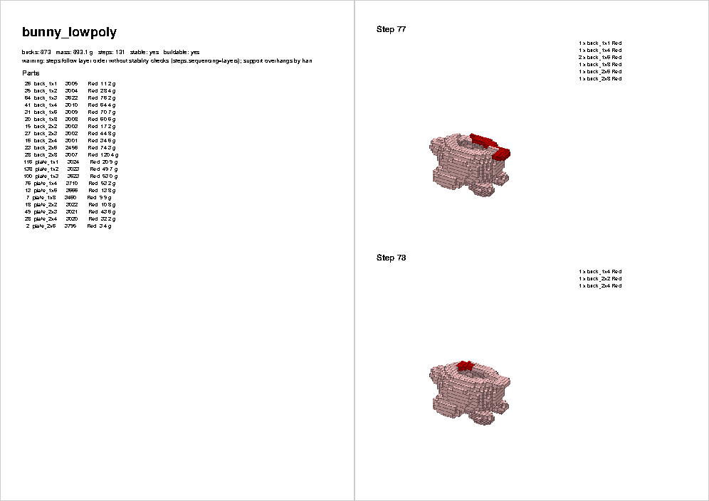

# Projektstatus

Stand: 2026-11-01 · Aktuelle Phase: **2 – End-to-End (MVP): fertig, wartet auf Merge (PR #13)** · Nächste: **Phase 3 – STEP + Farben**
Repo: https://github.com/leckermatz79/mesh2brick (öffentlich) · Plan: [PLAN.md](PLAN.md) · Messwerte: [benchmarks.md](benchmarks.md)

## Fazit in zwei Sätzen

`mesh2brick convert hase.stl` liefert jetzt in einem Befehl:
- das LDraw-Modell,
- drei Teilelisten (CSV, BrickLink, Rebrickable),
- eine PDF-Bauanleitung.

Der Hase hat 873 Teile, steht stabil und ist in 72 Sekunden fertig. Duo braucht 110 Sekunden statt vorher über 10 Minuten, die Zielmarke von 5 Minuten ist damit klar unterschritten.

| Ergebnis | PDF: Deckblatt und Schrittseite |
|---|---|
|  |  |

## Erledigt (Phase 2)

- **`mesh2brick convert`**: Mesh oder Voxeldatei → `.ldr`/`.mpd`, Steinmodell, Teilelisten, PDF und Vorschaubild. Jede Stufe wird mit Zeit angezeigt.
- **Teilelisten (ADR 0005):**
  - Formate: eigene CSV (vollständig), BrickLink-Wunschliste (XML) und Rebrickable-CSV.
  - BrickLink und Rebrickable nummerieren teilweise anders. Beispiel: Rot ist in LDraw 4, bei BrickLink 5; aus `3070b` wird bei BrickLink `3070`.
  - Die Übersetzungstabelle stammt aus den Katalogen selbst und ist geprüft: alle 52 Teile und 93 von 111 Farben. Die übrigen Farben sind exotisch, zum Beispiel Leuchtfarben. Sie werden gemeldet, nicht geraten.
- **PDF:** legolizations Bauheft mit unseren eigenen Schrittbildern (LeoCAD ließ sich nicht installieren, s. u.). Pro Schritt sind die neuen Teile kräftig gefärbt, die vorherigen blass. A4/Letter nach Einstellung.
- **Selbstkontrolle:** Jede erzeugte `.ldr` wird mit legolizations strengem LDraw-Leser wieder eingelesen. Geprüft wird, dass jedes Teil bekannt ist, auf dem Raster liegt, in einer gültigen Farbe ist und nichts sich überschneidet. Hase: 873/873, Duo: 1.077/1.077.
- **Schneller Renderer:** Die Vorschau ist 8× schneller, 131 Schrittbilder dauern 14 s. Die Bilder werden zusätzlich verlustarm verkleinert.
- **Fehler gefunden und behoben:**
  - Duo hatte eine winzige lose Insel aus 2 Voxeln. Deshalb galt das ganze Modell als „nicht baubar", und legolization suchte minutenlang nach Reparaturen.
  - Lose Inseln unter 5 % des Modells werden jetzt entfernt (`voxel.min_island_fraction`). Größere bleiben erhalten und werden gemeldet.
- **Upstream:** Fehlerbericht [#88](https://github.com/hbmartin/legolization/issues/88) und Draft-PR [#89](https://github.com/hbmartin/legolization/pull/89) eingereicht, mit dem Hinweis auf das Vibe-Coding-Projekt. Der Link zur Beispieldatei zeigt jetzt auf `main`.
- 307 automatische Tests, 95 % Abdeckung.

## So wurde Duo unter 5 Minuten gebracht (Benchmark, ADR 0006)

Drei Messrunden mit je 8–10 Varianten parallel, Details in [benchmarks.md](benchmarks.md):

1. **Lose Insel entfernt.** Danach ist Duo erstmals baubar, und die Reparaturphase entfällt.
2. **Strategie `kollsker` statt `luo`.** Sie setzt die Steine in Sekunden statt Minuten und braucht etwa gleich viele Teile.
3. **Schrittplanung begrenzt.**
   - legolization prüft beim Ordnen der Schritte die Stabilität jedes Zwischenstands. Das kostet bei ~1.000 Teilen allein 6–7 Minuten.
   - Bis 500 Teile bleibt diese Prüfung (beste Anleitung). Darüber werden die Schritte schichtweise von unten nach oben gebildet, in Sekunden.
   - Die geprüfte Planung läuft in einem eigenen Prozess mit Zeitlimit. Reicht die Zeit nicht, wird automatisch auf Schichten umgestellt, und das wird angesagt.
4. **Nicht hilfreich:** dünnere Wände (1 statt 2 Noppen). Sie ergeben *mehr* Teile (1.566 statt 1.077), weil dünne Wände kleine Steine brauchen.

**Ergebnis Duo (lokal, 32 Noppen):** 110 s gesamt (Import 11 s, Steine 78 s, PDF 21 s). 1.077 Teile in 171 Schritten, stabil, ein Stück, PDF 10 MB.

## Lückenliste: legolizations PDF gegen SPEC §1 (wird in Phase 6 geschlossen)

| Anforderung | Stand | Lücke |
|---|---|---|
| Deckblatt mit Bild, Teilezahl, Maßen | Titel, Teilezahl, Gewicht, Stabilitätsurteil | kein Modellbild, keine Maße in cm |
| Teileliste | Liste mit Anzahl, LDraw-Nummer, Farbe, Gewicht | interne Namen (`brick_2x4`), keine Teilebilder |
| Schrittseiten mit Teile-Callouts | Bild pro Schritt, neue Teile hervorgehoben, Callouts als Text | Callouts ohne Teilebilder; Modell im Bild recht klein |
| Gedimmte Vorschritte | ja (unser Renderer) | – |
| 1–4 Schritte pro Seite | fest 2 | Einstellung noch nicht nach außen geführt |
| Deutsch und Englisch | nur Englisch | Übersetzung fehlt (legolization kennt nur Englisch) |
| Unterbaugruppen als eigene Abschnitte | ja bei geprüfter Schrittplanung | bei Schicht-Reihenfolge (große Modelle) keine |
| Verständliche Hinweise | Warnungen wie „prefix unstable (score 1.00)" | Fachjargon |
| Schriften | Helvetica, nicht eingebettet | manche Betrachter zeigen dann keinen Text (z. B. `pdftoppm` hier); Ghostscript/Vorschau zeigen ihn |
| Größe | Hase 4,8 MB, Duo 10 MB | Ziel < 10 MB für den Hasen schon erfüllt |

## Als Nächstes

1. **Phase 3 (Issue #4): STEP-Import und Farben aus dem Modell.**
   - Gute Nachricht für Duo: Die Bambu-3MF enthält die Filamentfarbe jedes der 12 Teile. Duo kann damit in seinen echten Farben gebaut werden.

## Bekannte Einschränkungen

| Was | Einschätzung |
|---|---|
| Große Modelle (> 500 Teile) bekommen Schritte in Schicht-Reihenfolge ohne Stabilitätsprüfung. Bei Überhängen muss man evtl. mit der Hand stützen; das PDF sagt es. | von dir akzeptiert; Verbesserung in Phase 5/6 bzw. Upstream |
| Die letzte Optimierung in legolization („remerge", 40–170 s) lässt sich nicht begrenzen. Die 5 Minuten sind daher Zielmarke, keine harte Garantie; Überschreitungen werden gemeldet. | Upstream-Kandidat #5 |
| LeoCAD lässt sich per Homebrew nicht mehr installieren (seit 09/2026 gesperrt, Gatekeeper). LDView gibt es dort gar nicht. Die Schrittbilder kommen daher von unserem eigenen Renderer. | entschieden: eigener Renderer |
| Slopes vorerst aus (legolization-Hänger, Upstream #2 offen). | nach Upstream-Fix wieder an |
| PDF-Text englisch. | Phase 6 |
| `color.mode` vertex/texture/cad (Phase 3), Whitelists (Phase 4), `llm.*` (Phase 7) noch ohne Wirkung. | geplant |

## Umgebung (gut zu wissen)

- Die Python-Umgebung liegt außerhalb von Nextcloud (`.venv` ist ein Symlink nach `~/.local/share/venvs/mesh2brick`).
- Die LDraw-Teilebibliothek liegt in `~/Library/Caches/pyldraw3`. `samples/` (Duo) ist von Git ausgeschlossen.
- Neue Abhängigkeit: `pillow` (für kleinere PDF-Bilder; war schon indirekt da).

## Deine Entscheidungen

| Datum | Frage | Entscheidung |
|---|---|---|
| 2026-11-01 | Erster echter Testfall? | Duo (Eule aus `samples/`), **nur lokal**: nicht im Repo, nicht in der Galerie. |
| 2026-11-01 | Typische Modellgröße? | **32 Noppen** auf der längsten Achse (≈ 26 cm) als Standard, 48 erst später. |
| 2026-11-01 | LeoCAD für PDF-Schrittbilder installieren? | **Ja**, per Homebrew zu Beginn von Phase 2. Leider nicht möglich (s. o.). |
| 2026-11-01 | Fehlerbericht #2 bei legolization einreichen? | **Ja**, plus PR-Entwurf für das Zeitlimit; mit Hinweis, dass das Problem in einem Vibe-Coding-Projekt aufgefallen ist. Erledigt: Issue #88, Draft-PR #89. |
| 2026-11-01 | Wie lange darf eine Umwandlung dauern? | **5 Minuten.** Phase 2: Duo unter 5 Minuten als Zielmarke, Hebel per Benchmark wählen. Erreicht: 110 s. |
| 2026-11-01 | Manuelle Prüfung der `.ldr` in BrickLink Studio? | **Ja, Screenshot kommt später.** Bis dahin gilt der strenge Wieder-Einlese-Test als Prüfung. |
| 2026-11-01 | LeoCAD manuell installieren und nutzen? | **Nein.** Schrittbilder kommen vom eigenen Renderer. |
| 2026-11-01 | Schichtschritte für große Modelle (> 500 Teile)? | **Ja**, in Ordnung. |

## Fragen an dich

Keine offenen Fragen. Noch ausstehend von dir: ein Screenshot einer erzeugten `.ldr` aus BrickLink Studio (manuelle Abnahme laut SPEC). Bis dahin gilt der strenge Wieder-Einlese-Test.

## Offene Kleinigkeit

Die Release-Seiten auf GitHub fehlen, die Tags existieren. Das Anlegen öffentlicher Seiten wurde vom
Rechtesystem blockiert. Befehl für `v0.0.0`:
`awk '/^## \[0.0.0\]/{f=1;next} /^## \[/{f=0} f' CHANGELOG.md | gh release create v0.0.0 --prerelease --title "v0.0.0 – Phase 0: skeleton" --notes-file -`
