<!-- Generated by scripts/make_gallery.py; edit the script. -->
# Beispielgalerie · Example gallery

Every example model of the repository at the default size (longest axis 32
studs), converted with the default settings: the model as mesh2brick reads it,
its voxels and the placed bricks. Numbers from `scripts/benchmark_release.py` on
an Apple M2 Max laptop (one conversion at a time).

Jedes Beispielmodell des Repos in Standardgröße (längste Achse 32 Noppen) mit
den Standardeinstellungen: das Modell, wie mesh2brick es einliest, seine Voxel
und die gesetzten Steine. Zahlen aus `scripts/benchmark_release.py` auf einem
Apple-M2-Max-Laptop (eine Umwandlung nach der anderen).

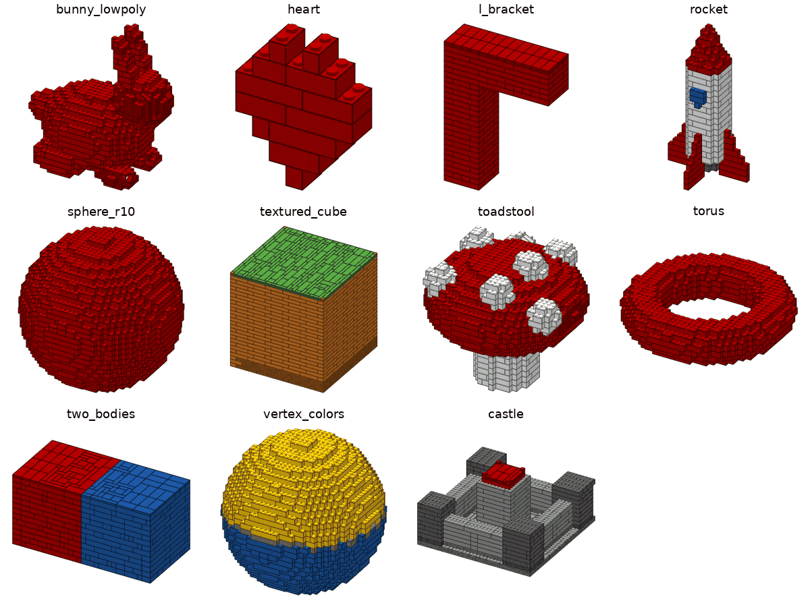

| Model | Shows · zeigt | Parts | Steps | Colours | One stable piece | Time |
|---|---|---:|---:|---:|---|---:|
| `bunny_lowpoly.stl` | Organic shape, thin ears, overlapping shells · Organische Form, dünne Ohren, überlappende Hüllen | 997 | 137 | 1 | yes · ja | 143 s |
| `cube_10mm.step` | Plain cube (STL and STEP twin) · Würfel (STL und STEP) | 2,091 | 294 | 1 | yes · ja | 247 s |
| `cube_10mm.stl` | Plain cube (STL and STEP twin) · Würfel (STL und STEP) | 2,091 | 294 | 1 | yes · ja | 248 s |
| `heart.vox` | MagicaVoxel input (legolization example) · MagicaVoxel-Eingabe | 12 | 7 | 1 | yes · ja | 4 s |
| `l_bracket.stl` | Overhang · Überhang | 177 | 40 | 1 | yes · ja | 36 s |
| `rocket.blend` | Blender file: materials, an Array modifier, a hidden helper, millimetre units · Blender-Datei: Materialien, Array-Modifier, verstecktes Hilfsobjekt, mm | 285 | 48 | 4 | yes · ja | 20 s |
| `sphere_r10.stl` | Round shape · Runde Form | 1,723 | 234 | 1 | yes · ja | 267 s |
| `textured_cube.obj` | Image texture (OBJ) · Bildtextur (OBJ) | 2,466 | 354 | 2 | yes · ja | 243 s |
| `toadstool.obj` | Material colours (OBJ) · Materialfarben (OBJ) | 1,424 | 198 | 2 | yes · ja | 263 s |
| `torus.stl` | Through-hole · Durchgehendes Loch | 634 | 86 | 1 | yes · ja | 41 s |
| `two_bodies.step` | STEP with two coloured bodies · STEP mit zwei farbigen Körpern | 702 | 97 | 2 | yes · ja | 179 s |
| `vertex_colors.ply` | Vertex colours (PLY) · Vertexfarben (PLY) | 1,746 | 241 | 4 | yes · ja | 267 s |
| `castle.step` | Generated STEP, about 1,650 parts: the v1.0 timing case · Erzeugtes STEP, rund 1.650 Teile: der Zeit-Test für v1.0 | 1,712 | 241 | 3 | yes · ja | 249 s |

## bunny_lowpoly

Organic shape, thin ears, overlapping shells · Organische Form, dünne Ohren, überlappende Hüllen

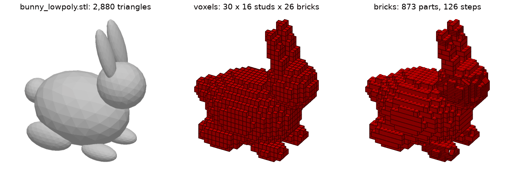

## heart

MagicaVoxel input (legolization example) · MagicaVoxel-Eingabe

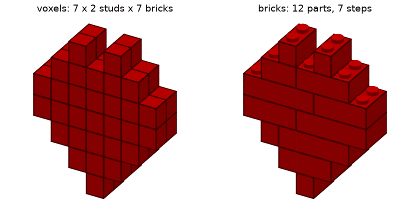

## l_bracket

Overhang · Überhang

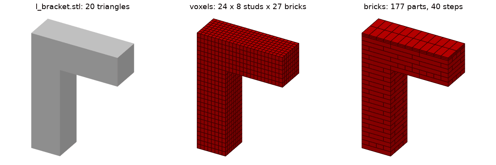

## rocket

Blender file: materials, an Array modifier, a hidden helper, millimetre units · Blender-Datei: Materialien, Array-Modifier, verstecktes Hilfsobjekt, mm

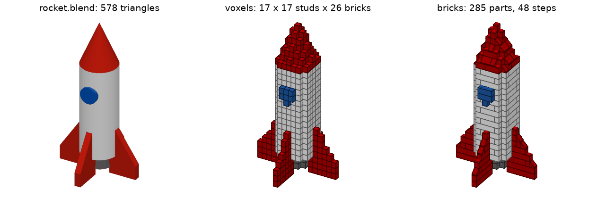

## sphere_r10

Round shape · Runde Form

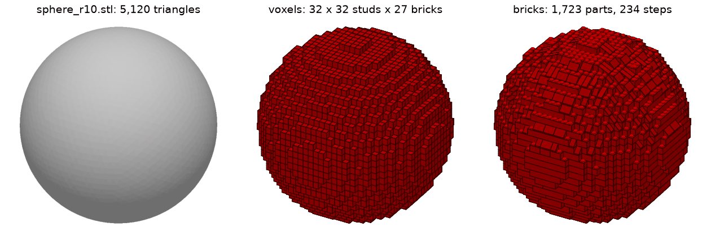

## textured_cube

Image texture (OBJ) · Bildtextur (OBJ)

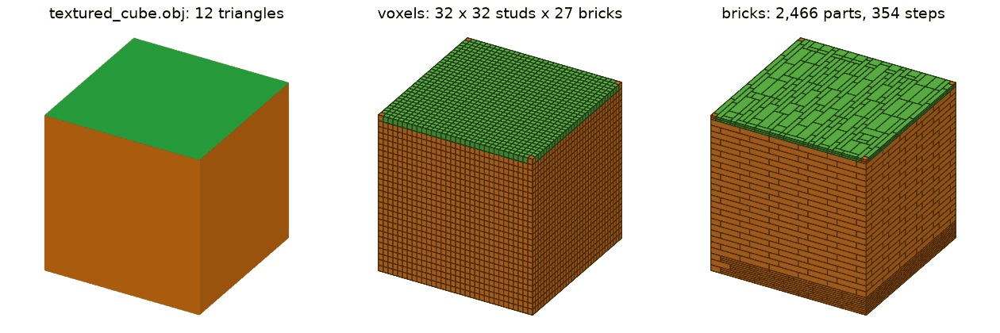

## toadstool

Material colours (OBJ) · Materialfarben (OBJ)

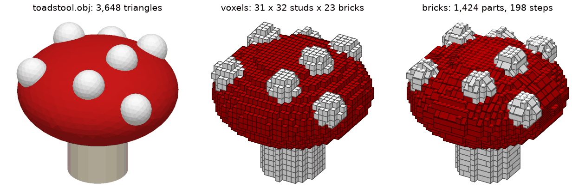

## torus

Through-hole · Durchgehendes Loch

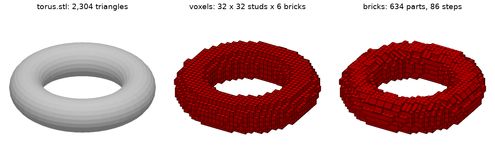

## two_bodies

STEP with two coloured bodies · STEP mit zwei farbigen Körpern

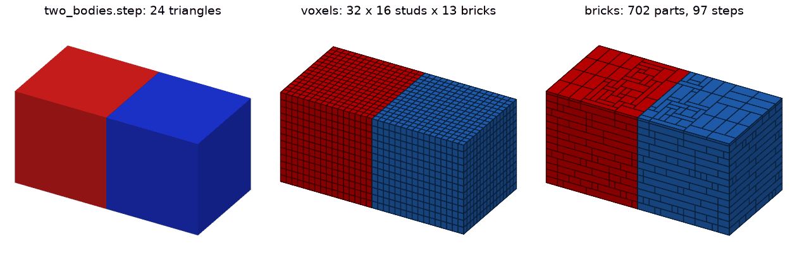

## vertex_colors

Vertex colours (PLY) · Vertexfarben (PLY)

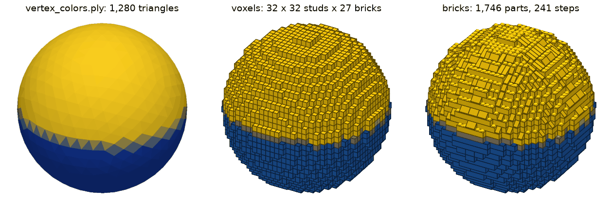

## castle

Generated STEP, about 1,650 parts: the v1.0 timing case · Erzeugtes STEP, rund 1.650 Teile: der Zeit-Test für v1.0

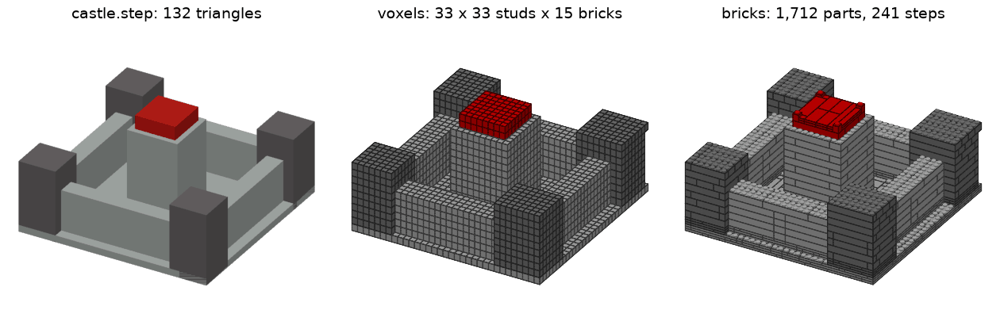
