<!-- Generated by scripts/make_gallery.py; edit the script. -->
# Beispielgalerie · Example gallery

Every example model of the repository at the default size (longest axis 32
studs), converted with the default settings: the model as mesh2brick reads it,
its voxels and the placed bricks. Numbers from `scripts/benchmark_release.py` on
an Apple M2 Max laptop (one conversion at a time).

Jedes Beispielmodell des Repos in Standardgröße (längste Achse 32 Noppen) mit
den Standardeinstellungen: das Modell, wie mesh2brick es einliest, seine Voxel
und die gesetzten Steine. Zahlen aus `scripts/benchmark_release.py` auf einem
Apple-M2-Max-Laptop (eine Umwandlung nach der anderen).

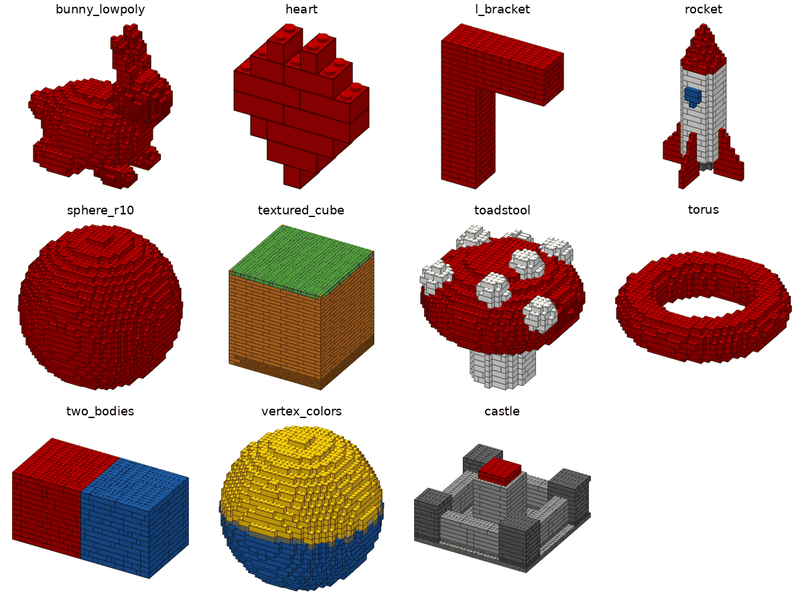

| Model | Shows · zeigt | Parts | Steps | Colours | One stable piece | Time |
|---|---|---:|---:|---:|---|---:|
| `bunny_lowpoly.stl` | Organic shape, thin ears, overlapping shells · Organische Form, dünne Ohren, überlappende Hüllen | 873 | 125 | 1 | yes · ja | 71 s |
| `cube_10mm.step` | Plain cube (STL and STEP twin) · Würfel (STL und STEP) | 1,952 | 274 | 1 | yes · ja | 232 s |
| `cube_10mm.stl` | Plain cube (STL and STEP twin) · Würfel (STL und STEP) | 1,952 | 274 | 1 | yes · ja | 232 s |
| `heart.vox` | MagicaVoxel input (legolization example) · MagicaVoxel-Eingabe | 12 | 7 | 1 | yes · ja | 4 s |
| `l_bracket.stl` | Overhang · Überhang | 153 | 37 | 1 | yes · ja | 27 s |
| `rocket.blend` | Blender file: materials, an Array modifier, a hidden helper, millimetre units · Blender-Datei: Materialien, Array-Modifier, verstecktes Hilfsobjekt, mm | 263 | 42 | 4 | yes · ja | 15 s |
| `sphere_r10.stl` | Round shape · Runde Form | 1,499 | 207 | 1 | yes · ja | 109 s |
| `textured_cube.obj` | Image texture (OBJ) · Bildtextur (OBJ) | 2,280 | 327 | 2 | yes · ja | 246 s |
| `toadstool.obj` | Material colours (OBJ) · Materialfarben (OBJ) | 1,240 | 177 | 2 | yes · ja | 164 s |
| `torus.stl` | Through-hole · Durchgehendes Loch | 552 | 74 | 1 | yes · ja | 16 s |
| `two_bodies.step` | STEP with two coloured bodies · STEP mit zwei farbigen Körpern | 606 | 83 | 2 | yes · ja | 159 s |
| `vertex_colors.ply` | Vertex colours (PLY) · Vertexfarben (PLY) | 1,519 | 212 | 4 | yes · ja | 118 s |
| `castle.step` | Generated STEP, about 1,650 parts: the v1.0 timing case · Erzeugtes STEP, rund 1.650 Teile: der Zeit-Test für v1.0 | 1,651 | 233 | 3 | yes · ja | 202 s |

## bunny_lowpoly

Organic shape, thin ears, overlapping shells · Organische Form, dünne Ohren, überlappende Hüllen

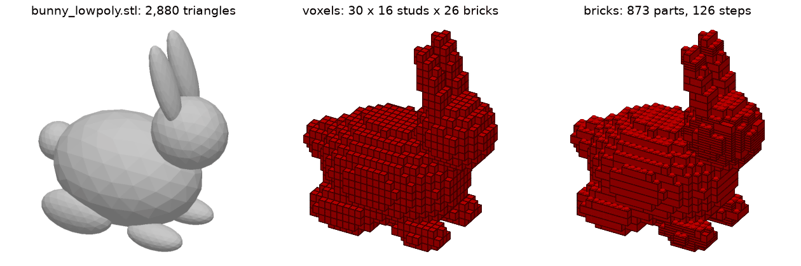

## heart

MagicaVoxel input (legolization example) · MagicaVoxel-Eingabe

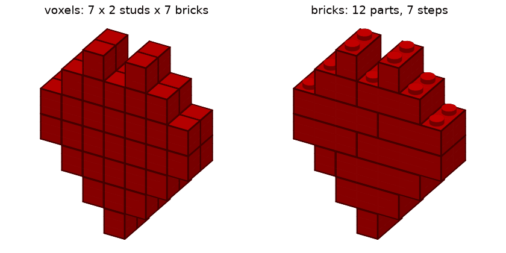

## l_bracket

Overhang · Überhang

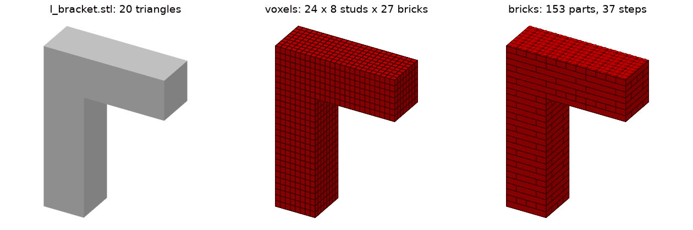

## rocket

Blender file: materials, an Array modifier, a hidden helper, millimetre units · Blender-Datei: Materialien, Array-Modifier, verstecktes Hilfsobjekt, mm

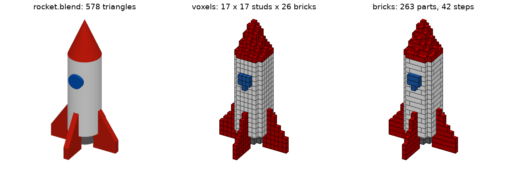

## sphere_r10

Round shape · Runde Form

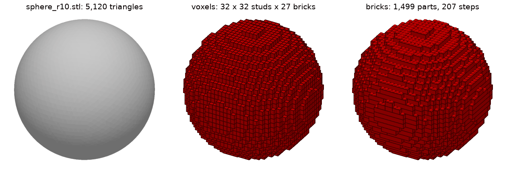

## textured_cube

Image texture (OBJ) · Bildtextur (OBJ)

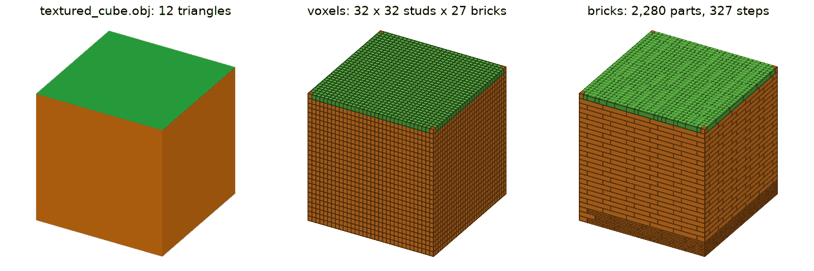

## toadstool

Material colours (OBJ) · Materialfarben (OBJ)

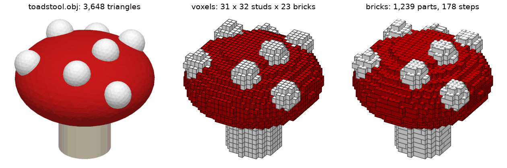

## torus

Through-hole · Durchgehendes Loch

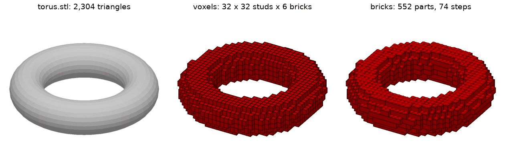

## two_bodies

STEP with two coloured bodies · STEP mit zwei farbigen Körpern

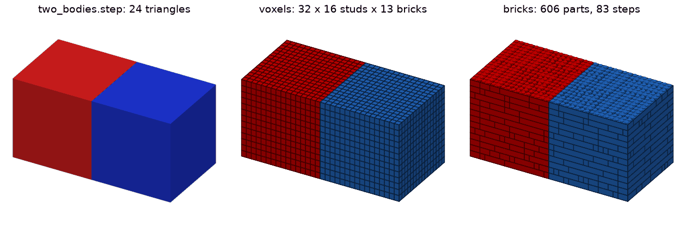

## vertex_colors

Vertex colours (PLY) · Vertexfarben (PLY)

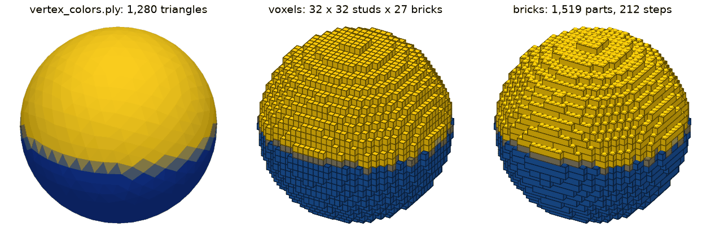

## castle

Generated STEP, about 1,650 parts: the v1.0 timing case · Erzeugtes STEP, rund 1.650 Teile: der Zeit-Test für v1.0

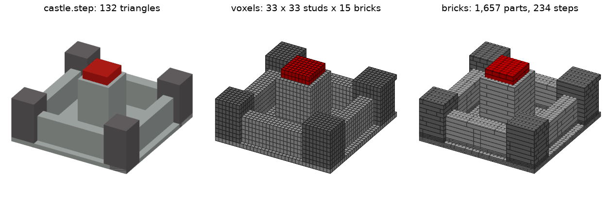
